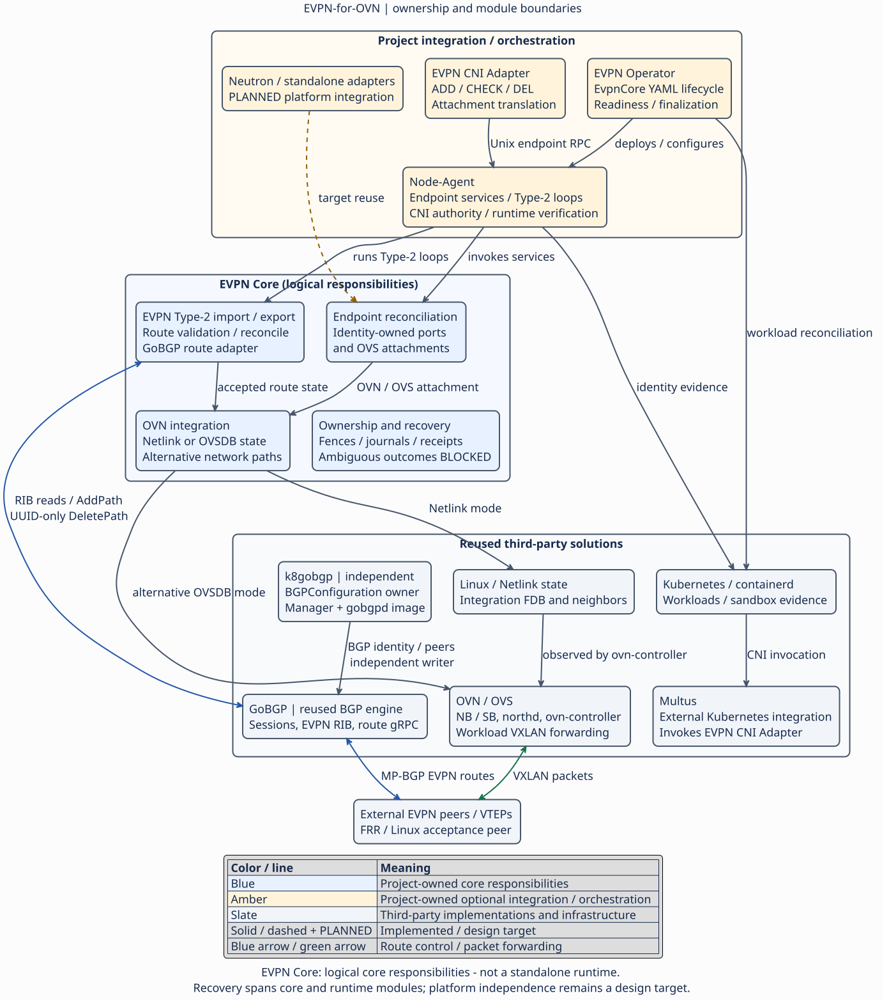

# EVPN for OVN

EVPN-for-OVN is an experimental modular SDN framework for developing and
testing EVPN over OVN. It combines project-owned Type-2 route processing,
endpoint reconciliation and ownership-aware recovery with the reused GoBGP
BGP engine and OVN/OVS data plane.

Kubernetes / Multus is the implemented platform integration, **not the
framework's primary purpose**. OpenStack / Neutron and standalone OVN platform
adapters are design targets, not implemented integrations. Direct Go services,
standalone fixtures and an opt-in OVSDB importer already support independent
experimentation; they are not a supported cross-platform installation.

## Architecture

The framework programs owned EVPN routes and network integration state;
**OVN/OVS forwards workload packets**. Netlink-Programmed and
OVSDB-Programmed integration are alternative paths, not parallel writers.
k8gobgp independently manages the current Kubernetes GoBGP provider and
`BGPConfiguration`; it is not an EVPN core module.

The [architecture guide](docs/architecture/framework-first.md) records the
verified component ownership matrix, existing interfaces and design targets.

## Verified capabilities

- Independent one-chassis Framework E2E for the Netlink-Programmed integration,
  including Type-2 exchange, OVN/OVS forwarding, withdrawal, survivor traffic,
  and cleanup.
- Independent Framework E2E for the OVSDB-Programmed integration, limited to
  one network and one remote VTEP; the importer is not enabled by the standard
  deployment.
- One-chassis CNI Full Lifecycle E2E, including replacement, packet-path
  verification, idempotency, negative CHECK, pre-LSP rollback, survivor
  preservation, and cleanup.
- Operator-managed Type-2 acceptance: normal and forced-SIGKILL runs passed
  18/18 each, including authenticated CNI creation, Node-Agent/speaker recovery,
  post-replacement forwarding, UUID-scoped withdrawal and cleanup.

These results do not establish shared-VTEP lifecycle, two-chassis
GoBGP-to-GoBGP operation, multi-VTEP lifecycle, EVPN Type-5, dynamic IPAM, or
production readiness. The complete acceptance scope and evidence are in the
[Testing Guide](TESTING_GUIDE.md).

Recovery is bounded: ambiguous AddPath outcomes without a durable UUID remain
**BLOCKED**, not adopted by matching route attributes. See the
[operator acceptance record](docs/architecture/operator-type2-acceptance.md).
The reported live results are historical, scoped private-source acceptance.
They are not fresh validation of a future public snapshot.

## Experimental use and security

Use deployment examples only on a dedicated, disposable lab host and a trusted,
isolated management network. The TCP management gRPC services have **no TLS,
authentication or authorization**; never expose them or OVN/OVSDB to untrusted
networks. The checked-in kind/core examples expose NodePorts `30052`/`30053`:
host/perimeter firewall isolation is required **before** applying them.
Containerlab management TLS does not secure Framework gRPC.
Privileged containers, host mounts and broad Operator permissions are lab
assumptions, not production defaults. See [SECURITY.md](SECURITY.md).

The optional EvpnCore Operator manages YAML-driven workloads, including
Node-Agent, with singleton ownership, readiness and finalizer cleanup.
Node-Agent hosts endpoint services, Type-2 loops and CNI runtime authority;
its Kubernetes/containerd recovery wiring is not a generic platform adapter.
The opt-in `evpn-node-agent --standalone-evpn-import` mode (with
`--mode=real-ovn-ovs --network-backend=linux-veth`) runs only the existing
Type-2 importer, without starting the CNI service or requiring Kubernetes/CRI.
It requires a root-owned remote-import configuration and standalone GoBGP
attestation. Standalone local endpoint export is not enabled: it still needs a
trusted endpoint/attachment authorization source.
CMS is only a test/demo emulator,
not a mandatory Framework service; no CMS runtime is required by the maintained
Framework or CNI acceptance runners.

## Getting started

Start with the safe, offline [Quick Start](QUICK_START.md). It builds and tests
the Go packages without deploying a cluster or changing host networking.
**Containerlab is the standard and required environment provisioning mechanism
for all EVPN-for-OVN E2E tests.** It coordinates disposable kind/OVN/FRR labs;
it is not a Framework runtime or production dependency. Procedures and evidence
are in the [Testing Guide](TESTING_GUIDE.md).

## Documentation

- [Framework boundaries and ownership matrix](docs/architecture/framework-first.md)
- [Control / data plane and integration modes](docs/architecture/integrations.md)
- [GoBGP provider management and dependencies](docs/architecture/runtime-dependencies.md)
- [Operator lifecycle](docs/architecture/evpn-core-operator.md) and [lab deployment](docs/architecture/deployment.md)
- [CNI lifecycle](docs/applications/cni/README.md) and [creation authority](docs/architecture/cni-creation-authority.md)
- [Ownership and recovery](docs/architecture/type2-restart-ownership.md)
- [Testing and acceptance](TESTING_GUIDE.md)
- [Current roadmap and task register](docs/roadmap/README.md)
- [Framework priorities](docs/roadmap/framework.md) and [upstream plan](docs/roadmap/upstream/README.md)
- [Platform integration targets](docs/roadmap/integrations/README.md)
- [Framework and application API reference](docs/api/README.md)
- [First public release gates](docs/roadmap/release.md)
- [Known OVN/OVS issues](docs/known-issues/README.md)
- [Architecture diagrams](docs/uml/README.md)

## License

Original project code is licensed under the [Apache License, Version 2.0](LICENSE).
Third-party material retains its applicable notices and licenses; see the
[licensing and attribution review](docs/release/licensing.md).
