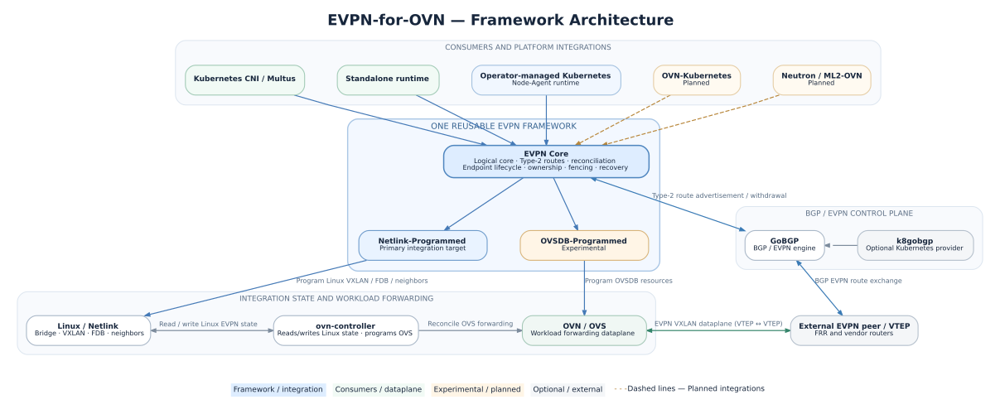

# EVPN for OVN

EVPN-for-OVN is an **experimental, platform-oriented networking project** for
developing and testing EVPN Type-2 integration with OVN. Its reusable EVPN Core
combines route reconciliation and ownership-aware recovery with GoBGP's BGP control
plane and OVN/OVS workload forwarding. It is not a production-ready installer.

The project also provides a standalone **secondary CNI** for Kubernetes:
Multus invokes the EVPN CNI plugin, which works with Node-Agent and a
project-owned OVN domain. This is separate from the primary CNI and does not
require EVPN BGP for connectivity inside a shared OVN domain. Kubernetes is
the current platform integration; OVN-Kubernetes and OpenStack Neutron/ML2-OVN
adapters are design targets, not implemented integrations.

<a id="architecture"></a>

[](docs/uml/component-overview.svg)

EVPN Core is a logical set of responsibilities, not a separate service.
Node-Agent hosts the existing Type-2 loops where used. The Framework has one
primary **Netlink-Programmed** integration target and a separate experimental
**OVSDB-Programmed** integration; neither changes OVN/OVS's role as workload
forwarding dataplane. [GoBGP](https://github.com/osrg/gobgp) is the BGP/EVPN
engine. In Kubernetes, the optional independent
[k8gobgp provider](https://github.com/purelb/k8gobgp) may manage speaker
configuration; it does not process Framework Type-2 routes. See the
[diagram index](docs/uml/README.md) and [component overview](docs/concepts/component-overview.md)
for architecture boundaries and current versus planned integrations. The
diagram is an architecture overview, not a vendor-interoperability validation
claim.

<a id="verified-capabilities"></a>

## What has been demonstrated

- Secondary CNI connectivity was validated on a two-worker Kubernetes cluster
  using Multus and OVN Geneve, including ADD/DEL, CHECK replay, bidirectional
  forwarding, owned endpoint cleanup, and primary Kindnet preservation. This
  did **not** test EVPN Type-2 or foreign OVN/OVS resource preservation.
- Separate bounded GoBGP/FRR tests demonstrated Type-2 exchange and
  VXLAN forwarding; standalone two-chassis forwarding and endpoint lifecycle
  also have separately scoped evidence.
- Two **independent OVN domains** exchanging Type-2 with GoBGP are a planned
  target, not a validated topology.

These are distinct scenarios, not a combined production acceptance. The
[capability matrix](docs/project/capability-matrix.md) is the current index
of evidence, limitations and unresolved status.

<a id="experimental-use-and-security"></a>
<a id="getting-started"></a>

## Security and getting started

The TCP management gRPC services have **no TLS, authentication or
authorization**. Use live examples only on a dedicated disposable lab host and
a trusted, isolated management network; never expose those services or
OVN/OVSDB to untrusted networks. The kind/core examples expose NodePorts
`30052` and `30053`: isolate them at the host/perimeter **before** applying
the manifests. Containerlab management TLS does not secure these RPCs.
Privileged containers, host mounts and broad Operator permissions are lab
assumptions, not production defaults. Read [SECURITY.md](SECURITY.md).

To explore a concrete networking solution, start with the
[Kubernetes CNI solution guide](docs/solutions/kubernetes-cni/README.md).
Its Containerlab/Kind workflow is an experimental, disposable lab—not a
production installation. The [Containerlab guide](deploy/containerlab/README.md)
documents prerequisites, isolation and tested scope before running anything.
There is no production deployment recipe. For development builds and safe
tests, use the [Development and Testing Guide](TESTING_GUIDE.md).
For the isolated Operator-managed two-worker lab, see the
[disposable VM E2E guide](docs/testing/vm-e2e-lab.md).

## Documentation

- [Documentation home](docs/README.md) — task-oriented navigation.
- [Component overview](docs/concepts/component-overview.md) and
  [network topologies](docs/architecture/network-topologies.md).
- [Capability and validation status](docs/project/capability-matrix.md).
- [EVPN Framework Architecture](docs/architecture/framework-architecture.md).
- [Kubernetes CNI solution](docs/solutions/kubernetes-cni/README.md),
  [API reference](docs/api/README.md), and
  [roadmap](docs/roadmap/README.md).

## Build and test from source

The Go source targets Go 1.27.3. From the repository root, the following
non-privileged commands compile the main binaries and run the Go tests without
provisioning Kubernetes, OVN/OVS, or a lab:

```bash
go build ./cmd/evpn-cni ./cmd/evpn-node-agent ./cmd/evpn-ovsdb \
  ./services/evpn_mgmt ./services/ovsdb_mgmt ./services/bgp_ad_handler \
  ./deploy/operator
go test ./...
```

These are development checks, not an installer or a live forwarding test.
There is no production installation recipe. For an experimental end-to-end
example, follow the [Kubernetes CNI solution guide](docs/solutions/kubernetes-cni/README.md)
and its [isolation and prerequisites](deploy/containerlab/README.md) first.

## Project History and Evolution

The project originated in 2018 as a Python/Ryu EVPN-over-OVN prototype; the
current Go framework is a substantial redesign using GoBGP and libovsdb.
The Go framework history is maintained on `main`; the historical
[`master` branch](https://github.com/romanspb80/evpn-for-ovn/tree/master)
preserves the separate Python/Ryu prototype. These histories are intentionally
separate and must not be merged. See the [historical index](docs/archive/README.md).

Type-3/Type-5, generalized multi-VTEP and shared-VTEP lifecycle, secure
management APIs and production readiness are not established. The optional
CMS emulator is a test/demo tool, not a required framework service.

Original project code is licensed under the [Apache License 2.0](LICENSE);
see the [licensing review](docs/release/licensing.md) for third-party material.
