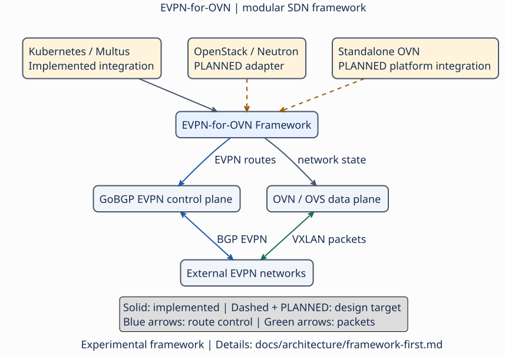

# EVPN for OVN

EVPN for OVN is an experimental, reusable Go Framework that integrates GoBGP
EVPN control-plane state with OVN/OVS.

EVPN-for-OVN is under active development, with a focus on modular architecture,
interoperability, and expanding EVPN capabilities for cloud-native networking
environments.

## Architecture

The Framework provides route processing, network and endpoint services,
ownership-aware reconciliation, OVN/OVS integration, and dataplane adapters.
It can be used and tested independently of Kubernetes CNI or Multus.

The two alternative integrations are:

- **Netlink-Programmed:** imports and exports GoBGP Type-2 state and reconciles
  owned Linux EVPN integration state. `ovn-controller` observes that state;
  OVN/OVS remains responsible for workload forwarding.
- **OVSDB-Programmed:** an opt-in standalone importer reads the GoBGP gRPC RIB
  and reconciles route-derived OVN/OVSDB provider-bridge, localnet, and VXLAN
  state.

Kubernetes CNI/Multus is an application consumer. It implements CNI
ADD/CHECK/DEL and translates Kubernetes attachment identity into Framework
operations. OpenStack Neutron and other orchestrators are potential future
consumers, not implemented integrations.

## Verified capabilities

- Independent one-chassis Framework E2E for the Netlink-Programmed integration,
  including Type-2 exchange, OVN/OVS forwarding, withdrawal, survivor traffic,
  and cleanup.
- Independent Framework E2E for the OVSDB-Programmed integration, limited to
  one network and one remote VTEP; the importer is not enabled by the standard
  deployment.
- One-chassis CNI Full Lifecycle E2E, including replacement, packet-path
  verification, idempotency, negative CHECK, pre-LSP rollback, survivor
  preservation, and cleanup.

These results do not establish shared-VTEP lifecycle, two-chassis
GoBGP-to-GoBGP operation, multi-VTEP lifecycle, EVPN Type-5, dynamic IPAM, or
production readiness. The complete acceptance scope and evidence are in the
[Testing Guide](TESTING_GUIDE.md).

The reported live results are historical, scoped private-source acceptance.
They are not fresh validation of a future public snapshot.

## Experimental use and security

Use deployment examples only on a dedicated, disposable lab host and a trusted,
isolated management network. The TCP management gRPC services have **no TLS,
authentication or authorization**; never expose them or OVN/OVSDB to untrusted
networks. The checked-in kind/core examples expose NodePorts `30052`/`30053`:
host/perimeter firewall isolation is required **before** applying them.
Containerlab management TLS does not secure Framework gRPC.
Privileged containers, host mounts and broad Operator permissions are lab
assumptions, not production defaults. See [SECURITY.md](SECURITY.md).

The optional EvpnCore Operator applies core manifests; k8gobgp separately
reconciles `BGPConfiguration` and manages gobgpd. Node Agent provides reusable
endpoint services and CNI orchestration. CMS is only a test/demo emulator,
not a mandatory Framework service; no CMS runtime is required by the maintained
Framework or CNI acceptance runners.

## Getting started

Start with the safe, offline [Quick Start](QUICK_START.md). It builds and tests
the Go packages without deploying a cluster or changing host networking.
**Containerlab is the standard and required environment provisioning mechanism
for all EVPN-for-OVN E2E tests.** It coordinates disposable kind/OVN/FRR labs;
it is not a Framework runtime or production dependency. Procedures and evidence
are in the [Testing Guide](TESTING_GUIDE.md).

## Documentation

- [Framework architecture](docs/architecture/framework-first.md)
- [Integration modes](docs/architecture/integrations.md)
- [Kind deployment](docs/architecture/deployment.md)
- [Kubernetes CNI application](docs/applications/cni/README.md)
- [Testing and acceptance](TESTING_GUIDE.md)
- [Current roadmap and task register](docs/roadmap/README.md)
- [Framework priorities](docs/roadmap/framework.md) and [upstream plan](docs/roadmap/upstream/README.md)
- [Operator and proposed CRDs](docs/roadmap/kubernetes-integration.md)
- [Framework and application API reference](docs/api/README.md)
- [First public release gates](docs/roadmap/release.md)
- [Known OVN/OVS issues](docs/known-issues/README.md)
- [Architecture diagrams](docs/uml/README.md)

## License

Original project code is licensed under the [Apache License, Version 2.0](LICENSE).
Third-party material retains its applicable notices and licenses; see the
[licensing and attribution review](docs/release/licensing.md).
