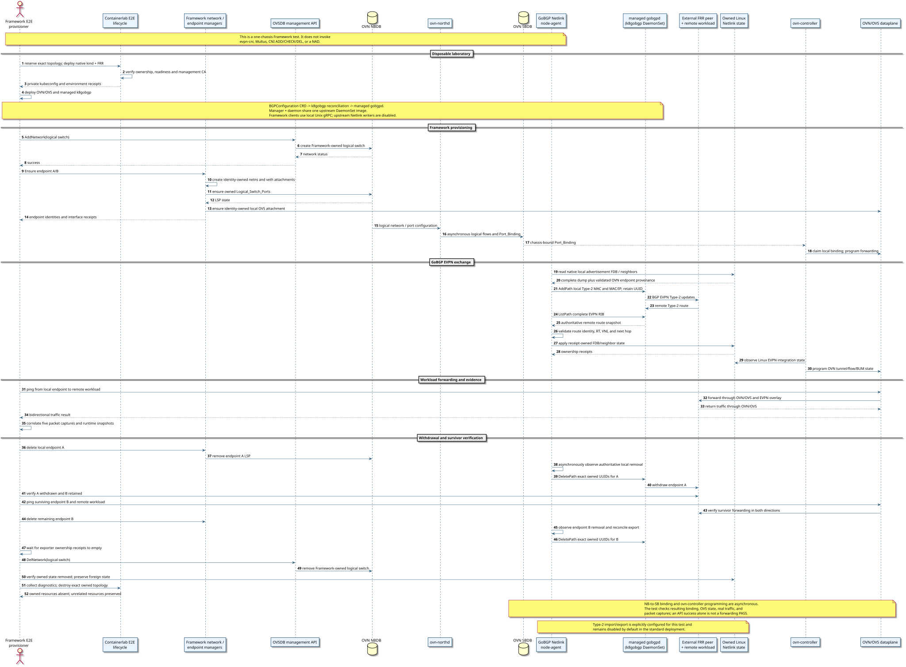
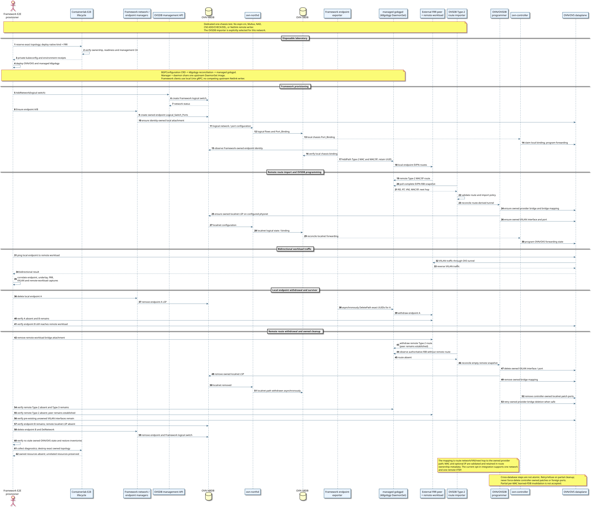
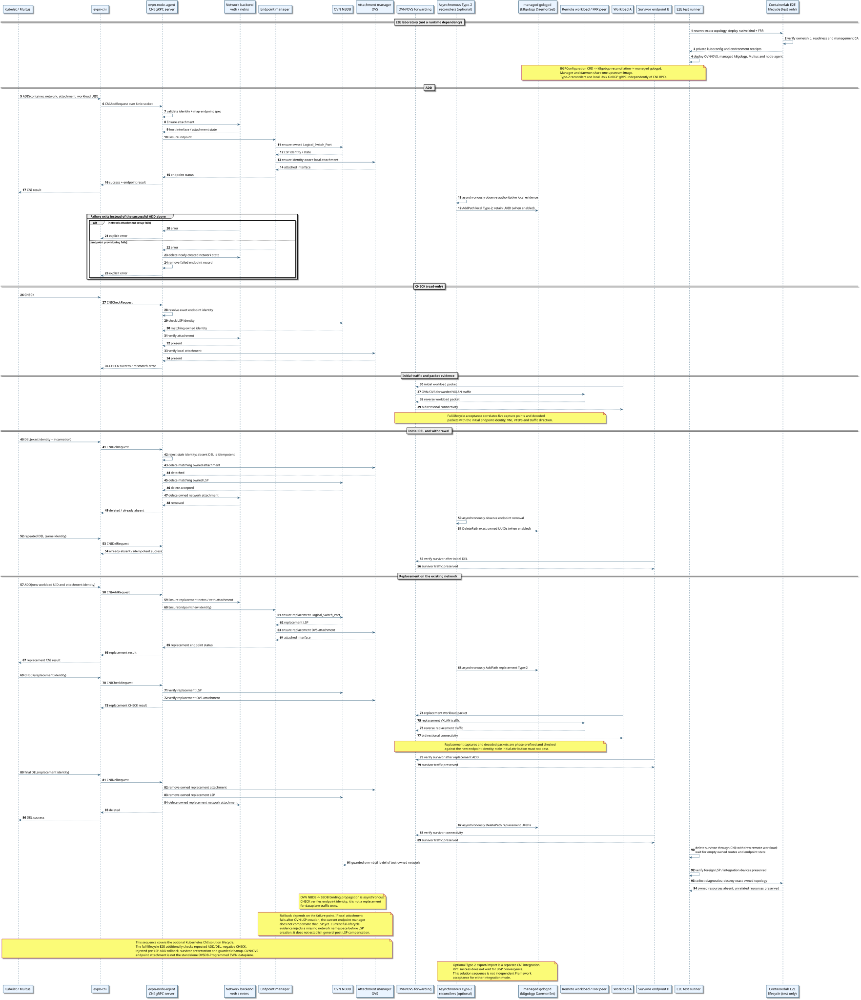

# Testing Guide

This guide covers development checks and reproducible test entry points.
Results depend on the exact checkout, images, environment and enabled
scenarios. For previously documented results, see the
[capability matrix](docs/project/capability-matrix.md) and
[historical testing record](docs/archive/validation-record.md); neither substitutes for a
fresh run.

For the isolated Operator-managed two-worker scenarios, see the
[disposable VM E2E lab guide](docs/testing/vm-e2e-lab.md). VM provisioning and
live Operator acceptance are not implied by offline fixture tests.

## Safety and prerequisites

The default Go workflow does not provision infrastructure. Live scenarios
create privileged disposable Containerlab/Kind, OVN/OVS and peer resources and
must run only on a dedicated, isolated Linux test host. Read
[SECURITY.md](SECURITY.md), the [lab prerequisites and ownership
rules](deploy/containerlab/README.md), and the
[runtime input requirements](docs/architecture/runtime-dependencies.md) first.
The management APIs are unauthenticated; isolate them before deploying.
Do not run cleanup against resources you do not own.

The lab guide specifies required tools, image identities, supported environment
and run-specific teardown. Some images or Go modules may need to be obtained
in advance; offline flags do not make an unprepared host fully air-gapped.

<a id="unit-and-offline-tests"></a>
## Development checks

From the repository root, with the Go toolchain declared in `go.mod`:

```bash
go test ./...
go build ./cmd/evpn-cni ./cmd/evpn-node-agent ./cmd/evpn-ovsdb \
  ./services/evpn_mgmt ./services/ovsdb_mgmt ./services/bgp_ad_handler \
  ./deploy/operator
PYTHONDONTWRITEBYTECODE=1 python3 -m unittest discover -s tools/lib -p 'test_*.py'
PYTHONDONTWRITEBYTECODE=1 python3 -m unittest discover -s tests/e2e -p 'test_*.py'
```

These check route/domain logic, authorization, ownership and fixture behavior
where covered by the tests. Success requires successful process exits and no
failed assertions. Privileged and live tests may be skipped by default; a skip
is not evidence of kernel, BGP or packet forwarding. See individual test files
for additional prerequisites.

`tools/lib/test_cni_worker_staging.py` includes 18 checks that exercise the
production worker-artifact script's root:root ownership requirement. Its
Docker mock runs the copied artifact and worker script as the test process, so
faithfully exercising that requirement needs an isolated disposable test
container or VM running with effective UID and GID 0. Do not run this test as
root directly on the development host. An unprivileged run reports those
checks as explicitly skipped with the prerequisite; the other tests in the
module still run. From inside the isolated environment, run:

```bash
PYTHONDONTWRITEBYTECODE=1 python3 -m unittest discover -s tools/lib -p 'test_cni_worker_staging.py' -v
```

## Test and tool directory responsibilities

The current layout is historical rather than a strict test/source split:

- `tests/e2e/` contains Python fixture and acceptance tests, fixture data, and
  their scenario READMEs.
- `tools/e2e/` mixes Python E2E test modules with lab orchestration, scenario
  helpers, and test-only Go fixtures.
- `tools/lib/` contains reusable shell/Python test support as well as Python
  tests for those helpers.
- `tools/` contains runnable E2E entry points, environment/lab orchestration,
  generators, and diagnostics. Go `*_test.go` files remain beside their Go
  source packages.

**Future migration proposal (not performed):** move `tools/e2e/test_*.py` into
`tests/e2e/` and classify `tools/lib/test_*.py` under a test-support or
integration-test subtree of `tests/`; keep reusable runners and helper
implementations in `tools/`. Treat test-only Go helpers and their `*_test.go`
files together, or keep those files colocated until a package move is justified.
The existing `tests/e2e/type2-fixture/` and `netlink-acceptance/` are established
fixture locations to build on, not a reason to relocate all E2E support at once.

Before any such move, update path-sensitive imports and `Path(__file__)` root
discovery. For example, `tools/lib/test_cni_capture_lifecycle.py` imports its
sibling `test_cni_vxlan_pcap_verify.py`, and `tools/e2e/test_external_frr.py`
imports `test_geneve_baseline.py`; fixture tests also load helper scripts by
path. Scenario helpers such as `tools/e2e/geneve_baseline.py` and
`external_frr.py` check for specific `tools/e2e/test_*.py` paths. Update those
checks, direct `unittest discover` commands in the Containerlab guide and
historical external-fabric record, and source paths used by `tests/e2e/` fixture
tests. Keep current `tools/run-*.sh` entry points as wrappers if their location
changes. This checkout has no root
Makefile or `.github/` workflow tree; no local CI/Makefile caller is available
to update, so any external CI configuration must be checked before migration.
Validation should run the existing `unittest discover` commands for
`tools/lib`, `tools/e2e`, and `tests/e2e` before and after each move, run Go
tests for any moved Go fixture package, and verify all documented commands and
runner path checks. Live E2E should remain a separately approved lab action.

## Coverage classification

The standard Kubernetes solution uses the Operator to create the Node-Agent
DaemonSet. Directly generated workloads in other runners are useful for
subsystem isolation and development, not a second production deployment mode.
Live results below are limited to their cited topology and evidence. Attempt 8
of the inventory-gated two-worker Type-2 scenario was compared with the
historical checkout represented by its source archive; that historical
comparison does not establish source identity with the current integrated
revision. The attempt-8 source archive is historical evidence, not the current
release source.
Other historical results likewise do not validate the current checkout.

| Test / location | Components and topology | Operator | Protocol, dataplane and recovery coverage | Status and gaps |
|---|---|---|---|---|
| `go test ./pkg/evpn/... ./pkg/nodeagent/... ./deploy/operator/...` | Unit/component tests; fakes and fixtures | Controller tests | Route decisions, identity, ownership, reconciliation and recovery as selected by individual tests | Offline tests, not live protocol or packet evidence |
| [`run-operator-e2e.sh`](tools/run-operator-e2e.sh) | One designated worker, actual controller and managed workloads | Yes | Placement, config updates, restart, inventory, finalizer, provider preservation; not CNI Type-2 forwarding | Historical lifecycle coverage; no multi-node placement |
| [`run-operator-type2-e2e.sh`](tools/run-operator-type2-e2e.sh) | One OVN chassis, Multus/CNI, agent, k8gobgp and FRR/Linux | Yes | Real Type-2 import/export, RIB, packet-attributed VXLAN, exact withdrawal, foreign survivor, agent/operator/speaker recovery | Historical bounded solution path; fixture installs provider, CNI and host configuration; not multi-node or independent OVN domains |
| [`run-operator-secondary-cni-e2e.sh --scenario operator-inventory-type2-two-worker`](tools/run-operator-secondary-cni-e2e.sh) | Two workers/chassis, shared OVN NB/SB, per-worker Operator-managed Node-Agent and GoBGP, external FRR/Linux endpoint | Yes | Inventory revision 1 accepted on both workers; local Type-2 export, external FRR Type-2 import, bidirectional workload-to-external-endpoint IPv4 and attributed VTEP/VNI observations | Attempt 8 PASS. Its exact source archive (`0d05c1ec554f9f6f4fb5e1f9f8c5558b371589df8a7c4b66cd9b98ba25504cc7`) matched all 468 files in the checkout used for the historical comparison; that comparison was not against the current integrated revision. Subsequent source changes include the documented `modelConfig` to `ovsdbConfig` rename and later implementation and documentation updates. The archive has no source commit SHA, so it cannot identify a current revision. No worker-to-worker forwarding, restart, withdrawal, recovery or complete Operator health. [Evidence and comparison scope](docs/architecture/operator-type2-acceptance.md#attempt-8-inventory-gated-two-worker-type-2-forwarding) |
| [`run-cni-full-lifecycle-e2e.sh`](tools/run-cni-full-lifecycle-e2e.sh) | One chassis, direct agent, Multus/CNI, FRR/Linux | No | ADD/CHECK/DEL, replacement, packets, withdrawal and scoped cleanup; pre-LSP rollback | Subsystem coverage, not Operator lifecycle |
| [`run-cni-mvp-2.4b-multus.sh`](tools/run-cni-mvp-2.4b-multus.sh) | One chassis, direct agent, Multus/CNI and FRR/Linux | No | Narrower route and packet interoperability without replacement | Subsystem regression, not Operator lifecycle |
| [`run-cni-isolated-secondary-e2e.sh`](tools/run-cni-isolated-secondary-e2e.sh) | Two workers, direct agent, shared OVN | No | CNI lifecycle and correlated Geneve packets, not EVPN; owned cleanup | Historical bounded result; no suitable foreign witness or agent recovery assertion |
| [`run-operator-secondary-cni-e2e.sh`](tools/run-operator-secondary-cni-e2e.sh) | Two workers, external shared OVN and node-local OVS | Yes | CNI lifecycle and correlated Geneve; optional authenticated CNI journal and agent restart | The inventory-gated Type-2 scenario has a separate attempt-8 PASS; this does not validate the legacy Geneve or authenticated CNI-continuity modes |
| [`run-framework-netlink-e2e.sh`](tools/run-framework-netlink-e2e.sh), [`run-framework-ovsdb-e2e.sh`](tools/run-framework-ovsdb-e2e.sh) | One chassis, independent dataplane adapters and FRR/Linux | No | Real routes, packets, withdrawal and cleanup; limited backend-specific recovery | Subsystem coverage; OVSDB limited to one network/remote VTEP |
| [`run-operator-type2-e2e.sh`](tools/run-operator-type2-e2e.sh) with `EVPN_TWO_WORKER_GENEVE`, `EVPN_EXTERNAL_FRR_SMOKE` or `EVPN_EXTERNAL_GOBGP_SMOKE` | Shared OVN fixture; optional external FRR or GoBGP/Linux peers | No Operator-managed CNI solution | Geneve, and for external profiles Type-2/VXLAN and preservation; Remote2 is a test-only projector | Fixture coverage, not independent OVN domains or Multus lifecycle |
| [`tests/e2e/type2-fixture`](tests/e2e/type2-fixture/README.md), [`tests/e2e/netlink-acceptance`](tests/e2e/netlink-acceptance/README.md) | GoBGP/FRR route and Linux Netlink component fixtures | No | Route lifecycle or kernel/forwarding checks respectively; no full OVN/CNI solution | Subsystem coverage, not independent OVN domains |
| `EVPN_STANDALONE_*` profiles of [`run-operator-type2-e2e.sh`](tools/run-operator-type2-e2e.sh) | Standalone agents and speakers, with shared OVN in the multi-chassis profile | Lab setup only | Authorization, Type-2, packets, deletion, migration and agent restart according to selected flags | Historical bounded standalone evidence, not independent OVN domains |

### Historical results and current inventory coverage

The [historical record](docs/archive/validation-record.md#standalone-multi-chassis-g7b5b2)
identifies locally accessible 2026-11-08 result bundles. The 15/15
two-chassis and 23/23 lifecycle runs used a Kind worker and an auxiliary
OVN/OVS container, direct inter-chassis GoBGP peering and disjoint switches.
The 18/18 Operator regression used one OVN chassis and a separate FRR/Linux
peer. Attempt 8, recorded separately below, is the verified bounded live run
of the inventory-gated two-worker Type-2 example; it does not extend the older
restart and lifecycle assertions to that topology.

| Behavior | Historical live evidence | Current offline coverage | Remaining integration |
|---|---|---|---|
| Publication, reservations, Node UID and rollout | Not present | `TestWorkerInventoryPublicationAndRetention`, `TestWorkerReservationsRejectRollbackAndReassignment`, `TestInventoryPinAndArgumentsAreExact` in `deploy/operator/controllers` | Clean-install publication and rollout on two real selected Nodes |
| Gate, local acceptance and migration | Attempt 8: inventory revision 1 accepted on both workers | `TestInventoryGateBlocksExporterCycle`, `TestInventoryGateBlocksImporterBeforeTransport`, `TestInventoryGateDurableAcceptanceAndRestart` in `pkg/nodeagent`; `TestInventoryMigrationBlocksLegacyDaemonSet` in controllers | Restart/migration behavior on the two-worker deployment; privileged tests may skip without root |
| BGP, exact receipts, FDB/neighbor, OVN/OVS VXLAN | Attempt 8: local Type-2 exports, external FRR import, and bidirectional workload-to-external forwarding | `TestRemoteNetworkMappingGate`, `TestTwoWorkerExampleConfigurations` in `pkg/nodeagent` | Worker-to-worker forwarding, exact withdrawal/recovery and broader multi-chassis behavior |
| Restart, withdrawal, foreign survivor, lifecycle | 23/23 standalone; 18/18 single Operator chassis | Inventory fence and controller tests above | Repeat agent/speaker recovery and exact withdrawal on the inventory-gated two-worker deployment |

`tools/lib/standalone-multichassis-test.sh` retains the historical packet and
receipt assertions. Its second chassis has no real Kubernetes Node identity
or in-cluster credentials, so adding inventory flags cannot turn it into the
new test. `tools/e2e/operator_secondary_cni.py` supplies a real two-worker
Operator/shared-OVN fixture. Its legacy mode starts an ungated DaemonSet and
does not exercise Type-2. The inventory scenario stages a clean, gated
installation and external FRR peer. Attempt 8 passed its local route,
external-import and workload-to-peer forwarding assertions; the result and
its exact evidence boundary are recorded in the
[acceptance record](docs/architecture/operator-type2-acceptance.md#attempt-8-inventory-gated-two-worker-type-2-forwarding).
Legacy migration protection must not be bypassed.

The inventory scenario also retains its **offline configuration-only** mode:

```bash
bash tools/run-operator-secondary-cni-e2e.sh \
  --scenario operator-inventory-type2-two-worker --check-config observations.json
```

The JSON input supplies `clusterUID`, the UID of an already-created disabled
EvpnCore as `installationUID`, `agentImage`, `clientImage`, `ovnNBHost`,
`ovnSBHost`, `remoteVTEP`, and a two-entry `workers` array. Each entry contains
the Kubernetes `node` object (at least `metadata.name` and `metadata.uid`),
`chassis`, `vtep`, `bootID`, `hostNetns`, `serviceUID`, `speakerCgroup`, and
the lowercase SHA-256 fields `ctrSHA256`, `cniSHA256`, `multusSHA256`,
`runtimeSHA256`, `wrapperExecutableSHA256`, `wrapperScriptSHA256` and
`gobgpdSHA256`. These are independently observed or administrator-pinned
identities, not values generated by the checker. The output contains rendered
existing example templates, per-node speaker and runtime configurations and
unexecuted datapath command arrays. It calculates the speaker-config hash
from the rendered bytes; install exactly those bytes. It neither validates
the supplied observations against live processes nor starts infrastructure.

The inventory deployment slice can be launched only on an explicitly
authorized disposable host using independently pinned `ctr` and `gobgpd`
binaries:

```bash
bash tools/run-operator-secondary-cni-e2e.sh \
  --scenario operator-inventory-type2-two-worker --confirm-disposable-host \
  --continuity-ctr /path/to/ctr --continuity-ctr-sha256 "$CTR_SHA256" \
  --inventory-gobgpd /path/to/gobgpd --inventory-gobgpd-sha256 "$GOBGPD_SHA256"
```

It creates a disabled EvpnCore to obtain the real installation UID, provisions
both nodes, then enables inventory reconciliation. It checks each local fence;
missing acceptance remains unknown. Attempt 8 verified acceptance on both
workers, but does not establish restart, withdrawal or recovery behavior.
It provisions an external FRR peer and checks per-worker remote import receipts
and Linux FDB/neighbor state. It creates authorized CNI endpoints and checks
their export receipts and FRR advertisements, and reads each attested speaker's
local Type-2 RIB. Attempt 8 additionally verified the expected VTEPs/VNI and
bidirectional workload-to-external-endpoint packets using captures and
counters. Recovery assertions are not part of this scenario. The legacy
secondary-CNI and authenticated CNI-continuity modes are separate and are not
validated by attempt 8.

The existing ownership verifier has an offline-testable inventory mode for
collected evidence, not a live fixture provisioner. In a restricted evidence
directory, provide Kubernetes JSON snapshots named `core.json`, `lease.json`,
`daemonset.json`, `pods.json` (a PodList), `nodes.json` (a NodeList),
`selector.json` (the expected selector map), and `inventory.json` (the
ConfigMap object). `inventory-journals.json` is a JSON object mapping each
Node name to the exact UTF-8 contents of that host's `journal.json` inventory
journal. Collect those files as an authorized administrator without modifying
the journals or exposing sensitive contents, and invoke:

```bash
python3 tools/e2e/operator_ownership.py "$EVIDENCE_DIR" --external-inventory
PYTHONDONTWRITEBYTECODE=1 python3 -m unittest discover -s tools/e2e -p 'test_operator_ownership.py'
```

The verifier checks current Operator conditions, ownership and UID receipts,
rollout, publication bytes and committed local fence checksums and scope.
It is a comparison of collected snapshots, not authentication of their
origin, an Operator acceptance acknowledgement, runtime health, BGP or
forwarding proof.

### Experimental Operator-managed shared-OVN lab

On a **verified disposable, isolated Docker host**, run:

```bash
bash tools/run-operator-secondary-cni-e2e.sh --confirm-disposable-host
```

The explicit confirmation is required; it does not replace verifying isolation.
The existing fixture also refuses unrelated running containers, active lab
leases and conflicting host OVS/OVN state. It requires Kind, Docker, kubectl,
Containerlab, Go, curl, a loaded OVS kernel module, the pinned local OVN image
specified in the runner, and access to the checksum-pinned Multus release. It
creates a disposable Kind cluster with two workers, shared OVN NB/SB, and
worker-local OVS/ovn-controller. Standard `/run/openvswitch`, `/run/ovn` and
`/run/evpn-node-agent` paths are used only inside those workers and must be
empty. The actual Operator installs its CRD and RBAC and reconciles the agent;
the external OVN workloads are not Operator-owned.

The runner checks actual CR, Lease, inventory, worker UIDs, DaemonSet and Pod
ownership, per-node socket identities, Operator restart and external resource
preservation. It reuses the direct fixture's Multus ADD/CHECK/DEL, OVN/OVS
endpoint observations and correlated `net1`/Geneve packet captures. Deleting
one endpoint checks that the other survives. Evidence and failure diagnostics
are retained under `/tmp/<cluster>-evidence`.

The default remains legacy CNI without authenticated continuity. For the
separate authenticated CNI scenario, supply a trusted static `ctr` compatible
with the disposable workers' containerd and its administrator-pinned SHA256:

```bash
bash tools/run-operator-secondary-cni-e2e.sh --confirm-disposable-host \
  --continuity-ctr /absolute/path/to/ctr --continuity-ctr-sha256 <lowercase-sha256>
```

The runner copies the pinned binary into each disposable worker, checks its
hash and connection to that worker's CRI, and configures the CRI socket as
root-only. It derives node UID, boot ID, network namespace and executable
hashes separately on each worker. The journal and configuration live on the
worker host path, not in the agent Pod. A shared service account can GET
**both** named nodes and Pods in `cni-test`; Kubernetes RBAC does not enforce
per-agent node isolation. The continuity attestor checks the actual local
Node UID, Pod UID, node placement, CRI sandbox and namespace itself. On
restart the runner checks the surviving worker's CNI CHECK, journal lock and
exact resource receipts, rechecks both endpoints and sends `net1` probes.
It checks deleted journal receipts after DEL. The legacy and authenticated
CNI-continuity modes described here have not been validated live. Attempt 8
covered the separate inventory-gated Type-2/forwarding path, not these
CNI-continuity assertions.

| Trusted input | Producer and validator | Scope / restart | Missing or inconsistent |
|---|---|---|---|
| Installation UID, node UID/name, boot and netns | Kubernetes and worker kernel; continuity domain and Node/Pod attestor | Per node; Pod restart retains host state | Recovery blocks on mismatch |
| CRI socket, pinned ctr, CNI/Multus/runtime/wrapper hashes | Administrator and observed worker executables; CRI peer and admission verifiers | Per node; process identities re-observed | Startup or admission fails closed |
| Network mapping and OVN/OVS UUID receipts | Administrator mapping, live NB/OVS observations; continuity observer | Cluster switch plus local OVS, journal persists on node | No unverified adoption or deletion |
| Durable journal, lock, checksums and pending intents | Node-Agent and host storage; ownership journal and recovery | Per node; survives Pod, not necessarily node loss | Corruption, conflict or unresolved intent blocks |
| BGP speaker identity and route receipts | Independent provider and administrator; speaker attestation and EVPN recovery | Per speaker/node | Not configured or tested by this shared-OVN scenario |

This is not a node reboot or unreachable-node test. Node loss still requires
manual fail-closed recovery; placement removal is not a safe automatic drain.
No BGP, EVPN Type-2, foreign route withdrawal, independent OVN domains or VXLAN
are tested. The direct-DaemonSet runner and single-node Operator Type-2/VXLAN
runner remain separate regression tests. The local Docker socket preflight and
explicit confirmation do not prove that the underlying host is disposable.

## Framework Netlink and OVSDB integration





Run either independent scenario on the lab described above:

```bash
bash tools/run-framework-netlink-e2e.sh
bash tools/run-framework-ovsdb-e2e.sh
```

The Netlink scenario exercises owned route and Linux integration state and
controller-programmed OVN/OVS forwarding. The OVSDB scenario exercises the
separate opt-in importer and provider-bridge programming. For each, the
runner's mandatory checks, packet attribution, withdrawal and scoped cleanup
must succeed; a ready process or an established BGP session alone is not a
pass. The OVSDB test is limited to one network and one remote VTEP; neither
scenario establishes generalized shared-VTEP or multi-VTEP recovery.

Source and scope: [Netlink runner](tools/run-framework-netlink-e2e.sh),
[OVSDB runner](tools/run-framework-ovsdb-e2e.sh),
[integration contracts](docs/architecture/framework-architecture.md#type-2-dataplane-boundaries)
and [historical scenarios](docs/archive/validation-record.md#independent-framework-netlink-e2e).

## Kubernetes CNI lifecycle



```bash
bash tools/run-cni-full-lifecycle-e2e.sh
```

This one-chassis scenario exercises Multus invoking the project CNI,
Node-Agent endpoint lifecycle, traffic, replacement, idempotency, negative
CHECK, withdrawal and cleanup with an FRR peer. Packet-path checks matter:
a successful attachment alone does not demonstrate external EVPN forwarding.
Mandatory lifecycle, traffic and cleanup assertions must pass. Failure
injection covers pre-logical-port rollback; generalized post-port compensation
and shared-VTEP lifecycle are not established.

See the [Kubernetes CNI solution guide](docs/solutions/kubernetes-cni/README.md), the
[runner](tools/run-cni-full-lifecycle-e2e.sh) and the
[historical acceptance description](docs/archive/validation-record.md#cni-full-lifecycle-acceptance).

## Multi-node OVN Geneve secondary CNI

```bash
bash tools/run-cni-isolated-secondary-e2e.sh
```

The isolated scenario provisions two Kind workers, Kindnet primary networking,
Multus and a separate shared OVN control plane. It checks actual secondary
ADD/DEL, CHECK using captured Multus arguments, distinct chassis bindings,
bidirectional net1 and correlated Geneve packets, owned endpoint cleanup and
primary network preservation. The aggregate result and all required packet,
identity and cleanup checks must succeed; missing or incomplete capture is
not forwarding evidence.

This tests **intra-domain Geneve**, not BGP EVPN Type-2. The recorded
secondary-CNI run had no suitable foreign OVN/OVS witness, so did not establish
foreign-resource preservation. Its isolated-host preflight rejects conflicting
OVN/OVS state and does not prove coexistence with another OVN-owning CNI.
See the [lab guide](deploy/containerlab/README.md#running-and-collecting-evidence)
and [fixture source](tools/e2e/isolated_secondary_cni.py).

<a id="operator-managed-type-2"></a>
## GoBGP–FRR Type-2 and Operator

```bash
bash tools/run-operator-e2e.sh
bash tools/run-operator-type2-e2e.sh
```

The first tests the Operator lifecycle. The second uses actual CNI,
Node-Agent, OVN/OVS, a separately managed GoBGP speaker and an FRR/Linux
peer. It checks Type-2 route import/export, packet-attributed VXLAN
forwarding, exact withdrawal, ownership and cleanup. The FRR side is not a
second OVN control plane. Run the optional forced agent-crash variant only
in the same disposable lab:

```bash
EVPN_OPERATOR_TYPE2_FORCE_AGENT_CRASH=1 bash tools/run-operator-type2-e2e.sh
```

All mandatory checks and owned cleanup must pass; a session or route-only
result is not packet forwarding. See [runner](tools/run-operator-type2-e2e.sh),
[historical operator record](docs/architecture/operator-type2-acceptance.md)
and [runtime dependencies](docs/architecture/runtime-dependencies.md).

For route lifecycle without OVN or CNI, use the
[GoBGP/FRR fixture](tests/e2e/type2-fixture/README.md). It requires explicit
digest-pinned images and provides start, advertise, observe, withdraw and
stop operations. The companion [Linux Netlink component
scenario](tests/e2e/netlink-acceptance/README.md) tests kernel state and
component forwarding; neither alone proves OVN/OVS workload forwarding.

## Shared OVN with external EVPN peers

These are separate opt-in profiles of the operator test runner:

```bash
EVPN_TWO_WORKER_GENEVE=1 bash tools/run-operator-type2-e2e.sh
EVPN_EXTERNAL_FRR_SMOKE=1 bash tools/run-operator-type2-e2e.sh
EVPN_EXTERNAL_GOBGP_SMOKE=1 bash tools/run-operator-type2-e2e.sh
```

The first tests local Geneve with fixture endpoints, not Multus lifecycle.
The FRR profile adds external Type-2 and VXLAN while local Geneve continues.
The GoBGP profile additionally uses a **test-only RIB projector and Linux
dataplane** for the remote peer; it is not an independent OVN control plane.
Mandatory route, attributed packet, preservation and cleanup checks must
pass for the selected profile. See the
[runner](tools/run-operator-type2-e2e.sh) and
[historical topology, assertions and limitations](docs/testing/external-evpn-fabric.md).
The final full-fabric acceptance status is unresolved, not a pass or a
known technical block merely because evidence has not been verified.

## Standalone authorization and recovery

The operator fixture can opt into standalone runtime checks:

```bash
EVPN_STANDALONE_EXPORT_SMOKE=1 \
EVPN_STANDALONE_COHOST_SMOKE=1 \
EVPN_STANDALONE_MULTICHASSIS_SMOKE=1 \
EVPN_STANDALONE_LIFECYCLE_SMOKE=1 \
  bash tools/run-operator-type2-e2e.sh
```

Each flag requires the preceding flags. This exercises protected authorization,
co-hosted import/export, two chassis sharing OVN, and ordered endpoint
deletion/replacement/migration in the fixture. The runtime mode is standalone;
the lab itself still uses Kubernetes infrastructure. A pass requires the
selected scenario's identity, route receipt, kernel-state, packet and cleanup
checks; it does not establish recovery from every speaker replacement,
database outage, interrupted write or power loss.

See the [authorization contract](docs/architecture/standalone-endpoint-authorization.md),
[runner](tools/run-operator-type2-e2e.sh) and
[historical lifecycle details](docs/archive/validation-record.md#standalone-authorization-and-two-chassis-lifecycle).

## Evidence and troubleshooting

Record the source revision, image digests, configuration, selected flags,
result and cleanup status for each run. Keep evidence private: it may contain
kubeconfigs, process identities and sensitive configuration. A nonzero
command exit, failed mandatory check, missing capture, incomplete observation
or failed cleanup is not a pass. Inspect the runner's failure and per-case
reports and preserve ownership receipts; if teardown cannot verify ownership,
follow the [lab recovery procedure](deploy/containerlab/README.md) rather than
deleting shared resources.

Historical reports may reference ephemeral developer paths. Those paths are
provenance, not durable public evidence; missing primary artifacts must not
be reconstructed or treated as a current result. The
[historical validation record](docs/archive/validation-record.md) summarizes
the scenarios, limitations and significant failures.
