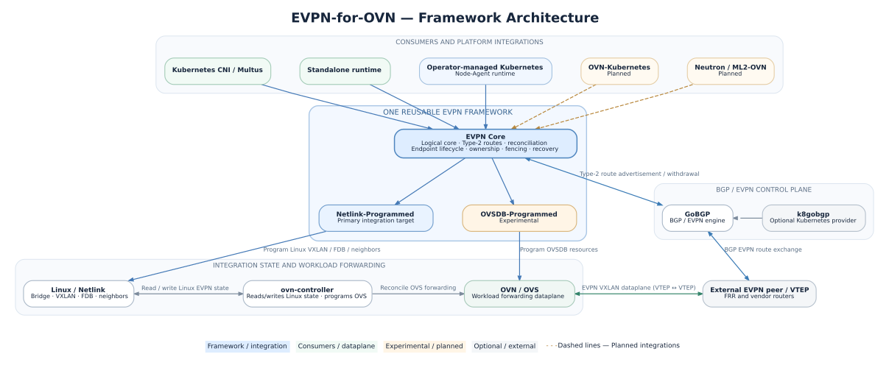

# EVPN-for-OVN component overview

EVPN-for-OVN is the project; **EVPN Core** is its reusable Type-2 route,
reconciliation, ownership and recovery functionality. The Core is a logical
boundary embedded in existing runtimes, not a separate service. The current
Go implementation is not wholly platform-independent: `pkg/evpn/domain`
contains provider-neutral models, while stateful reconciliation and Node-Agent
still depend on GoBGP, OVN/OVS, Linux and runtime-specific services. See the
[framework architecture](framework-architecture.md) for the
implementation boundaries and limits.

## Solutions and integrations

| Area | Status and scope |
|---|---|
| Kubernetes secondary CNI solution | Experimental implementation. It includes the project CNI plugin and CNI-serving Node-Agent integration; Multus is an external caller. A standalone EVPN Node-Agent runtime is a separate, non-CNI mode. |
| OVN-Kubernetes integration | Planned; not an implemented solution. |
| OpenStack Neutron / ML2-OVN integration | Planned; not an implemented solution. |
| Standalone Node-Agent runtime | Explicit Type-2 import and authorized-export paths exist without requiring the Operator; these paths do not start a CNI server and are not a complete, generally supported platform lifecycle solution. |

## Control plane and dataplane

GoBGP provides BGP sessions and EVPN RIB operations. k8gobgp is a distinct,
external provider manager that configures its speaker; it is not part of EVPN
Core and is not interchangeable with GoBGP. The Core reconciles Type-2 routes
and owned integration state. OVN/OVS remains responsible for workload packet
forwarding; Linux Netlink is the selected integration path for v0.1.0, not a replacement
dataplane. EVPN Type-2 is not required for ordinary Geneve connectivity within
a shared OVN domain.

Network-state programming, deployment lifecycle, CNI/Multus endpoint
integration, platform and BGP engine/provider are separate dimensions; this
overview does not assert arbitrary combinations. The current workload
platform is project-owned OVN/OVS. OVN-Kubernetes and Neutron / ML2-OVN
remain planned, and the Operator currently accepts only the `k8gobgp`
provider.

The overview's bidirectional Linux / `ovn-controller` arrow represents upstream
OVN Dynamic Routing's remote-state reads and local FDB/neighbor writes. The implemented
`ovn-netlink` exporter reads it with OVN provenance checks. Other export
sources observe authorized OVN endpoints directly. The
[Netlink integration](integrations.md)
distinguishes these mechanisms without adding a separate top-level handler.

The [runtime architecture diagram](../uml/evpn-runtime-architecture.svg),
[deployment notes](deployment.md), and
[network-state programming](integrations.md) explains the detailed
control-plane synchronization and dataplane programming paths. More specific
contracts and evidence are in [CNI authority](cni-creation-authority.md),
[standalone authorization](standalone-endpoint-authorization.md),
[ownership and recovery](type2-restart-ownership.md), and the
[capability matrix](../project/capability-matrix.md).
