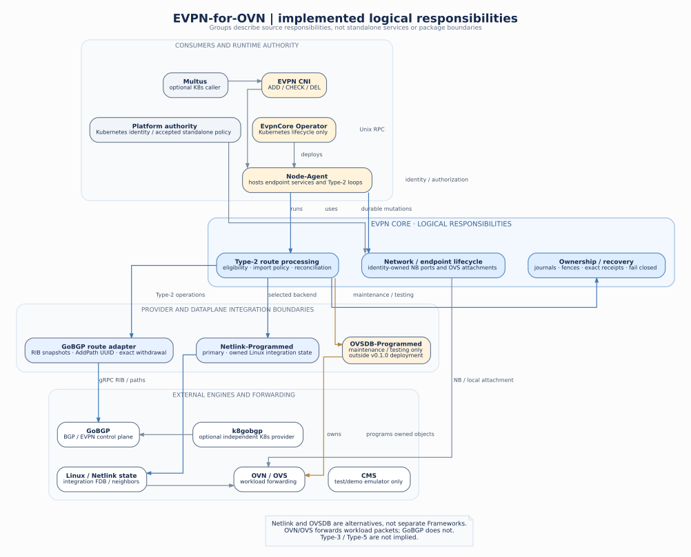

# EVPN Framework Architecture

EVPN-for-OVN is a modular SDN framework for developing and testing EVPN over
OVN across platform integrations. Kubernetes / Multus is implemented;
OpenStack / Neutron and OVN-Kubernetes adapters are planned; explicit standalone
OVN import and authorized-export runtimes now exist with bounded smoke coverage.
The framework is not primarily a CNI or a production-ready cross-platform installer.

There is one reusable EVPN Framework with two alternative dataplane
integrations: **Netlink-Programmed** is the selected development target;
**OVSDB-Programmed** is experimental and retained for regression; comparative
benchmarking is only a potential use, not a validated result. These names
describe how EVPN integration state is programmed, not two
separate frameworks. Kubernetes CNI/Multus consumes shared Framework services;
it does not define the Framework boundary. OpenStack Neutron and
OVN-Kubernetes are future consumers, not implemented adapters.

Start with the product-oriented [component overview diagram](../uml/component-overview.svg),
[modular architecture](../uml/evpn-modular-architecture.svg), and the
[diagram index](../uml/README.md). Blue identifies project-owned core
responsibilities, amber optional or proposed integration and slate
third-party solutions. Dashed arrows mark planned platform integrations; BGP
route control is distinct from green workload packet paths. Validation status
and vendor interoperability claims belong to the capability matrix and
acceptance documentation, not the component overview.
The boxes are logical responsibilities, not newly introduced runtime services.
In particular, **EVPN Core is not an independent standalone runtime**;
Node-Agent embeds the reusable Type-2 core and now offers explicit standalone
runtime entry points. Complete platform lifecycle adapters/installers remain
design targets. The project-owned EVPN CNI Adapter is distinct from external
Multus, which invokes it in
Kubernetes and is not developed or maintained by EVPN-for-OVN.
The optional CMS emulator is a test/demo tool, not a Framework core service.

## Verified component ownership matrix

Ownership here means who implements the component. Mutation authority
(which resources it may change) is narrower and listed separately. The
source links ground the diagrams in this working tree, not in a proposed
package split.

| Component | Implementation owner / category | Current responsibility and source |
|---|---|---|
| Type-2 importer/exporter | Project core | Build/filter routes, complete RIB observation, receipt-owned mutation; [`exporter.go`](../../pkg/evpn/exporter.go), [`type2_gobgp.go`](../../pkg/evpn/type2_gobgp.go), [`remote_type2.go`](../../pkg/evpn/remote_type2.go). |
| Endpoint reconciliation | Project core | Identity-scoped NB logical ports and OVS attachments; [`pkg/endpoint`](../../pkg/endpoint/manager.go), [`pkg/attachment`](../../pkg/attachment/ovs.go). |
| OVN / Netlink integration | Project core | Program owned integration state, not workload packets; [`owned_netlink.go`](../../pkg/evpn/owned_netlink.go), [`ovsdb_programmer.go`](../../pkg/evpn/ovsdb_programmer.go), [`runtime_wiring.go`](../../pkg/nodeagent/runtime_wiring.go). |
| Ownership and recovery | Project core plus runtime wiring | Durable intent/receipts and fail-closed recovery; [`pkg/ownership`](../../pkg/ownership/journal.go), [`export_recovery.go`](../../pkg/evpn/export_recovery.go), [`remote_recovery.go`](../../pkg/evpn/remote_recovery.go); process/provider/CNI identity remains in Node-Agent. |
| Node-Agent | Project integration and orchestration | Hosts reusable services and import/export loops; CNI authority, namespace/veth handling, attested Unix provider transport; [`server.go`](../../pkg/nodeagent/server.go), [`provider_transport.go`](../../pkg/nodeagent/provider_transport.go), [`cni_continuity_runtime.go`](../../pkg/nodeagent/cni_continuity_runtime.go). Not a platform-neutral recovery daemon. |
| EVPN Operator | Project Kubernetes orchestration | YAML-driven singleton workload lifecycle, configuration, readiness, installation journal and finalizer; [`controllers`](../../deploy/operator/controllers/evpncore_controller.go). No endpoint RIB writer. |
| EVPN CNI | Project optional platform integration | CNI ADD/CHECK/DEL and attachment translation via Unix Node-Agent RPC; [`cmd/evpn-cni`](../../cmd/evpn-cni/main.go). Multus itself is reused, not project code. |
| Compatibility management services | Project services | [`evpn-mgmt`](../../services/evpn_mgmt/main.go), [`ovsdb-mgmt`](../../services/ovsdb_mgmt/main.go) and [`bgp_ad_handler`](../../services/bgp_ad_handler/main.go). Not a new unified framework service; distinct from the opt-in [`evpn-ovsdb`](../../cmd/evpn-ovsdb/main.go) importer. |
| k8gobgp | Third-party independent provider manager | Owns BGPConfiguration and managed speaker lifecycle; manager and gobgpd share one image. See the [audited upstream inventory](runtime-dependencies.md). Not installed or configured by EvpnCore. |
| GoBGP | Third-party BGP engine | BGP sessions, EVPN RIB and gRPC route operations. Framework client uses `api.GoBgpServiceClient`; the managed fork differs from the client module version. |
| OVN / OVS and Linux | Third-party SDN/runtime | NB/SB databases, northd/controller, OVS packet forwarding; Linux kernel and Netlink provide integration/device state. Project code uses libovsdb and Netlink clients, not a replacement BGP or forwarding engine. |
| Kubernetes / Multus / containerd | Third-party platform/runtime | API workload lifecycle, CNI invocation and independently queried sandbox/process identity in the current recovery path. Not mandatory for all Go domain operations. |
| FRR and remote VTEPs | Third-party external peers | EVPN announcements and peer-side VXLAN forwarding in acceptance. FRR is not the framework's control-plane engine. |
| Containerlab / kind | Third-party test infrastructure | Disposable lab provisioning, not framework runtime components; see [deployment](deployment.md). |
| Standalone OVN runtime / future adapters | Project runtime plus planned platform integration | Protected authorization/fencing and authoritative OVN export, standalone importer and GoBGP attestation are implemented in Node-Agent; [contract](standalone-endpoint-authorization.md). Neutron adapter and supported installer remain planned. |

## Framework core and existing interfaces

For the staged per-worker speaker topology and its current limitations, see
[multi-worker Type-2 development](network-topologies.md#multi-worker-type-2-development-sequence).
The Node-Agent checks co-hosted import/export configuration against the same
speaker identity and checks overlapping network switch, VNI and local VTEP;
the validated Netlink importer additionally binds its configured local VTEP to
the observed VXLAN device before route application. Mismatches do not grant
ownership or authorize withdrawal. Configuration changes after startup may
cause an individual in-flight reconciliation to finish; later cycles refuse
inconsistent configuration. These checks do not replace peer configuration,
attestation or end-to-end forwarding validation.

The shared Framework provides:

- GoBGP EVPN Type-2 route construction, validation, observation, import/export,
  and reconciliation.
- Network and endpoint provisioning with ownership-aware cleanup.
- OVN/OVS management and endpoint attachment services.
- Netlink-Programmed integration as the selected target and
  OVSDB-Programmed integration as an experimental alternative.
- APIs that can be consumed without Kubernetes CNI or Multus.

`pkg/evpn` contains core EVPN and reconciliation logic. `pkg/attachment`,
`pkg/endpoint`, and reusable `pkg/nodeagent` services support direct Framework
tests as well as the Kubernetes CNI solution. Logical ownership is separate from the
current Go package layout; packages are not moved merely to match diagrams.

`pkg/evpn/domain` is the extracted, standard-library-only Type-2 domain
boundary: provider-neutral endpoint identity, primary-IP selection, Type-2
prefix identity, and deterministic withdrawal-first planning. Its static
golden cases are shared with the `pkg/evpn` compatibility and GoBGP wire tests.
The provider-facing route contracts are `Type2RIBSource`,
`Type2RouteApplier`, `RemoteType2RIBSource`, `Type2RouteSnapshotSource`, and
`ReadinessGate`. Their current Type-2 route/snapshot values contain no GoBGP
protobuf or packet types; snapshots explicitly report completeness or fail,
and route importers reject incomplete observations. The GoBGP adapters in
`type2_gobgp*.go` own GoBGP RPCs, wire conversion, route-target extraction,
RIB reads, and speaker readiness checks. `pkg/evpn` still imports GoBGP packet
helpers for RD/RT validation and retains the stateful reconciler, mutation
acknowledgments, ownership, receipts and recovery. The legacy exported
`RemoteRIBSource`, `RouteSnapshotSource`, and `ReceivedType2Route` shapes remain
as compatibility bridges; they are not the contracts used by the updated
Node-Agent and OVSDB importer composition. This is source-level isolation
inside `pkg/evpn`, not a separate Go package boundary, and does not make all of
`pkg/evpn` or `pkg/nodeagent` platform-independent.

GoBGP `AddPath` still has no compare-and-swap. The applier returns the exact
acknowledged receipt (currently a GoBGP UUID), and withdrawal uses that
receipt only; it never falls back to NLRI deletion. A lost/ambiguous AddPath
acknowledgment remains recovery-blocking, and provider rebind still requires
fresh attestation and authoritative snapshots. Durable journal layout and
speaker/process continuity are unchanged.

### Export runtime composition boundary

The Type-2 Core remains embedded in Node-Agent. Both existing exporter
entry points select a private `exportPlatformBinding` before entering
`runEndpointExporter`; the shared loop no longer selects CNI versus standalone
behavior through nullable server/config/fencer parameters. No exported Core
identity, authorization, journal or runtime API was added.

`cniExportBinding` owns the CNI/Framework/native observer composition and the
existing CNI continuity observer and recovery-applier wrappers. It retains the
original `CNIServer`; no server-private lifecycle state moves into Core.
`continuityRouteApplier.Add` still holds that server's `operations` mutex
through both independent continuity validation and route mutation. Exact UUID
withdrawal does not require the deleted workload to remain live.

`standaloneExportBinding` owns per-cycle standalone validation, protected
policy loading, durable `Fencer.Accept`, and publication of the resulting
`AcceptedSnapshot` to the standalone observer. That observer still intersects
authorization with independent NB/SB state and checks snapshot currency before
and after observation. LSP metadata alone is not authorization. The standalone
entry point retains ownership of the fencer and closes it after the loop exits.

The shared loop retains timing/retry/status behavior, local configuration
validation before platform preparation, exporter authority, database clients,
provider transport/rebind, route recovery, native observer cleanup and the
existing conditional shutdown drain. Main supervision, speaker attestors,
importer state machines, journal/policy schemas and protocol contracts are
unchanged. Provider service identity and Kubernetes workload identity remain
distinct concrete mechanisms.

This is an in-package composition boundary, not compile-time package
independence: `pkg/nodeagent` still imports Kubernetes/CRI, Linux, OVN/OVS and
GoBGP dependencies. Standalone selection bypasses CNI server/socket/continuity
and Kubernetes/CRI initialization, as before. Package extraction, future
OVN-Kubernetes/Neutron adapters, a standalone installer and generalized
shared-VTEP/multi-chassis acceptance remain deferred. Exact validation scope
is recorded in the [historical validation record](../archive/validation-record.md#framework-fixture-and-exporter-regressions).

### Type-2 dataplane boundaries

The two implemented import modes intentionally retain separate, source-level
contracts rather than sharing a new backend package. The narrow
`DataplaneBackend` contract is used by the simple per-route snapshot importer;
it receives normalized Type-2 route intent, and the importer rejects incomplete
snapshots before calling it. Its `ImportedType2Route` DTO still carries Linux
device mapping strings for compatibility, so this is not an importable,
platform-neutral dataplane API.

The active verified Netlink path is stricter: `RemoteType2Importer` validates
the authoritative `RemoteImportSnapshot`, generation and route incarnation,
then invokes `OVNNetlinkBackend`. That backend retains exact FDB/neighbor
receipts, durable journal intents and acknowledgments, per-slot quarantine,
global recovery blockers, and receipt-scoped deletion in place. The
The experimental OVSDB-Programmed Type-2 path is separate. Its exported
`Model1Type2Handler`, `Model1TunnelProgrammer`, and
`LibovsdbModel1Programmer` names are legacy Go API identifiers retained for
source compatibility, not architectural model labels. The path validates the
same route evidence, aggregates tunnels, and delegates owned NBDB/OVSDB
transactions to the programmer; it retains its explicit single-network and
single-remote-VTEP limits and has no generalized durable restart-recovery
contract.

The separation is deliberate: sharing these APIs would require a new
authorization/receipt handoff for Netlink and would conflate per-route kernel
mutations with multi-object OVSDB transactions. No Netlink, OVSDB, journal, or
runtime state machine was moved or redesigned. Contract tests pin snapshot
completeness, deterministic per-route withdrawal-before-apply updates and
idempotency;
the existing backend tests cover exact Netlink receipt recovery, quarantine,
OVSDB ownership metadata, partial transaction errors, and foreign-resource
preservation. The compile-time dependency graph remains unchanged: both
implementations are in `pkg/evpn`, which still depends directly on
libovsdb/OVN `vswitchd`, Linux Netlink/netns, Unix APIs, and ownership code.
This boundary does not make `pkg/evpn` platform-independent.

The Framework fixture wiring does not change production reconciliation.
Both Framework runners generate provider attestation from their own node,
speaker DaemonSet, pinned executable/image, containerd helper and
BGPConfiguration identities. Node-Agent runtime configs reference that
attestation and use the existing observer service account and read-only
identity mounts. The shared helper accepts the actual configuration name and
observer namespace; CNI callers retain their existing defaults. Strict
provider validation, exact UUID withdrawal, acknowledged receipts, quarantine,
single-writer fencing and journal formats are unchanged.

The direct Framework test provisioner now derives endpoint IDs with
`endpoint.NewEndpointID`, matching the existing Framework observer contract;
arbitrary fixture IDs were correctly excluded from export. The OVSDB runner
waits for its two acknowledged MAC/IP advertisements and their observation by
FRR before O6. This differs from native Netlink export's four advertisements
(MAC-only plus MAC/IP per endpoint). Its optional evidence-root override
retains ownership-marker validation and never adopts another checkout's
retained evidence. The
[historical validation record](../archive/validation-record.md#framework-dataplane-boundary-evidence)
describes the reported fixture results and deferred shared-VTEP coverage.

The checked compile-time package edges are `pkg/evpn -> pkg/evpn/domain` and
`pkg/nodeagent -> pkg/evpn` (among its other project dependencies). The domain
package imports only `fmt`, `net`, `sort` and `strings`. `pkg/evpn` still
directly imports GoBGP, libovsdb/OVN `vswitchd`, Netlink/netns, Unix APIs and
ownership packages; `pkg/nodeagent` still directly imports Kubernetes and CRI
APIs in addition to EVPN and dataplane packages. Runtime service relationships
are broader than these Go import edges.

Concrete extension seams already exist: `endpoint.OVNBackend`,
`endpoint.AttachmentManager` and `endpoint.EndpointManager`, the
`evpn.GoBGPType2Adapter` with `ReadinessGate`, and node-agent backend/factory
interfaces. These are not a universal platform plugin API. There is no
implemented interchangeable k8gobgp/standalone provider-deployment interface:
`EvpnCore.spec.bgp.provider` is a forward-compatible configuration selector,
and its validator currently permits only `k8gobgp`.

## Control plane and provider management

GoBGP receives/sends MP-BGP EVPN routes and holds the authoritative RIB.
Framework Type-2 logic validates network/RD/RT/VNI/VTEP scope, reads complete
snapshots, and programs only its owned local advertisements. Exporter deletion
uses exact durable path UUIDs; a failed observation is never an empty RIB.

k8gobgp separately reconciles BGPConfiguration for ASN/router ID, neighbors
and EVPN families. EvpnCore does not create a competing configuration writer
or own the provider's resources. Node-Agent's attested Unix connection verifies
the actual managed speaker and its incarnation; attestation is runtime
integration, not a new BGP engine. Legacy `evpn-mgmt` configuration RPCs exist,
but must not race BGPConfiguration ownership.

The future **EvpnCore standalone BGP provider deployment** means an alternative
installation/configuration owner for GoBGP. That selector remains unimplemented
and `provider: standalone` is rejected. In contrast, standalone process
attestation and Node-Agent import/export runtime already consume an
administrator-provisioned speaker. Trusted endpoint policy and OVN intersection
are implemented; generalized platform lifecycle production/installation is not.
See [provider configuration ownership](runtime-dependencies.md#bgpconfiguration-versus-direct-grpc)
and [operator provider selection](evpn-core-operator.md).

## Data plane and integration adapters

The Framework supports two alternative integration modes:

| Integration | Responsibility |
|---|---|
| Netlink-Programmed — selected target | The optional GoBGP Type-2 importer/exporter reconciles owned Linux EVPN integration state with Netlink. `ovn-controller` observes the state and programs OVN/OVS workload forwarding. |
| OVSDB-Programmed — experimental | The opt-in standalone route importer reads the GoBGP gRPC RIB, validates Type-2 routes, and reconciles route-derived OVN/OVSDB provider-bridge, localnet, and VXLAN state. It is retained for independent regression tests, research, and a future evidence-based comparison; it is not the selected deployment backend or claimed production-ready. |

OVN/OVS owns workload forwarding in both modes. Linux bridge, VXLAN, FDB,
and neighbor entries in the Netlink integration are not a separate workload
dataplane. The integration boundary follows the upstream
[OVN Dynamic Routing EVPN architecture](https://docs.ovn.org/en/latest/topics/dynamic-routing/architecture.html#evpn-ethernet-vpn-integration),
without claiming support for every upstream feature.

See [integration modes](integrations.md) for ownership, test scope, and limits.

## Platform solutions and shared services

Kubernetes CNI/Multus is a current solution consumer. `evpn-cni` handles
ADD/CHECK/DEL and CNI result semantics; node-agent orchestration resolves
Kubernetes identity and coordinates namespace/interface lifecycle with shared
Framework services. The whole node-agent is not CNI-only.

OpenStack Neutron remains a future platform consumer. Standalone OVN has
explicit import and authorized-export runtime support; bounded validation
covers one chassis with revocation/restart, not a complete multi-chassis platform lifecycle.
The standalone OVSDB importer and direct Framework fixtures retain their
separate scope. See the [Kubernetes CNI solution guide](../solutions/kubernetes-cni/README.md)
for its responsibilities and tested lifecycle.

CNI endpoint creation and Type-2 route exchange are separate operations:
ADD does not wait for BGP convergence. In the authenticated creation path,
durable PENDING_CREATION requires verified Unix caller and creation authority;
later independent runtime/OVN/OVS checks permit VERIFIED_ACTIVE and export.
The reusable endpoint managers do not themselves implement Kubernetes
admission. See [creation authority](cni-creation-authority.md) and
[endpoint continuity](cni-endpoint-continuity.md).

## Runtime ownership

In the kind lab, upstream `k8gobgp` is the GoBGP speaker and FRR is an external
EVPN peer. `evpn-mgmt` exposes EVPN management operations; `ovsdb-mgmt` exposes
OVN/OVSDB operations. The checked-in `bgp_ad_handler` service path is distinct
from the opt-in standalone `cmd/evpn-ovsdb` Framework importer.

OVN NBDB describes logical network state; `ovn-northd` translates it to
Southbound logical flows and port bindings. `ovn-controller` owns local
binding and controller-managed OVS forwarding. Framework
reconcilers remove only resources they own and must not delete
controller-managed objects directly.

The kind deployment and its generated test components are described in the
[deployment guide](deployment.md). The `EvpnCore` operator is the standard
Kubernetes CNI lifecycle controller, but is experimental, not a production
installer. When enabled it manages the Node-Agent DaemonSet and core app/OVN workloads, with
reconciliation-level singleton enforcement, workload readiness and conservative
finalization. Workload Ready is not proof of route convergence or forwarding.
See [operator lifecycle](evpn-core-operator.md).

## Implemented boundaries versus design targets

| Boundary | Implemented now | Remaining design target / limit |
|---|---|---|
| EVPN logic versus platform adapters | Route processing under `pkg/evpn`; direct endpoint/attachment managers can be exercised without CNI. | Complete platform-neutral orchestration/identity API; Node-Agent CNI recovery still depends on Kubernetes/containerd. |
| BGP management versus route programming | Independent k8gobgp/BGPConfiguration owner; Framework owned Type-2 RPCs; standalone process/socket attestation. | EvpnCore standalone provider installation/configuration, not a replacement BGP engine. |
| CNI endpoints versus route exchange | CNI Unix RPC/asynchronous loops; standalone authorization and authoritative OVN intersection without CNI startup. | Neutron adapter, trusted platform policy producer and multi-chassis lifecycle acceptance. |
| Kubernetes orchestration versus networking | EvpnCore YAML workload lifecycle separated from domain managers and route reconciliation; experimental external-OVN selector for prepared nodes. | Supported multi-platform installers and general multi-node lifecycle; attempt 8 validates only the bounded inventory-gated two-worker Type-2/external-FRR scenario, not general multi-node lifecycle or Operator health. |
| Route control versus packet forwarding | Framework integration-state mutations; GoBGP route exchange; OVN/OVS/Linux forwarding. | Broader topology and feature acceptance, not a project-owned packet engine. |
| Core versus runtime ownership/recovery | Durable generic journal and exact receipts; Node-Agent managed/standalone attestation; authorization revision/generation fence and lifecycle tombstones. | General recovery/migration acceptance, not a new independent authority daemon. |
| Project code versus dependencies | Project owns its logic/adapters; reuses GoBGP, k8gobgp, OVN/OVS and platform APIs. | No fork-independent compatibility guarantee or universal supported runtime installation. |

The [platform roadmap](../roadmap/integrations/README.md) distinguishes
proposed integration from accepted code. These diagrams do not imply a package
move, a plugin registry, a Neutron agent, or a standalone controller.

## Ownership and bounded recovery

The [recovery contract](type2-restart-ownership.md) binds journals to immutable
installation/node/boot/netns/configuration identity, fences writers, persists
intent before external mutation and records independently verified receipts.
Diagnostics/status JSON is not ownership authority. Foreign matching resources
are not adopted or deleted.

Importer recovery restores only verified exact Netlink receipts and obtains
fresh authoritative RIB observations. Exporter recovery retains UUID ownership
for the attested speaker and obtains fresh receipts after verified replacement.
An AddPath accepted without a durably acknowledged UUID remains intentionally
BLOCKED if the route is retained: the pinned provider cannot recover that lost
UUID from ListPath/WatchEvent. Ambiguous kernel mutations also fail closed.
Administrator-assisted resolution must verify and resolve the exact conflict,
not delete journals blindly. Neither OVSDB-mode generalized restart recovery
nor arbitrary namespace/device/host migration is established.

## Verified scope

Independent one-chassis Framework E2E tests cover Netlink-Programmed and
OVSDB-Programmed behavior separately. Kubernetes CNI Full Lifecycle is a
separate subsystem test that bypasses the Operator. These results do not establish
shared-VTEP lifecycle, two-chassis GoBGP-to-GoBGP operation, multi-VTEP
lifecycle, Type-5, dynamic IPAM, or production installation readiness. The
[Testing Guide](../../TESTING_GUIDE.md) records accepted criteria and evidence;
the [active roadmap](../roadmap/README.md) lists unresolved work.

The [attempt-8 inventory-gated two-worker acceptance](operator-type2-acceptance.md#attempt-8-inventory-gated-two-worker-type-2-forwarding)
adds one narrowly verified Operator-managed topology: each worker exported a
local Type-2 route, imported the external FRR Type-2 route, and passed
bidirectional workload-to-external-endpoint forwarding. It does not test
worker-to-worker workload forwarding, restart, withdrawal, recovery, generalized
multi-chassis support, or complete Operator runtime health.

The [operator-managed recovery record](operator-type2-acceptance.md) additionally
reports normal and forced-SIGKILL runs, 18/18 each: authenticated real CNI
creation, agent/importer/exporter recovery, speaker re-attestation, real MP-BGP
and post-replacement bidirectional VXLAN forwarding, final UUID withdrawal,
CHECK/DEL, foreign-resource preservation and cleanup. These are bounded,
historical private-lab results, not fresh validation performed for these diagrams
or proof of production readiness.

## Detailed documentation navigation

| Topic | Dedicated documentation |
|---|---|
| Control/data plane | [Integration modes](integrations.md), [mode comparison diagram](../uml/evpn-dataplane-comparison.svg) |
| Provider and dependencies | [Runtime/ownership audit](runtime-dependencies.md) |
| Operator and lab deployment | [EvpnCore lifecycle](evpn-core-operator.md), [kind deployment](deployment.md) |
| CNI lifecycle | [Kubernetes CNI solution](../solutions/kubernetes-cni/README.md), [creation authority](cni-creation-authority.md), [continuity](cni-endpoint-continuity.md) |
| Standalone endpoint authorization | [Protected local authorization snapshot](standalone-endpoint-authorization.md) |
| Ownership/recovery and acceptance | [Restart contract](type2-restart-ownership.md), [operator Type-2 acceptance](operator-type2-acceptance.md), [Testing Guide](../../TESTING_GUIDE.md) |
| Platform roadmap | [Integration targets](../roadmap/integrations/README.md), [framework capabilities](../roadmap/framework.md) |

The [API reference](../api/README.md) separates compatibility management RPCs
from reusable Go domain operations and accepted Type-2 ownership.
In particular, today's `ProvisionVni` handler only updates an in-memory
registry; it does not implement the domain `CreateVNI(LS,VNI)` contract.
