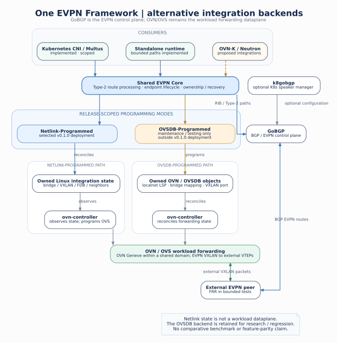
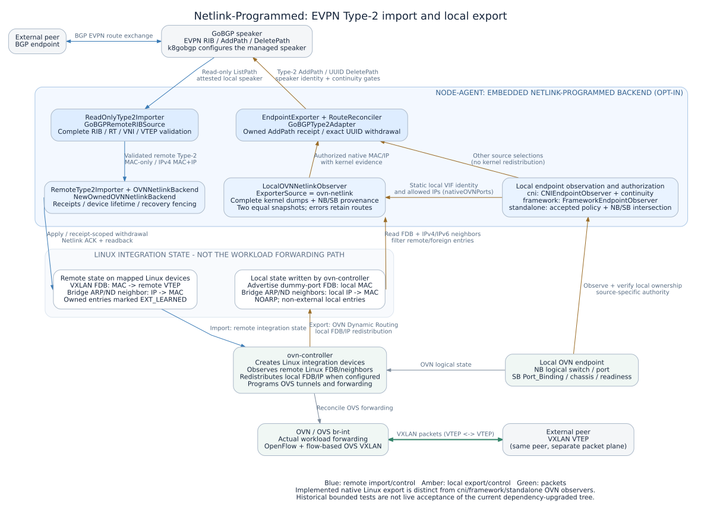

# Framework integration modes

The EVPN Framework provides shared GoBGP route processing, network and
endpoint services, ownership-aware reconciliation, and OVN/OVS integration.
Its two dataplane integrations are alternatives. OVN/OVS owns workload
forwarding in both. These are networking integration paths, not platform
adapters: neither the opt-in standalone importer nor these test fixtures
implements the planned standalone OVN platform lifecycle.
See the [framework boundary matrix](framework-architecture.md) and
[modular diagram](../uml/evpn-modular-architecture.svg).

## Netlink-Programmed — selected target

The optional Netlink integration consumes GoBGP EVPN Type-2 route state and
reconciles ownership-scoped Linux EVPN integration state with Netlink. Local
endpoint export is also available through the node-agent's Framework services.
The path uses per-VNI Linux state and shared per-chassis OVS EVPN configuration;
`ovn-controller` observes the integration state and owns OVS forwarding.

The Linux bridge, VXLAN, FDB, and neighbor state is not a separate workload
dataplane. This integration follows the boundary described by the upstream
[OVN Dynamic Routing EVPN architecture](https://docs.ovn.org/en/latest/topics/dynamic-routing/architecture.html#evpn-ethernet-vpn-integration),
without claiming support for unverified upstream features.

The optional importer/exporter is disabled by default. Independent Framework
E2E covers one OVN chassis with an external FRR peer and verifies Type-2
exchange, OVN/OVS workload traffic, withdrawal, survivor preservation, and
owned cleanup.

### Netlink-Programmed Type-2 internals

The diagram separates remote import (blue), local export (amber), and VXLAN
packets (green). These are responsibilities embedded in Node-Agent, not new
services. The historical `services/bgp_ad_handler` executable still exists as a
legacy compatibility path; it is not the handler used by the current owned
Netlink importer. Its modern equivalent is
`RemoteType2Importer` with the `OVNNetlinkBackend` returned by
`NewOwnedOVNNetlinkBackend`, wired by
[`RunRemoteType2Importer`](../../pkg/nodeagent/remote_runtime.go#L368-L403).
The compatibility executable must not be enabled as a second kernel writer.

#### Remote import and withdrawal

GoBGP receives external Type-2 routes. `GoBGPRemoteRIBSource` adapts its
read-only RIB into complete, provider-neutral snapshots.
`ReadOnlyType2Importer` validates network mapping, RT, VNI, next hop and
MAC/IP state; incomplete or uncertain snapshots are not authoritative empty
RIBs. Consecutive matching snapshots establish the desired state before
`RemoteType2Importer` reconciles it into the owned backend.
See [`remote_type2.go`](../../pkg/evpn/remote_type2.go) and
[`type2_gobgp_remote_source.go`](../../pkg/evpn/type2_gobgp_remote_source.go).

The backend validates mapped bridge/VXLAN device lifetimes and writes a
remote MAC-to-VTEP FDB entry on the VXLAN interface, plus an IP-to-MAC
neighbor on the bridge when an IP is present. These entries carry
`NTF_EXT_LEARNED`; ACK/readback, receipts, route incarnations and optional
durable recovery gate changes. Withdrawal deletes only the currently owned,
verified entries, not arbitrary matching foreign state.
See [`owned_netlink.go`](../../pkg/evpn/owned_netlink.go#L747-L888).
The validated importer currently accepts MAC-only and IPv4 MAC/IP Type-2;
the backend's ARP/ND representation is not a claim of validated IPv6 import.

`ovn-controller` consumes the Linux integration state and programs OVS
forwarding. The framework does not install OpenFlow directly in this backend.
The packet path is workload -> OVN/OVS -> external VTEP over OVS VXLAN,
not workload forwarding through the Linux integration bridge.

#### Local export: two different implemented mechanisms

**Native Linux export is implemented**, not merely an upstream proposal.
For `ExporterSource: "ovn-netlink"`,
[`cniExportBinding.buildObserver`](../../pkg/nodeagent/export_composition.go#L42-L69)
constructs `LocalOVNNetlinkObserver` with `nativeOVNPorts`. The provenance
source checks NB switch/device/VNI configuration, enabled `fdb`
redistribution, static VIF addresses, local ready SB binding and datapath
identity. NB/SB IPs are an allowlist, not sufficient advertisement evidence:
[`local_netlink_observer.go`](../../pkg/nodeagent/local_netlink_observer.go#L15-L133).

The actual observer dumps the advertise dummy interface's FDB
(`AF_BRIDGE`) and bridge neighbors (`AF_INET` and `AF_INET6`), selecting
local `NUD_NOARP`, non-external entries that agree with the OVN provenance.
It verifies device identity and provenance before/after each read and requires
two equal complete observations. Errors retain existing routes rather than
triggering speculative withdrawal:
[`LocalOVNNetlinkObserver`](../../pkg/evpn/local_netlink.go#L143-L267).
Thus this path is local endpoint -> OVN Dynamic Routing -> Linux FDB/neighbors
-> Node-Agent native observer -> Type-2 reconciliation -> GoBGP.
When durable CNI continuity is enabled, native LSP UUIDs must also match
active, resource-verified endpoint ACKs; deleted or unknown endpoints cannot
be adopted from residual kernel state:
[`cni_continuity_export.go`](../../pkg/nodeagent/cni_continuity_export.go#L52-L114).

**The other sources do not require Linux redistribution.** `cni` observes
CNI-owned OVN/OVS attachment state and caller/workload continuity;
`framework` uses `FrameworkEndpointObserver` to verify managed NB identity
and ready local SB binding. Standalone export adds a protected, durably
accepted authorization policy intersected with OVN observations; its current
binding selects the framework observer, not the native Linux observer.
See [`export_observer.go`](../../pkg/nodeagent/export_observer.go),
[`ovnexport/observer.go`](../../pkg/nodeagent/ovnexport/observer.go), and
[`standalone_export_runtime_linux.go`](../../pkg/nodeagent/standalone_export_runtime_linux.go#L286-L365).
The sources share `EndpointExporter`/`RouteReconciler` and
`GoBGPType2Adapter`: advertisement uses `AddPath`; withdrawal uses the
acknowledged UUID with payload/ownership and speaker-continuity checks.
Neither configures BGP neighbors or adopts an ambiguous existing route.

#### Upstream capability versus project evidence

Upstream OVN Dynamic Routing can both observe remote Linux state and write
local FDB/IP state for redistribution. Its documentation illustrates an
external routing daemon such as FRR; this project's native exporter instead
performs the guarded Linux-to-GoBGP adaptation in Node-Agent.
k8gobgp's own `netlinkImport`/`netlinkExport` writers remain disabled in the
maintained suites to preserve the single-writer boundary. That is distinct
from disabling OVN's local redistribution or the framework's native observer.
See [upstream EVPN architecture](https://docs.ovn.org/en/latest/topics/dynamic-routing/architecture.html#evpn-ethernet-vpn-integration)
and [configuration ownership](runtime-dependencies.md#bgpconfiguration-versus-direct-grpc).

Offline coverage includes native filtering/provenance, device-lifetime loss,
consecutive snapshots, owned Netlink mutation, authorization, exact UUID
withdrawal and recovery. The opt-in
[`TestNativeLocalExporter_Live`](../../pkg/nodeagent/local_netlink_integration_test.go#L43)
exercises real native state and GoBGP.
[Historical operator acceptance](operator-type2-acceptance.md#implementation-and-component-boundaries)
explicitly records the `ovn-netlink` export path and reverse owned import.
These bounded prior results do not establish live acceptance of the current
dependency-upgraded tree, all upstream port types, IPv6 interoperability,
Type-3/Type-5, or production readiness. OVN-Kubernetes/Neutron platform
adapters and broader topologies remain planned.

## OVSDB-Programmed — experimental

The opt-in standalone importer reads the GoBGP gRPC RIB without modifying it,
validates Type-2 routes, and passes accepted snapshots to the OVSDB handler.
The route-derived state includes an OVN localnet logical switch port, provider
bridge and bridge mapping, and an OVS VXLAN interface/port. `ovn-controller`
reconciles the OVN state into the workload forwarding path.

Route withdrawal removes only state owned by the integration. Cleanup respects
OVN controller ownership and preserves unrelated bridge ports and interfaces.
The importer is standalone and is not enabled by the standard kind deployment.

The verified independent Framework E2E covers one network and one remote
VTEP. It does not establish multi-VTEP lifecycle, shared-VTEP sibling
lifecycle, or two-chassis GoBGP operation.
This backend is retained for isolated Framework regression tests, architectural
research, and a future comparison. It is not the selected deployment target
and is not claimed to have feature parity or production readiness.

## Ownership and limits

Each adapter owns only the state it creates and can identify. OVN owns
controller-generated bindings and patch ports; the integration must wait for
controller reconciliation rather than deleting controller-owned objects.
GoBGP owns the control-plane RIB, while FRR is an external peer used for
interoperability testing.

For managed k8gobgp, BGPConfiguration is the sole writer of global identity,
neighbors and EVPN AFI/SAFI. Framework gRPC writes are limited to owned
Type-2 paths; the adapters own only their integration state. See the
[release-specific capability and ownership audit](runtime-dependencies.md)
before enabling upstream Netlink writers or calling legacy management
`StartBgp`/`AddPeer` APIs.

The one-chassis operator-managed Netlink path has bounded
[recovery acceptance](operator-type2-acceptance.md), including
agent/speaker replacement and post-recovery forwarding/withdrawal. The
separate attempt-8 two-worker Type-2 scenario verifies initial forwarding, not
recovery. The one-chassis result does not confer equivalent restart guarantees
on the OVSDB path or authorize ambiguous AddPath/Netlink adoption. The
integrations do not establish EVPN Type-5, dynamic IPAM, generalized
restart/adoption guarantees, or production installation readiness. The current
acceptance evidence and exact test commands are in the
[Testing Guide](../../TESTING_GUIDE.md).

## Planned comparative benchmark

The backend comparison remains planned, not measured. It should use equivalent
topology, route population, workload, peer behavior, and failure injection for
both modes, and report route convergence and withdrawal convergence, route
scale, CPU, memory, restart/recovery and reconciliation, forwarding correctness,
and operational complexity. Results must separate GoBGP engine behavior,
backend integration behavior, shared Framework behavior, and test-harness
limitations; no backend is presumed faster or more reliable.
