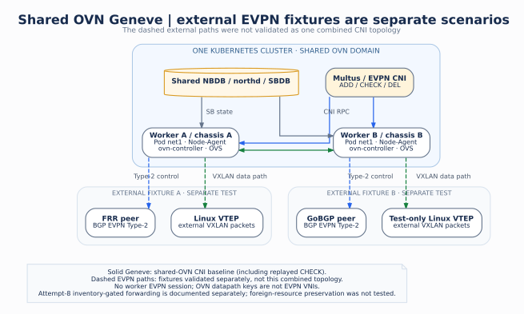
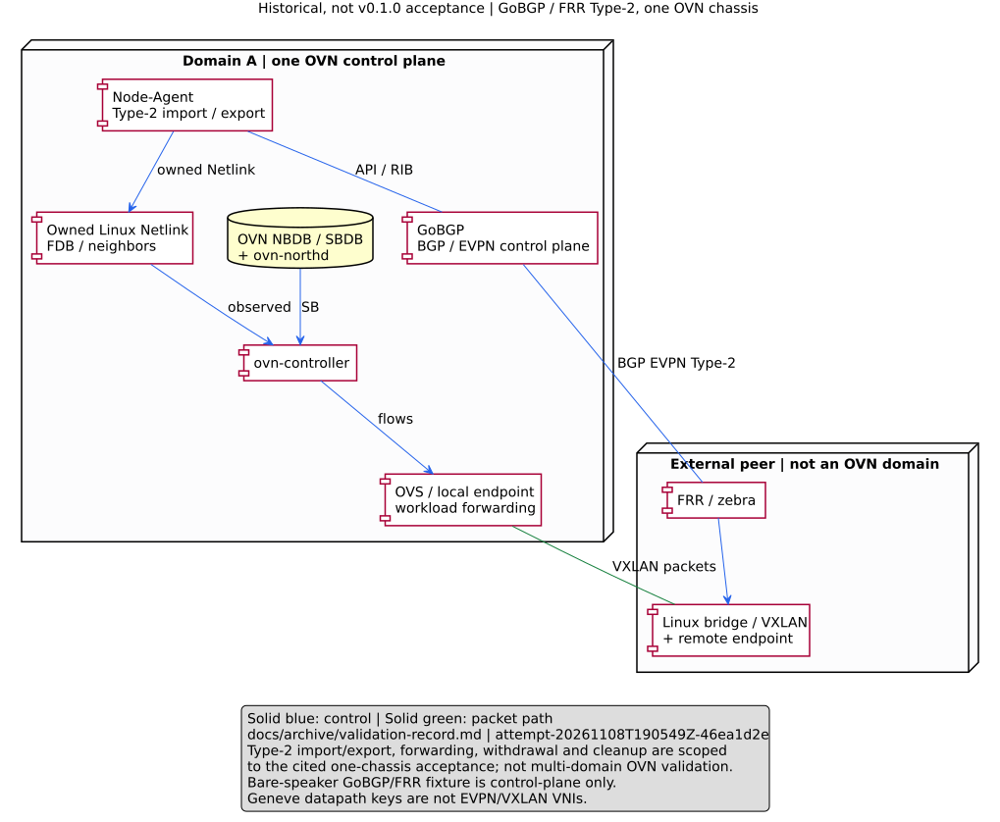
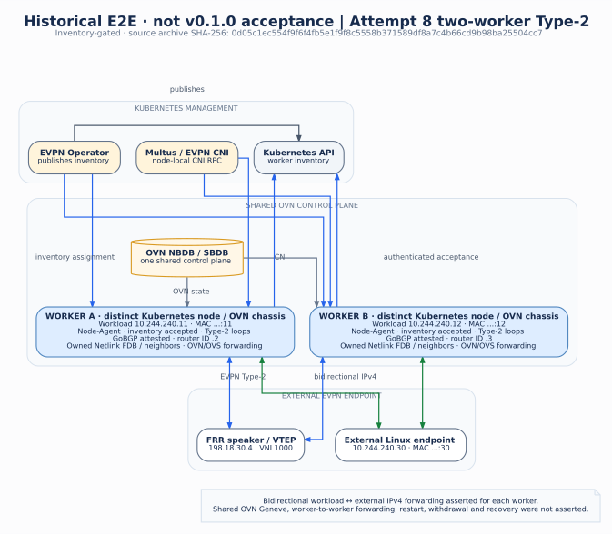
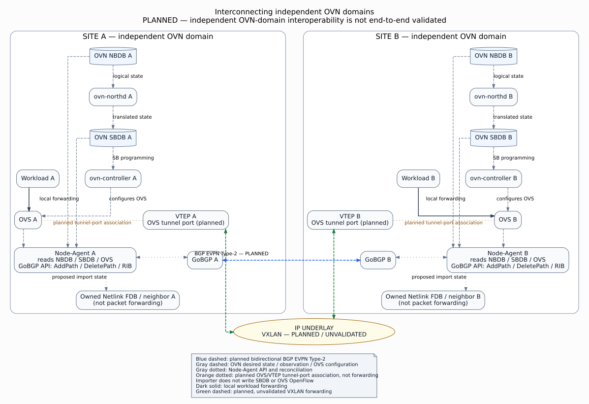

# Secondary OVN and EVPN network topologies

These editable PlantUML diagrams separate the shared-OVN secondary CNI baseline
from external EVPN integration. Solid blue lines denote validated control
or lifecycle paths; solid green lines denote validated packet paths. Dashed
lines are targets, not claims about the pictured deployment. The diagrams
are logical views, not deployment manifests. GoBGP is a BGP speaker; OVN
controllers and OVS program and forward the OVN dataplane.

## Shared OVN Geneve with external domains

[](../uml/multinode-secondary-external-domains.svg)

[Editable PlantUML source](../uml/multinode-secondary-external-domains.puml).

**Purpose and boundaries.** Two Kind workers share the project-owned OVN
NBDB/SBDB and run separate OVS/ovn-controller instances and registered
chassis. Multus invokes the project EVPN CNI and Node-Agent for the secondary
attachments. FRR and GoBGP external domains are independent; the GoBGP
speakers drawn on the workers are **planned for this particular scenario**.

**Control and data planes.** OVN northd translates NB logical state to SB;
each controller consumes SB and programs local OVS. The Pods exchange packets
over intra-domain Geneve; this does not depend on BGP EVPN. The diagram's
external FRR and GoBGP paths summarize fixtures validated separately from this
secondary-CNI baseline; they do not represent one combined accepted deployment.
A distinct inventory-gated two-worker Type-2 scenario is recorded below. A BGP
session alone does not provide external forwarding. An OVN Geneve datapath
tunnel key is not an EVPN/VXLAN VNI.

**Evidence and limitations.** The
[isolated secondary-CNI acceptance](../../deploy/containerlab/README.md#running-and-collecting-evidence)
passed two-worker ADD/DEL and CHECK replayed from captured Multus arguments,
bindings, packet-correlated bidirectional Geneve, owned endpoint cleanup and
primary Kindnet checks. It did **not** test
Type-2, an external peer or foreign OVN/OVS preservation. Its
[harness](../../tools/e2e/isolated_secondary_cni.py) and
[fixture tests](../../tools/e2e/test_isolated_secondary_cni.py) define its
actual scope. Other EVPN acceptance results do not prove this combined topology.

## GoBGP and FRR Type-2 domains

[](../uml/multidomain-gobgp-frr-type2.svg)

[Editable PlantUML source](../uml/multidomain-gobgp-frr-type2.puml).

**Purpose and boundaries.** Domain A shows one project OVN/OVS chassis with
Node-Agent and a separate GoBGP speaker. Domain B is an independent FRR/zebra
and Linux bridge/VXLAN peer, not a second OVN control plane. The diagram
summarizes the bounded integration; it is not the bare-speaker fixture topology.

**Control and data planes.** EVPN Type-2 carries MAC/IP advertisements and
withdrawals through BGP. The project imports remote routes and performs owned
local integration; FRR and Linux manage the peer side. Workload packets use a
separate VXLAN path, not the BGP session.

**Evidence and limitations.** The
[operator-managed Type-2 acceptance](operator-type2-acceptance.md) records
one-chassis GoBGP/FRR exchange, bidirectional packet evidence, route withdrawal
and cleanup in a specific Kubernetes/CNI lab. The
[independent Framework Netlink and OVSDB E2E](../../TESTING_GUIDE.md)
have their own bounded scopes. The
[standalone GoBGP/FRR fixture](../../tests/e2e/type2-fixture/README.md)
exercises exact route lifecycle without OVN, CNI or dataplane forwarding; its
readiness checks alone do not prove route exchange. None of these separately
proves the multi-chassis CNI plus external-domains scenario above.
The separate [two-worker FRR fixture](../testing/external-evpn-fabric.md#accepted-external-frr-interoperability)
tested external FRR with two workers sharing OVN and simultaneous Geneve; it
is not the same fixture as the one-chassis diagram or the later Multus
secondary-CNI baseline.

## Inventory-gated Operator Type-2 with two workers

[](../uml/operator-inventory-type2-two-worker.svg)

[Editable PlantUML source](../uml/operator-inventory-type2-two-worker.puml).

**Status: live E2E verified within the exact attempt-8 scope.** The
`operator-inventory-type2-two-worker` scenario used workers
`cni-sec-e9022d22-worker` and `cni-sec-e9022d22-worker2`, distinct Kubernetes
Node UIDs and OVN chassis, and one shared NB/SB Service.
Each worker ran an independently attested GoBGP speaker with a distinct router
ID and a local Node-Agent. Both workers accepted inventory revision 1 and
exported their own local Type-2 route. Both imported the external FRR route
`198.18.30.4:1000` and passed bidirectional IPv4 connectivity to the external
FRR/Linux endpoint. The exact route identities, checksums, packet assertions
and limits are recorded in the
[acceptance record](operator-type2-acceptance.md#attempt-8-inventory-gated-two-worker-type-2-forwarding).

This evidence does not establish direct workload-A-to-workload-B forwarding,
generalized multi-chassis support, the full multi-worker CNI lifecycle,
Node-Agent or GoBGP restart, withdrawal, recovery, failure convergence,
complete Operator runtime health, or production readiness. It is not the
independent-OVN-domain target described below.

## Multi-worker Type-2 development sequence

The first stage now has one bounded live verification described above:
independently attested, node-local GoBGP and Node-Agent instances on two
workers, each exchanging Type-2 routes with an authorized external FRR speaker.
This provides tested reachability to an external endpoint in that topology,
not a replacement for native Geneve or proof of arbitrary inter-worker
forwarding. A later target is to connect independently managed OVN domains.
The independent provider owns speaker lifecycle and BGP peer configuration;
the Operator does not provision or verify a general multi-node speaker fabric.

Each worker needs its own speaker/router ID, local VTEP, trusted node and
process identities, endpoint authorization, and isolated export and import
journals. A local authorized NB/SB endpoint observation drives Type-2 export;
the route carries its VNI, RT and local VTEP next hop. The remote speaker's
eligible Type-2 routes must pass VNI/RT and explicit remote VTEP policy before
the Netlink importer programs owned FDB/neighbor state for VXLAN. The
ovn-controller/OVS dataplane then forwards packets; BGP peering alone does
not prove this path. Deletion uses the exporting speaker's exact UUID
receipt, not an NLRI-wide withdrawal.

The current increment checks co-hosted import/export speaker and overlapping
network identities, and binds an import policy's local VTEP/VNI to the observed
local VXLAN device. The Operator can mount a pre-existing, node-local durable
journal directory, and Kubernetes speaker attestation checks the local node
name and recovery node UID. An Operator-managed external-OVN exporter now
checks the configured chassis against node-local OVS system-id and a unique
Southbound chassis before every export reconciliation. Inconsistent
configuration blocks the relevant runtime; after recovery is initialized, a
chassis loss durably fences advertisements and attempts exact owned-route
withdrawal. Unavailable recovery, pending intents or an unattested speaker
leave withdrawal unresolved. Attempt 8 does not establish a general admission
mechanism for cluster-wide VTEP/speaker uniqueness, peer installation,
per-worker trust provisioning or lifecycle recovery. Historical standalone
two-chassis results use a shared OVN control plane; they are not Kubernetes
multi-worker Type-2 or two-independent-domain acceptance.

## GoBGP and GoBGP independent OVN domains

[](../uml/multidomain-gobgp-gobgp-type2.svg)

[Editable PlantUML source](../uml/multidomain-gobgp-gobgp-type2.puml).

**Purpose and boundaries.** This is a **target, not validated**:
two independent OVN control planes, each with its own NBDB, SBDB, controller,
OVS, Node-Agent and GoBGP speaker. No shared OVN database is assumed.

**Control and data planes.** Each domain would export authorized MAC/IP
routes and import the peer's Type-2 routes. BGP and the proposed inter-domain
packet path are separate. On removal, each exporter must use its own exact
route receipt for withdrawal and each importer must clean up only its owned
state; ambiguous ownership remains blocked.

**Evidence and limitations.** Existing
[shared-OVN multi-chassis and external GoBGP results](../../TESTING_GUIDE.md)
are distinct topologies and do not validate this two-independent-OVN-domain
target. The [Type-2 ownership and recovery contract](type2-restart-ownership.md)
and [framework boundary](framework-architecture.md) describe existing mechanisms,
not acceptance of the proposed combination.

## Rendering

From the repository root, render locally without a network service:

```sh
plantuml -tsvg docs/uml/multinode-secondary-external-domains.puml \
  docs/uml/multidomain-gobgp-frr-type2.puml \
  docs/uml/multidomain-gobgp-gobgp-type2.puml
```

The `.puml` files are canonical; the SVG files are generated previews.
The [diagram index](../uml/README.md) contains existing architecture and
sequence diagrams, including separately scoped Type-2 lifecycle sequences.
