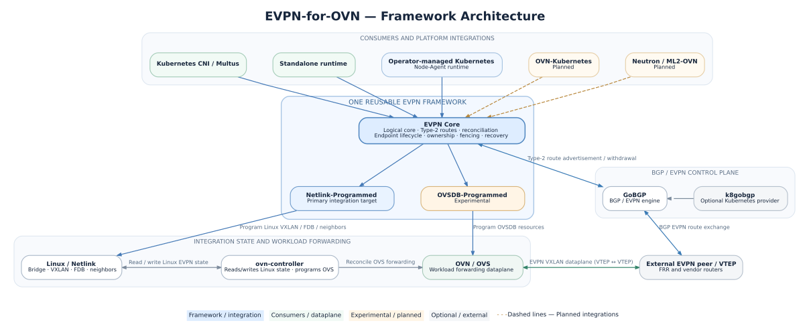

# EVPN-for-OVN component overview

EVPN-for-OVN is the project; **EVPN Core** is its reusable Type-2 route,
reconciliation, ownership and recovery functionality. The Core is a logical
boundary embedded in existing runtimes, not a separate service. The current
Go implementation is not wholly platform-independent: `pkg/evpn/domain`
contains provider-neutral models, while stateful reconciliation and Node-Agent
still depend on GoBGP, OVN/OVS, Linux and runtime-specific services. See the
[framework architecture](../architecture/framework-architecture.md) for the
verified boundaries and limits.

## Solutions and integrations

| Area | Status and scope |
|---|---|
| Kubernetes secondary CNI solution | Implemented with bounded validation. It includes the project CNI plugin, Node-Agent integration and Kubernetes lifecycle components; Multus is an external caller. Node-Agent also hosts shared and non-CNI runtime responsibilities. |
| OVN-Kubernetes integration | Planned; not an implemented solution. |
| OpenStack Neutron / ML2-OVN integration | Planned; not an implemented solution. |
| Standalone OVN runtime | Explicit Type-2 import and authorized-export paths exist, but this is not a complete, generally supported platform lifecycle solution. |

## Control plane and dataplane

GoBGP provides BGP sessions and EVPN RIB operations. k8gobgp is a distinct,
external provider manager that configures its speaker; it is not part of EVPN
Core and is not interchangeable with GoBGP. The Core reconciles Type-2 routes
and owned integration state. OVN/OVS remains responsible for workload packet
forwarding; Linux Netlink is one optional integration path, not a replacement
dataplane. EVPN Type-2 is not required for ordinary Geneve connectivity within
a shared OVN domain.

The [runtime architecture diagram](../uml/evpn-runtime-architecture.svg),
[deployment notes](../architecture/deployment.md), and
[integration modes](../architecture/integrations.md) explain the detailed
control-plane synchronization and dataplane programming paths. More specific
contracts and evidence are in [CNI authority](../architecture/cni-creation-authority.md),
[standalone authorization](../architecture/standalone-endpoint-authorization.md),
[ownership and recovery](../architecture/type2-restart-ownership.md), and the
[capability matrix](../project/capability-matrix.md).
