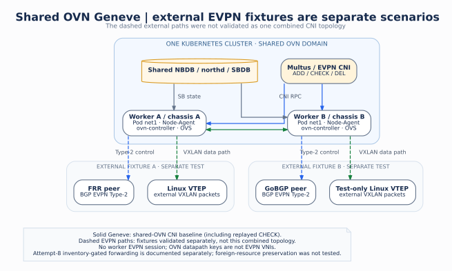

# Deployment, integration and operations

These are mechanisms for realizing the [two networking use cases](../use-cases/README.md),
not additional EVPN use cases or a promise that every combination is supported.
The [capability matrix](../project/capability-matrix.md) defines maturity;
the [deployment overview](../architecture/deployment.md) and linked architecture
contracts remain authoritative for configuration and ownership.
Use only trusted disposable environments with [security prerequisites](../../SECURITY.md).

## Deployment and Integration

### Kubernetes secondary CNI / Multus

**User and problem:** A Kubernetes Platform Engineer needs an additional
OVN-backed Pod network without replacing the cluster's primary CNI.

**Desired outcome:** Two Pods obtain the intended secondary attachments,
exchange packets within their shared OVN domain, and release exactly their
owned resources through ADD/CHECK/DEL.

**Prerequisites:** Separately installed Multus, project CNI binary and
NetworkAttachmentDefinition (NAD), a CNI-serving Node-Agent, project-owned
OVN/OVS, and the required kernel Unix-peer authentication facilities.
Continuity-enabled creation also requires the pinned invocation and workload
identity checks. Use only reviewed, environment-specific sample configuration.

**Workflow:** Configure the network/NAD and create Pods referencing it.
Multus invokes `evpn-cni`; the CNI-serving Node-Agent provisions or verifies
owned OVN logical ports and local OVS/veth attachments. Run CHECK and actual
Pod-to-Pod traffic, preserve the primary network, then delete the Pods and
verify exact DEL cleanup. CNI success is not asynchronous forwarding proof.

**Maturity and limits:** Secondary-CNI lifecycle is implemented experimentally.
Only the diagram's solid shared-OVN Geneve path describes this baseline;
its dashed external paths are separate fixtures. Type-2 is **not required**
for ordinary connectivity inside that shared domain. The existing
[CNI sequence](../uml/evpn-cni-lifecycle-sequence.svg) also illustrates a
separate optional external-EVPN test. Neither preserves arbitrary foreign
state by implication. Shared-domain Geneve is not independent-domain
interconnection or evidence for the planned second use case.

**Architecture and verification:** Follow the [CNI solution guide](../solutions/kubernetes-cni/README.md),
[creation authority](../architecture/cni-creation-authority.md) and
[endpoint continuity](../architecture/cni-endpoint-continuity.md).
Use the [secondary-network procedure](../../TESTING_GUIDE.md#prepare-and-execute-the-scoped-scenarios)
and its [scope notes](../testing/lifecycle-scenarios.md#secondary-cni-and-external-type-2).

### Standalone OVN integration

**User and problem:** An SDN/Private Cloud Engineer needs EVPN reachability
for OVN endpoints provisioned without Kubernetes CNI.

**Desired outcome:** Explicitly authorized local endpoints are exported,
validated remote routes are imported, OVN/OVS external packets are verified,
and retirement affects only exactly owned routes/resources.

**Prerequisites:** Existing compatible OVN/OVS endpoint and attachment
provisioning, attested local GoBGP Unix peer, protected administrator policy,
original identity fences/journals and configured Netlink network mapping.
Compatibility with an arbitrary existing deployment is not assumed.

**Workflow:** Provision the endpoint through the deployment's existing
non-CNI interface; configure standalone Node-Agent EVPN import/export.
Intersect current OVN NB/SB observations with accepted endpoint authorization,
advertise owned Type-2 paths, import remote routes and verify OVN/OVS VXLAN
traffic. Retire the endpoint through its provisioning authority and reconcile
exact owned withdrawal. Imported-state cleanup requires its own authoritative
route observations and receipts; do not clear all state on local retirement.

Use the source-independent [Netlink route/packet diagram](../uml/netlink-programmed-type2.svg)
and [non-CNI Framework sequence](../uml/evpn-framework-netlink-e2e-sequence.svg)
for the component boundaries. The latter is a bounded test fixture with
Framework provisioning, not proof of arbitrary standalone installation.

**Maturity and limits:** Opt-in standalone non-CNI import/export is
implemented; it does **not start a CNI server** or require an Operator.
End-to-end qualification of the chosen existing deployment remains required.
OpenStack Neutron / ML2-OVN and OVN-Kubernetes adapters remain planned.
CMS is only a test/demo emulator, not a required core framework service.

**Architecture and verification:** See [standalone authorization](../architecture/standalone-endpoint-authorization.md),
[deployment](../architecture/deployment.md#standalone-mode) and
[route ownership](../architecture/type2-restart-ownership.md).
The [VM guide](../testing/vm-e2e-lab.md) documents separate Framework procedures;
the [Testing Guide](../../TESTING_GUIDE.md) does not provide complete acceptance
for every standalone deployment.

## Deployment and Operations

### Kubernetes Operator

**User and problem:** A Kubernetes Platform Administrator wants declarative
installation and configuration rather than managing core workloads by hand.

**Desired outcome:** An `EvpnCore` reconciles its declared owned resources,
status reflects observed conditions, separate connectivity checks verify the
chosen network path, and uninstall removes only installation-owned resources.

**Prerequisites:** Reviewed CRD/Operator installation, isolated trusted
cluster, pinned inputs and permissions, a supported profile, and separately
provisioned Multus/CNI or `k8gobgp` resources when needed.

**Workflow:** Install the Operator and CRD; apply a configured `EvpnCore`;
inspect managed resource UIDs and observed generation/readiness. In
`managed-single-node`, the Operator manages an OVN Service/Deployment and
optional Node-Agent DaemonSet on the selected node. In `external-ovn`,
OVN is external and the Node-Agent DaemonSet is required. Configure optional
Type-2 loops explicitly and run separate BGP/packet tests.
Delete the CR for finalizer cleanup; disabling it is not uninstall.

Use the [runtime diagram](../uml/evpn-runtime-architecture.svg) for Kubernetes,
Node-Agent and provider roles, not as an acceptance topology. The
[component overview](../uml/component-overview.svg) supplies the wider context.

**Maturity and limits:** Constrained experimental lifecycle is implemented;
only `k8gobgp` is accepted as the Operator BGP provider. The Operator does not
install provider resources, Multus, NADs, CNI binaries or app/legacy
compatibility workloads. Readiness is not BGP exchange, endpoint ownership
acceptance or forwarding proof. Finalization retains ensured namespaces and
does not replace endpoint orphan reconciliation or the explicit network drain.

**Architecture and verification:** Follow the [Operator guide](../architecture/evpn-core-operator.md)
for actual installation/configuration and ownership rules. The
[lifecycle runner](../../tools/run-operator-e2e.sh) checks installation
ownership and cleanup separately from the
[connectivity procedures](../../TESTING_GUIDE.md#prepare-and-execute-the-scoped-scenarios).
