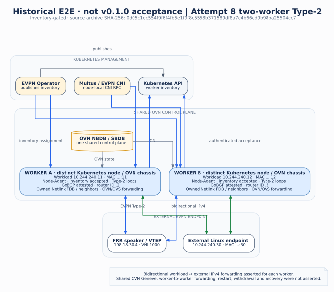

# Network topologies

Topologies describe endpoint placement and forwarding boundaries, not
additional use cases or interchangeable supported deployments. Start with
the [two networking use cases](../use-cases/README.md) and the authoritative
[architecture topology reference](../architecture/network-topologies.md).

For the network-engineer view, see the
[external-fabric topology](../uml/external-evpn-fabric.svg) and
[separate route/packet flow](../uml/external-evpn-type2-exchange.svg).
Independent-domain interconnection is planned; its
[topology](../uml/multidomain-gobgp-gobgp-type2.svg) and
[route/packet flow](../uml/multidomain-type2-flow.svg) are proposals, not
end-to-end validation.

Shared OVN Geneve networking, one OVN domain connected to an external EVPN
VTEP, and independent OVN domains are distinct. The first does not need Type-2;
the second uses GoBGP for route exchange and OVN/OVS for external VXLAN;
the third remains planned without full multi-site acceptance.

## Standalone two-chassis EVPN Type-2

**Status: Implemented and validated in v0.1.0.** The topology uses two OVN/OVS
chassis with a shared NB/SB control plane, distinct switches/VTEPs and GoBGP
route exchange. Validation includes bidirectional OVN/OVS VXLAN forwarding,
route reconciliation and withdrawal, Node-Agent restart recovery, and cleanup.
The [validation archive](../internal/validation-history/two-chassis.md)
preserves the source and artifact qualifications.

This is not independent OVN-domain interconnection, shared-domain Geneve, or
the inventory-gated Kubernetes Operator scenario. It does not establish
generalized multi-VTEP lifecycle, speaker failover, or zero-loss mobility.

## Multi-worker / multi-VTEP placement

**User and problem:** A Kubernetes Infrastructure Engineer wants peers to
learn the right worker-local endpoint location, including after Pod
retirement and recreation on another worker.

**Desired outcome:** Each worker's speaker, OVN chassis and owned endpoint
are identified independently; the intended old-location withdrawal and
new-location advertisement converge to correct remote reachability.

**Prerequisites:** Distinct node/chassis/speaker identities, accepted
worker-local inventory, protected journals, configured VTEPs and a selected
external peer. Shared OVN databases do not merge per-worker ownership.

**Intended workflow:** Verify a workload at worker A, retire that exact
endpoint and confirm withdrawal, then recreate the Pod at worker B.
Authorize the new incarnation, observe its advertisement and verify renewed
packets, absence of stale competing routes and scoped survivors. Record
observed convergence without promising a timing bound.

**Maturity and limits:** Worker-local inventory and templates exist.
Historical Attempt 8 checked each worker's external forwarding, not
worker-to-worker traffic, restart, withdrawal or relocation. Generalized
multi-chassis/multi-VTEP lifecycle and mobility remain unqualified.
Pod recreation is **not transparent live migration**. The intended workflow
above is not a reported completed relocation test.

**Architecture and verification:** See [Operator inventory/lifecycle](../architecture/evpn-core-operator.md),
the [two-worker example](../../deploy/operator/examples/two-worker/README.md)
and [validation procedure](../../deploy/operator/examples/two-worker/VALIDATION.md).
The [scenario notes](../testing/lifecycle-scenarios.md#multi-worker-and-multi-vtep)
keep historical forwarding separate from broader lifecycle targets.
Use the [reliability guide](reliability-and-lifecycle.md) for receipt and
recovery requirements; topology diagrams alone do not establish them.
