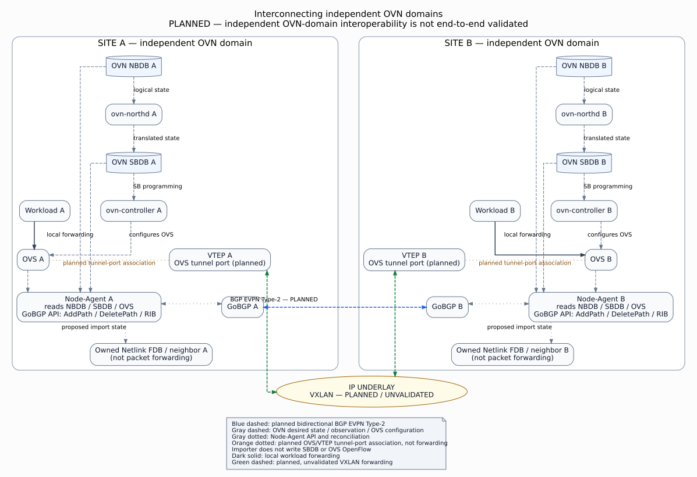

# Roadmap and future work

This roadmap distinguishes current implementation, validated use cases,
incomplete operational qualification and future plans. It is not a delivery
commitment or a second test scorecard. The [capability matrix](../project/capability-matrix.md)
and [v0.1.0 release notes](../release/v0.1.0.md) remain authoritative for the
selected release boundary; the maintainer-oriented
[validation archive](../internal/validation-history/README.md) preserves
historical source and evidence qualifications.

The roadmap was reconciled against
[`2549c1c`](https://github.com/romanspb80/evpn-for-ovn/tree/2549c1c73a4fd6d5e2e1e088a89fe4a92077a380),
[`ae07988`](https://github.com/romanspb80/evpn-for-ovn/tree/ae07988afdd08b860eb45221ed50c01e1995769f),
and the shortened release-preparation roadmap at
[`2e0295b`](https://github.com/romanspb80/evpn-for-ovn/tree/2e0295b6ed1a6cdddd8e375ccc973c39a269460c).
Restored plans do not imply that their historical statuses or validation
results are current.

## 1. Current experimental implementation

- EVPN Type-2 import/export uses the selected experimental Netlink
  integration. GoBGP is the BGP engine; OVN/OVS owns workload forwarding.
- Standalone Node-Agent import/export modes have authorization, speaker
  attestation, ownership receipts and fencing boundaries. They do not require
  the Operator or start a CNI server.
- Kubernetes secondary CNI/Multus endpoint lifecycle and constrained Operator
  profiles exist experimentally. They are separate from the cluster primary
  CNI and are not a production support matrix.
- The Operator currently accepts the optional `k8gobgp` Kubernetes speaker
  provider. `k8gobgp` manages Kubernetes speaker configuration; it is not a
  separate BGP engine.
- The validated Two-Chassis EVPN Type-2 use case shares one OVN NB/SB control
  plane. It does not establish interconnection of independent OVN domains,
  generalized mobility, or vendor interoperability.
- Direct OVSDB programming is maintenance/testing-only for this release.

OVN/OVS remains the intentional networking foundation. Supporting Linux
Netlink, FDB and neighbor state is not a primary Linux-bridge workload
forwarding path. The historical CMS emulator is optional testing/demo
infrastructure, not a Framework core component.

## 2. Planned EVPN networking capabilities

These are future design and acceptance areas, not implemented v0.1.0
capabilities:

- **External EVPN fabric acceptance remains unresolved.** Historical FRR,
  GoBGP/Linux and other bounded scenarios do not establish full-fabric
  acceptance. Reconcile final manifests, source/build identity, route evidence
  and actual packet-path evidence before making broader claims; keep this
  separate from the vendor test program below.
- **Independent OVN-domain interconnection and DCI.** Define independent
  NB/SB control planes, per-site endpoint authority, speaker/VTEP identity,
  RD/RT policy, underlay reachability and tenant isolation. Acceptance must
  demonstrate route exchange and actual bidirectional OVN/OVS-to-external-VTEP
  VXLAN traffic across independent domains, exact owned-route withdrawal,
  scoped cleanup, and separate link, peer, controller and restart/failure
  cases. Shared-OVN multi-chassis tests do not satisfy this requirement.
- **Type-5 / IP-VRF and routed tenants.** Define prefix and VRF ownership,
  RD/RT policy, L3-VNI, next-hop and gateway/IRB behavior before implementation.
  Validate import, export, forwarding and withdrawal independently of Type-2
  regression. Type-5 is outside the implemented release scope.
- **Route reflection.** Specify RR/client policy, loop prevention, path
  selection, provenance and restart/failover behavior, with route and real
  traffic evidence. Provider schema fields alone are not RR acceptance.
- **Shared VTEP, VLAN/VNI and generalized multi-VTEP lifecycle.** Define
  per-network/VTEP ownership and allocation, next-hop changes, shared-resource
  deletion, survivor forwarding and last-owner cleanup. Test the Netlink and
  OVSDB integration modes separately; the OVSDB path is currently constrained
  to one network and one remote VTEP.
- **Mobility and failure recovery.** Extend endpoint deletion, replacement and
  migration beyond bounded scenarios. Test route withdrawal/re-advertisement,
  restart, stale or partial observations, survivor traffic, exact receipts and
  foreign-state preservation. Do not promise zero-loss mobility or infer
  recovery from control-plane convergence alone.

### Independent OVN-domain interconnection (planned)

This planned data-center-interconnect capability connects independently
managed OVN domains without merging their control planes. Each domain would
retain separate NBDB/SBDB, `ovn-northd`, Node-Agent, GoBGP speaker,
`ovn-controller`, OVS environment, logical network, workload and VTEP. Multiple
chassis sharing one OVN control plane do not constitute independent domains.

The [topology source](../uml/multidomain-gobgp-gobgp-type2.puml) shows the two
separate control planes. The [route and packet-flow diagram](../uml/multidomain-type2-flow.svg)
and [source](../uml/multidomain-type2-flow.puml) distinguish the proposed
GoBGP-to-GoBGP Type-2 exchange from the separate OVN/OVS-to-external-VTEP
VXLAN data plane.

Implementation must define per-domain endpoint authority and route ownership,
RD/RT policy, VNI/VTEP mapping, remote endpoint mapping, tunnel provisioning,
forwarding-state reconciliation and scoped teardown. Acceptance requires
actual bidirectional packets across the inter-domain VXLAN path independently
of route exchange, exact route withdrawal, survivor forwarding and cleanup,
and recovery under independent peer, controller and restart failures. These
are planned integration and E2E requirements, not implemented automation or
an executable deployment recipe.

EVPN Type-3/IMET and full BUM membership remain outside release scope; no
dedicated historical implementation commitment was recovered. Multihoming is
research-only, without accepted ESI, Designated Forwarder or failover behavior.

## 3. Vendor EVPN/VXLAN interoperability

Plan a reusable EVPN Type-2 interoperability suite for the Netlink-Programmed
Framework and external EVPN speakers. This is future test planning: no vendor
pass or production interoperability guarantee is claimed.

| Peer platform | Historical status | Planned role |
|---|---|---|
| FRRouting (FRR) | `PLANNED` | Reference behavior and regression peer; reuse existing FRR interoperability infrastructure. |
| Nokia SR Linux | `IMAGE_AVAILABILITY_PENDING` | Vendor interoperability target. |
| Juniper cJunosEvolved | `IMAGE_AVAILABILITY_PENDING` | Vendor interoperability target. |
| NVIDIA Cumulus VX | `IMAGE_AVAILABILITY_PENDING` | Vendor interoperability target. |
| Arista cEOS | `IMAGE_AVAILABILITY_PENDING` | Vendor interoperability target. |

The historical plan does not specify exact image versions, vendor-specific
feature support, or availability/licensing outcomes. Before a vendor case is
selected, verify authorized image provenance and access, license and
redistribution terms, Type-2 feature support, CPU/memory/storage requirements,
architecture and virtualization compatibility, Containerlab suitability or an
authorized VM alternative, repeatable configuration/observation automation,
and CI feasibility. Do not download or deploy images until authorized access
is established.

Use a reusable Containerlab topology where supported, with a Framework/GoBGP
node, one external EVPN peer under test, and Linux endpoints or traffic
generators. Keep the FRR reference case in the same topology and harness. Use
an authorized VM peer when a container image is unavailable or unsuitable.

For each platform and tested software release, record:

- BGP session establishment and EVPN AFI/SAFI negotiation.
- Type-2 MAC-only and MAC/IP route exchange where supported; RD/RT handling,
  VNI, VTEP and next-hop interpretation. Record unsupported forms and
  configuration differences rather than assuming parity.
- Exact withdrawal, re-advertisement after peer and Framework restarts, and
  route-level convergence observations.
- Framework ownership isolation during import, export and withdrawal,
  including preservation of foreign routes and state.
- Separate packet-forwarding verification across the advertised VXLAN
  VNI/VTEP for the supported MAC/IP forms. A control-plane pass is not a
  dataplane pass; GoBGP routes do not forward workload packets.

Retain versioned configuration, image provenance, logs, route observations and
forwarding evidence. Track readiness independently as `PLANNED`,
`IMAGE_AVAILABILITY_PENDING`, `LAB_READY`, `CONTROL_PLANE_PASS`,
`DATAPLANE_PASS`, `BLOCKED` or `NOT_SUPPORTED`. Assign either pass status only
after its corresponding checks have run and evidence is retained. Select vendor
order by verified feasibility, not assumed availability or feature parity.

## 4. Cloud and orchestration integrations

- **OpenStack Neutron / ML2-OVN — planned, not implemented.** Define network
  and port ownership around Neutron/OVN switches and ports without importing
  Kubernetes NAD, Multus, CNI or Operator assumptions. Keep one authoritative
  BGP speaker/peer writer and receipt-owned Type-2 paths. Acceptance should
  cover create/update/delete, retries and failures, restart/recovery, traffic,
  withdrawal and last-owner cleanup in a disposable OpenStack/OVN environment.
- **OVN-Kubernetes — integration investigation.** First identify the seam
  between its FRR/frr-k8s-specific reconciliation and a potential
  GoBGP-backed integration; GoBGP is not a drop-in replacement. Compare
  CUDN/VTEP/RouteAdvertisements, Type-2 and any future Type-5 semantics, and
  define one writer for each BGP and kernel object. Do not take ownership of
  OVN-Kubernetes' OVN, FRR or kernel state.
- **Network-intent APIs — proposed only.** EvpnGateway, EvpnVTEP and
  EvpnNetwork CRDs are design proposals, not project-owned APIs. Establish
  identity, topology, ownership, translation and deletion behavior before
  implementation; preserve provider ownership and avoid duplicate BGP writers.
- **Dynamic IPAM — proposed only.** Define allocation/release, collision,
  stale-incarnation, retry and restart semantics. Existing accepted CNI
  examples use static addressing.
- **Operator lifecycle and production deployment — incomplete.** The
  experimental Operator is not a production installer. Define supported
  standalone and Kubernetes installation, reproducible images, per-node
  identity, least privilege and RBAC, mounts and configuration, durable storage,
  scheduling/disruption, upgrades, rollback and recovery. Kubernetes workload
  readiness is not BGP convergence or dataplane acceptance.

CMS remains an optional emulator for testing and demonstrations; it is not a
cloud integration or Framework core.
Cilium remains outside the planned integration scope: historical review found
no maintained adapter, concrete consumer or specific integration defect to
track. Revisit only when a consumer requirement and compatible route-ownership
contract are identified.

## 5. Reliability, security and operations

The following items remain bounded open follow-ups in the selected release
baseline or lack complete operational acceptance:

- **Endpoint cleanup and API outage:** missed CNI DEL/orphan retirement and
  Kubernetes API-unavailability recovery are not fully accepted. Treat
  unavailable or partial observations as uncertainty, not proof of endpoint
  absence; fail closed and preserve foreign state.
- **Endpoint transaction and shared-state lifecycle:** the baseline retains
  an endpoint attachment-failure case without automatic OVN compensation.
  Define safe compensation for newly created owned state, preserving
  pre-existing endpoints, survivors and retry behavior. Shared-VTEP cleanup
  requires separate owner-withdrawal, survivor-forwarding and last-owner tests.
- **Agent, controller, speaker and device recovery:** separate failure
  domains; test restarts, stale/partial observations, persisted receipts,
  adoption/refusal, reconnection and cleanup without foreign deletion. Keep
  Netlink and OVSDB recovery claims distinct.
- **OVSDB partial-withdrawal behavior:** define ownership-safe invalidation or
  aging of a withdrawn MAC's learned provider-bridge FDB entry while another
  route still retains the tunnel. Verify survivor traffic and final cleanup;
  do not flush broad bridge/FDB state or treat row deletion as proof of
  dataplane convergence.
- **Management API contracts:** audit declared versus implemented RPCs,
  truthful reads, status/error behavior, idempotency and compatibility.
  Historical task review found generated unimplemented methods and mixed
  response semantics. Preserve working API contracts; require conformance
  tests for declared methods and reproducible protobuf generation before
  changing them.
- **Local management security:** legacy management services lack transport
  authentication and authorization; the supported Operator Netlink profile
  excludes them. Define an enforceable authenticated transport or isolation
  model, threat model, tests and migration plan. Do not confuse lab PKI with
  gRPC transport security.
- **Remote BGP peer security:** keep remote peer authentication separate from
  local speaker attestation and endpoint authorization. The pinned k8gobgp
  provider already has Secret references for TCP MD5; this does not establish
  live interoperability, rotation or other protections. Validate matching,
  mismatched and missing keys; TCP-AO/kernel/FRR compatibility; GTSM/ACL and
  import/export policy; protected secrets and coordinated rotation/reconnect.
  Never introduce competing peer writers or expose credentials in evidence.
- **Compatibility investigations:** retain evidence-led GoBGP/k8gobgp/OVN
  investigations in [engineering findings](../known-issues/engineering-findings.md).
  Compare exact stock/fork API behavior for AddPath UUID readback and MAC-only
  encoding; investigate provider configuration ownership and Secret rotation;
  isolate OVN crash/reference reports with minimal reproducers and exact
  versions. These are compatibility investigations, not confirmed upstream
  defects. The current GoBGP adapter uses binary NLRI and durable AddPath
  receipts; do not reintroduce synthetic IPs or broad withdrawal fallbacks.

Do not treat an individual historical scenario as broader fabric or production
qualification.
Production privilege, RBAC, availability, upgrade and rollback qualification
remain open. See [known limitations](../known-issues/README.md), the
[security contract](../security/netlink-deployment-security-contract.md), and
[historical validation provenance](../internal/validation-history/README.md).

## 6. Research and benchmarking

- **Reproducible performance and convergence research:** functional pings do
  not establish convergence or scale. Define equivalent topology, route
  population, workload, peer behavior and failure injection; record route and
  withdrawal convergence, route scale, CPU/memory use, packet loss and
  recovery/reconciliation. Attribute observations separately to GoBGP,
  integration backend, shared Framework logic and harness limitations. No
  performance result or comparative winner is claimed.
- **Backend comparison:** Netlink-Programmed is the selected development
  target. OVSDB-Programmed remains experimental for isolated regression and
  architectural comparison. Any future comparison must use equivalent
  scenarios and report operational complexity as well as measurements.
- **Multihoming:** research ESI, DF election, split horizon, mass withdrawal and
  failure behavior only after a design and test plan exist. It is not an
  implementation commitment or v0.1.0 capability.

No item in the planned, operational follow-up or research sections is a release
promise. See the [capability matrix](../project/capability-matrix.md), the
[release boundary](../release/v0.1.0.md), [known limitations](../known-issues/README.md),
[engineering findings](../known-issues/engineering-findings.md), and the
[Testing Guide](../../TESTING_GUIDE.md).
