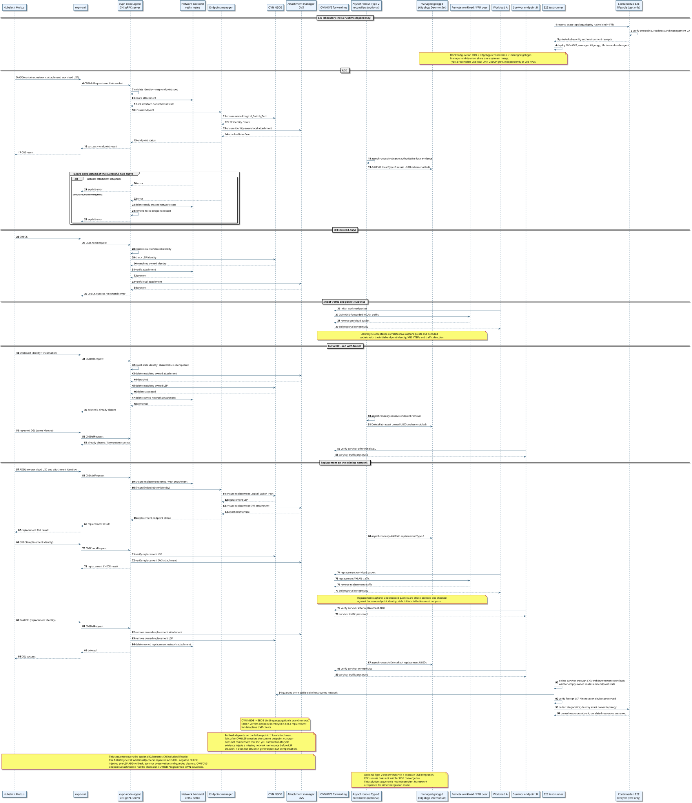

# Kubernetes CNI solution

The Kubernetes CNI solution combines the project CNI plugin, Node-Agent
services, and Kubernetes lifecycle components to provide secondary-network
attachments. It is built using EVPN Core; it is not the Core itself and does
not define the Framework's Netlink or OVSDB integration mode.
The standard Kubernetes lifecycle path is the experimental EVPN Operator
reconciling an `EvpnCore` into a node-local Node-Agent DaemonSet. The current
Operator defaults to one designated node; its experimental external-OVN mode
can select multiple prepared nodes. A bounded inventory-gated two-worker
Type-2 forwarding scenario has passed through the Operator; general multi-node
CNI lifecycle, restart, withdrawal and recovery remain untested. Standalone
operation does not require the Operator.

## Responsibilities and flow

External Multus invokes `evpn-cni` for a secondary Pod network. The plugin sends the
request to `evpn-node-agent` over the node-local gRPC Unix socket. The
node-agent validates the network, attachment, workload, and incarnation
identity, then coordinates the network namespace/interface backend with shared
Framework endpoint and attachment services. The
[NodeAgentCNI API reference](../../api/node-agent.md) records request identity,
outcomes, dependencies and gRPC errors.

The Framework creates or verifies the owned OVN logical switch port and local
OVS attachment. Optional Type-2 import/export is configured separately and is
disabled by default. It runs asynchronously from ADD/DEL; a successful CNI
response does not itself establish route advertisement/withdrawal.
In the kind test topology, GoBGP is provided by upstream
`k8gobgp`; FRR is the external peer. OVN/OVS owns workload forwarding.

## CNI operations

- **ADD** creates an attachment and owned endpoint state, returning the CNI
  result only after the required operations succeed.
- **CHECK** validates the exact endpoint identity and expected network and
  OVN/OVS attachment; it is read-only and does not recreate missing resources.
- **DEL** removes only matching owned state. Repeated DEL is idempotent and a
  stale workload incarnation must not delete a replacement endpoint.
- **Replacement** uses a new attachment/workload identity on the same network;
  the old endpoint's withdrawal and cleanup must not remove survivor state.

The accepted rollback scenario injects a missing network namespace before the
OVN LSP is created, verifies no endpoint resources remain, and then retries
successfully. It does not establish general compensation for failures after
LSP creation; post-LSP ADD compensation remains open work.

## Configuration and deployment

The example Multus NetworkAttachmentDefinition is
[`network-attachment-definition.example.yaml`](../../../deploy/kind/cni-multus-test/network-attachment-definition.example.yaml).
It includes the CNI version, network name/type, node-agent socket, network ID,
attachment ID, logical switch, and example static IPv4/MAC values. Kubernetes
calls must provide unambiguous workload identity. Dynamic IPAM is not
implemented.

The Operator-managed Type-2 test creates the Node-Agent through the actual
Operator. Other disposable test runners create the DaemonSet directly for
subsystem isolation or multi-worker coverage. This is a testing/development
mechanism, not a separate supported production installation mode. CNI staging,
Multus configuration and privileged host mounts remain fixture-provided; none
of these is a production installation recipe. Production lifecycle, privilege,
mount, RBAC, addressing and upgrade policies remain to be designed and
validated.

## Verification

The [CNI Full Lifecycle E2E](../../../TESTING_GUIDE.md#kubernetes-cni-lifecycle)
is a subsystem test that bypasses the Operator. It covers initial and
replacement ADD/CHECK/DEL, bidirectional traffic and five-point packet
verification, idempotency, negative CHECK, pre-LSP rollback, survivor
preservation, and guarded cleanup.

The bounded [Operator-managed Type-2 scenario](../../../TESTING_GUIDE.md#operator-managed-type-2)
combines Operator reconciliation with CNI and real GoBGP–FRR Type-2/VXLAN
assertions on one chassis. The two-worker shared-OVN Geneve scenario is
separate and does not demonstrate EVPN forwarding.

The distinct [inventory-gated two-worker Type-2 scenario](../../../docs/architecture/operator-type2-acceptance.md#attempt-8-inventory-gated-two-worker-type-2-forwarding)
passed local Type-2 export, external FRR route import, and bidirectional
workload-to-external-endpoint forwarding on two workers. It does not test
worker-to-worker workload forwarding, restart, withdrawal or recovery, and
does not establish complete Operator runtime health.

The no-replacement interoperability scenario is a separate, narrower
regression using `tools/run-cni-mvp-2.4b-multus.sh`. Neither CNI test replaces
the independent Framework Netlink or OVSDB acceptance suites. Shared-VTEP
lifecycle and broader multi-chassis behavior remain untested.
