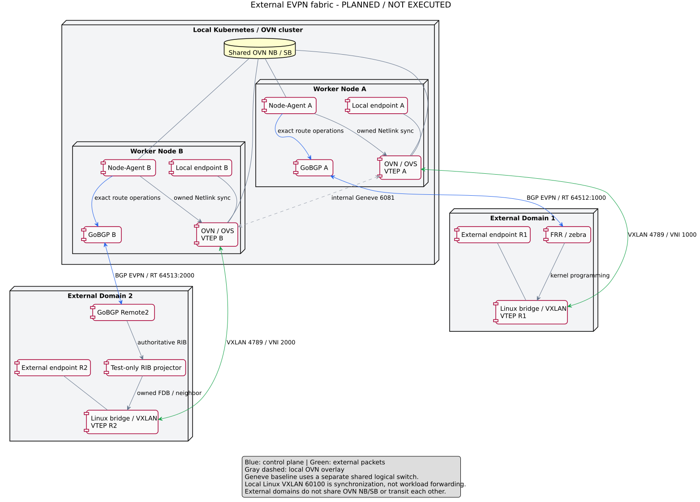
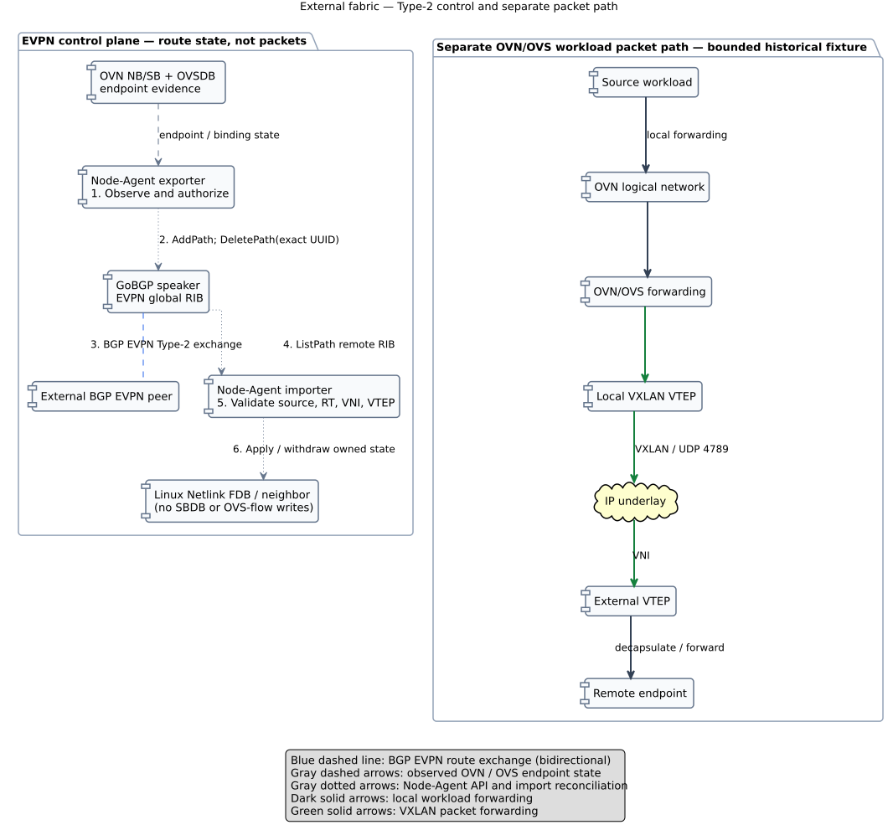
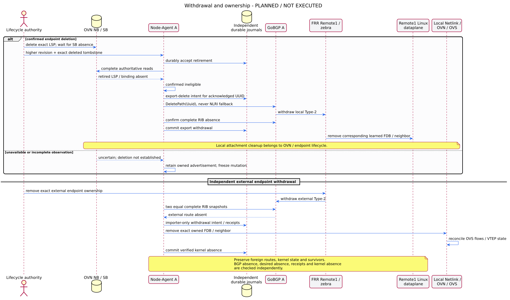

# External EVPN fabric interoperability

> **Historical engineering record:** scenarios and results below describe
> their original fixtures and source inputs, not a fresh validation of the
> current tree. Local artifact paths are provenance and may be unavailable.
> Full-fabric acceptance remains **unresolved** until the final manifests
> and source identities are verified. See the
> [capability matrix](../project/capability-matrix.md) and
> [Testing Guide](../../TESTING_GUIDE.md).

Historical results report Type-2 exchange and known-unicast VXLAN forwarding
between Worker A and an external FRR peer and Worker B and an external GoBGP
peer, alongside local two-worker Geneve. Selected isolation and lifecycle
checks were also reported passing, including two agent-recovery runs with
identical inputs. Other reports describe Remote2 restart, policy-injection and
endpoint-lifecycle cases, but their final-input evidence has not been
independently verified.

**Full external-fabric acceptance remains unresolved.** It requires
independently verified final-input manifests and source/build identities,
plus evidence that owned routes and dataplane state are drained before
speaker destruction. Ordinary teardown or earlier supporting runs do not
establish that acceptance. The [detailed case matrix and limitations](#isolation-and-lifecycle-evidence)
distinguish supporting checks from complete scenario acceptance.
The diagrams describe a proposed complete topology. Bounded scenarios using
co-hosted Node-Agents and a shared OVN control plane remain separate from
independent OVN-domain interoperability; see the
[standalone lifecycle record](../../docs/architecture/standalone-endpoint-authorization.md#live-endpoint-lifecycle-contract)
and [capability matrix](../project/capability-matrix.md).

## Proposed topology

**PLANNED DESIGN — NOT EXECUTED.** The diagram is an architectural proposal,
not evidence of an accepted multi-domain topology.

[](../uml/external-evpn-fabric.svg)

[Editable architecture source](../uml/external-evpn-fabric.puml).

One Kubernetes cluster has **two real worker nodes**, A and B, with one
shared OVN Northbound/Southbound control plane. Each worker has independent
OVS/ovn-controller, Node-Agent, locally attested GoBGP process, authorization
fence and exporter/importer journals. An auxiliary OVN container is not a
second Kubernetes worker.

Normal local connectivity uses OVN Geneve. A separate shared `ls-local`
logical switch, with endpoints on both workers and no EVPN dynamic-routing
configuration, supplies the initial local baseline. `ls-ext1` and `ls-ext2`
are isolated external-service switches with no connecting logical router.
Geneve coexistence on the same EVPN-enabled logical switch is additional,
unestablished coverage, not inferred from this separate baseline.

Node A peers only with external FRR Remote1; Node B peers only with external
GoBGP Remote2. Both external domains have separate Linux bridge/VXLAN
dataplanes and workload veths/namespaces. Neither has access to, or shares,
local OVN NB/SB. Remote1 uses FRR/zebra kernel integration; Remote2 needs a
**test-only RIB projector** that composes existing validated route observation
and owned Netlink reconciliation. GoBGP itself does not forward packets.

### Proposed address and service plan

These are **disposable test-fixture values**, not address assignments for
deployed infrastructure.

| Component | BGP address / router ID | VXLAN VTEP | Pair ASN |
|---|---|---|---|
| Node A | `198.18.10.2` | `198.18.10.2` | 64512 |
| FRR Remote1 | `198.18.10.3` | `198.18.10.4` | 64512 |
| Node B | `198.18.20.2` | `198.18.20.2` | 64513 |
| GoBGP Remote2 | `198.18.20.3` | `198.18.20.4` | 64513 |

Local Geneve uses a separate underlay, proposed A=`198.18.30.2`,
B=`198.18.30.3`. Management is separate. Pair-specific external underlays are
`198.18.10.0/24` and `198.18.20.0/24`; no tenant bridge or router joins them.
External BGP peer and VTEP identities are deliberately distinct. Tunnel
selection follows the route's MP_REACH next hop, not its neighbor address.

| Endpoint | MAC / IPv4 | Legitimate advertiser | RD | RT / VNI / next hop |
|---|---|---|---|---|
| Local A (`ext1`) | `02:00:00:01:00:0a` / `10.100.1.10` | Node-Agent A only | `198.18.10.2:1000` | `64512:1000` / 1000 / `198.18.10.2` |
| Remote1 | `02:00:00:01:00:65` / `10.100.1.101` | FRR Remote1 | `198.18.10.3:1000` | `64512:1000` / 1000 / `198.18.10.4` |
| Local B (`ext2`) | `02:00:00:02:00:0b` / `10.100.2.10` | Node-Agent B only | `198.18.20.2:2000` | `64513:2000` / 2000 / `198.18.20.2` |
| Remote2 | `02:00:00:02:00:66` / `10.100.2.101` | Remote2 fixture through GoBGP | `198.18.20.3:2000` | `64513:2000` / 2000 / `198.18.20.4` |

Start with direct iBGP inside each isolated pair. There is no A/B BGP session,
route reflector, Remote1/Remote2 session, route leaking or implicit transit.
Pair-specific export/import policy must be deny-by-default. Node A imports
only RT1/VNI1000/R1-VTEP; B only RT2/VNI2000/R2-VTEP. Peer policy must reject
forbidden dual-domain RT sets: the current importer uses RT **intersection**,
not exact-set matching. Final policy syntax needs pinned-GoBGP verification.

### Ownership and forwarding

The authorization observer intersects a durably accepted policy with actual
NB LSP UUID/name/MAC/IP/switch membership and one ready local SB chassis
binding. Shared database visibility never authorizes non-owning advertisements.
Revision/digest high-water, exact tombstones and retired attachment generations
survive agent restart. Trusted deletion plus complete authoritative absence
permits withdrawal; incomplete observations retain existing owned routes.

The locally attested Unix GoBGP peer is pinned by process/executable,
arguments, cgroup and configuration identity. Export recovery owns only
acknowledged AddPath UUID receipts in the verified incarnation. DeletePath
uses that exact UUID, never an NLRI fallback. Retained unacknowledged AddPath
is ambiguous and blocks recovery. This local attestation does not authenticate
remote BGP peers.

Imported Type-2 requires explicit RT/VNI/VTEP validation and two equivalent
complete RIB observations. Independent importer receipts bind kernel entries
to the node, network namespace and device lifetime; no foreign-state adoption
is permitted. Same-domain conflicting MAC/IP/VTEPs freeze reconciliation
rather than establish multihoming or mobility selection.

The local Linux bridge/FDB/neighbor and VXLAN interface are a **Netlink
synchronization boundary**, not the OVN workload dataplane. In the existing
validated fixture configuration, Linux synchronization VXLAN uses UDP
**60100**, while ovn-controller programs actual external OVS VXLAN forwarding
on UDP **4789**. The proposed fixture must validate this separation against
its pinned image and actual sockets/flows, not assume configuration is proof.

```text
Local A veth -> OVN/OVS br-int -> OVS VXLAN A-VTEP to R1-VTEP
  -> Remote1 Linux VXLAN -> Linux bridge -> external workload veth

Remote1 workload -> Linux bridge -> received-Type-2-derived FDB
  -> Linux VXLAN -> Node A OVS -> local A veth
```

Node B/Remote2 follows the same packet path. Remote2's GoBGP supplies routes
to the test-only RIB projector; Linux bridge/VXLAN forwards packets.
Received endpoint FDB state must not be preseeded to fake route-driven import.
An endpoint on B is not reachable from Remote1 merely because A sees it in
NB/SB. Cross-chassis external reachability needs a separately authorized
gateway ownership model or separately reviewed peering. Never authorize every
agent to advertise every OVN endpoint as a shortcut.

## Type-2 unicast prerequisites and limits

The mandatory initial service is IPv4 known-unicast: zero ESI, Ethernet Tag
0, one VNI label and an explicit VXLAN encapsulation community. Use one
untagged Linux bridge/VXLAN device per external VNI, explicit local VTEP,
UDP4789, `nolearning`, and a workload access veth. SVD/VLAN-to-VNI mapping is
not part of this acceptance.

Received Type-2 supplies per-MAC remote FDB and IP/MAC neighbor state.
Explicitly recorded static **workload** neighbors may remove ARP bootstrap
from the first unicast gate; they do not prove ARP suppression. Return-path
FDB programming and independently initiated reverse traffic are mandatory.

BUM is not required for static-neighbor known-unicast. Optional ARP/bootstrap
coverage may use one fixture-owned zero-MAC static flood entry per pair,
whose lifetime is independent of individual endpoint withdrawals. FRR may
emit Type-3 IMET; record it, but do not claim Framework Type-3 membership
reconciliation. Native controller VTEP/BUM groups are observations, not full
L2 EVPN service acceptance.

IPv4 VXLAN adds approximately 50 bytes over an untagged inner IP packet.
For underlay MTU1500 use workload MTU at most1450, lower if actual tags or
Geneve options require it. Record all device MTUs and DF-probe the real path.
Test TCP179 and UDP4789 independently; BGP establishment does not prove VTEP
reachability. No IPv6/ND, Type-5, ESI/DF election, mass withdrawal, general MAC
mobility, routed transit or performance certification is implied.

The native Netlink path is the initial local adapter. OVSDB-programmed mode
has different provider-bridge/localnet ownership, one-network/remote-VTEP
constraints, non-atomic NB/OVS operations and open per-MAC FDB withdrawal
limits; it requires separate acceptance.

## Two-worker OVN Geneve baseline

Run the bounded Geneve baseline through the existing Type-2 runner:

```bash
EVPN_TWO_WORKER_GENEVE=1 EVPN_E2E_ALLOW_DOWNLOAD=0 \
  bash tools/run-operator-type2-e2e.sh
PYTHONDONTWRITEBYTECODE=1 python3 -m unittest discover \
  -s tools/e2e -p test_geneve_baseline.py -v
```

This opt-in mode cannot be mixed with standalone EVPN smoke flags. It uses
`tools/e2e/containerlab.py`'s exclusive lock, retained-lab lease, exact container
receipts and scoped teardown. The new `geneve` profile uses the bounded
`kind-two-worker.yaml`; existing profiles still use their original one-worker
configuration. A copy of the two-worker Kind configuration and its digest are
retained in the attempt directory and checked before lifecycle operations.

Two actual Kubernetes workers run separate privileged OVN runtime Pods
(`ovn-a`, `ovn-b`), with independent OVS databases/controller processes and no
shared runtime-directory volume. A hosts the one NB/SB/northd instance;
B connects to the same SB at `198.18.30.2:6642`. These are disposable, isolated
fixture databases, not host OVN. Native Geneve VTEPs are `198.18.30.2` and
`198.18.30.3` on each worker's dedicated underlay interface (`eth1` in the
accepted runs). The control-plane node runs no OVN chassis.

Workloads are explicit Linux endpoint namespaces inside the respective
worker's OVN runtime network namespace, attached through OVS veth ports.
They are **not** Multus/CNI attachment acceptance or application Pod lifecycle
tests. Both ports belong to `ls-local` with empty `other_config`:

| Endpoint | Namespace / NB LSP | MAC / IPv4 | Worker / VTEP |
|---|---|---|---|
| A | `local-a` / `local-a` | `02:00:00:30:00:0a` / `10.100.30.10/24` | `-worker` / `198.18.30.2` |
| B | `local-b` / `local-b` | `02:00:00:30:00:0b` / `10.100.30.20/24` | `-worker2` / `198.18.30.3` |

Each three-packet ping was lossless in both directions. Both underlay PCAPs
contain all **12** attributed IPv4 ICMP packets: three requests and three
replies for each initiating endpoint, with exact outer VTEPs, inner MAC/IPs
and UDP6081. The Geneve key matches the actual SB datapath `tunnel_key`
(1 in these runs), not external VNI1000/2000. The decoder rejects external
UDP4789, wrong datapath keys and duplicate-only packet counts.
Endpoint ARP resolution is native OVN; no static neighbors or remote FDB
entries are preseeded. Workload MTU is 1400.

| Historical run | Result |
|---|---|
| Initial complete A1 | 12 PASS, 0 FAIL/SKIP/BLOCKED |
| Expanded identity/evidence checks | 12 PASS, 0 FAIL/SKIP/BLOCKED |
| Repeat A1 | 12 PASS, 0 FAIL/SKIP/BLOCKED |
| Final source-pinned A1, including direct shared-NB resolution | 12 PASS, 0 FAIL/SKIP/BLOCKED |
| Same-source repeat A1 | 12 PASS, 0 FAIL/SKIP/BLOCKED |

The latest attempt records:

| Identity | A | B |
|---|---|---|
| Kubernetes node UID | `3f3686a6-3fc7-4f10-ad6c-f3653caf7841` | `8ed574e0-3403-4358-b4e0-5e175df7b400` |
| OVS system ID / chassis name | `9ae139bd-dd05-4b77-9290-8fa6cef5fa9d` | `9d232e9b-b43c-4a25-b48e-47dc4187a26c` |
| SB chassis UUID | `c7b747d2-55b1-473c-ad41-3fc268f1b7ed` | `718b7069-82ad-423d-a95a-f1314628fc3e` |
| SB `Port_Binding` UUID | `ab67a85b-95c0-4e65-a833-3f96e6063806` | `7479fc83-7cf0-46e7-9f1b-ee21b9ccc3aa` |

SB binds each exact `local-a`/`local-b` to its expected chassis with `up=true`.
Both share datapath `f23edec1-4ee0-40a5-9e86-c11adeeed2c1`, whose
`external_ids` identify NB `ls-local` UUID
`ee016989-bac7-4d1a-812d-d33e8f59e066`. This is actual SB evidence, not
inference from Kubernetes placement.

Evidence files include `nodes.stdout`, `nodes-ready.stdout`,
`ovs-controller-identities.json`, `a-runtime-pod.stdout`, `b-runtime-pod.stdout`,
`nb-switch.stdout`, `nb-ports.stdout`, `sb-chassis.stdout`, `sb-encap.stdout`,
`sb-bindings.stdout`, `sb-datapaths.stdout`, `a-interfaces.stdout`,
`b-interfaces.stdout`, `a-flows.stdout`, `b-flows.stdout`,
`geneve-a.pcap`, `geneve-b.pcap`, `geneve-packet-evidence.json`,
`ping-a-b.stdout`, `ping-b-a.stdout`, and `external-evpn-absence.json`.
Every fixture command retains arguments, stdout, stderr and exit code.
The final pair also retains exact fixture source copies and SHA-256 hashes in
`source/` and `source-inputs.json`, including files not yet committed during
validation. `a-shared-switch.stdout` and `b-shared-switch.stdout` verify
both workers resolve that same NB switch UUID directly.
`lab.json`, `lab-resources.json`, `containerlab-destroy.log`, `result.json`
and `cases.tsv` retain ownership and final teardown results.

Inputs: cached Kind v1.32.3 node digest
`sha256:b36e76b4ad37b88539ce5e07425f77b29f73a8eaaebf3f1a8bc9c764401d118c`;
cached OVN image ID
`sha256:c593278d6b9fffcd51a7b355bd80efca291eda4bc7848c3dd838078ef5109505`;
OVN26.09.0, OVS4.0.0 and Containerlab0.79.0. Exact image inspections,
component versions, topology and source diff are retained per attempt.

No external FRR/GoBGP containers, BGP processes or sessions, OVS VXLAN
interfaces, or external Type-2 routes are needed or installed. Socket/process
and whole-cluster Pod snapshots support that bounded independence evidence.
No absent GoBGP RIB is fabricated. **Within .2, A2's external-peer
disable/re-enable behavior remained PLANNED; .5 acceptance is recorded below.**

Normal cleanup removes exact owned LSP UUIDs, veths/namespaces and `ls-local`,
waits for NB/SB endpoint absence, and verifies an independently receipted
foreign-to-endpoint-cleanup switch is unchanged. Its fixture owner then
removes that sentinel. Coordinator teardown removes only the exact disposable
cluster/container/network receipts and releases the retained-lab lease.
No pre-existing host fixture state is changed. On failure, capture/fixture
diagnostics are attempted before coordinator teardown; uncertain container
ownership blocks teardown and retains the lease for scoped recovery.

Two earlier fixture attempts failed and were cleaned. The first reported
6 PASS, 1 FAIL and 5 BLOCKED due to OVN scalar `up=true` representation; the
second reported 8 PASS, 1 FAIL and 3 BLOCKED after buffered capture lost the
last packets. The corrected fixture waits for
authoritative readiness and uses immediate-mode, bounded, PID-verified
captures with explicit exit/flush before copying. No production defect or
passing result is claimed for either failed attempt.

Seven focused offline tests passed. The existing Containerlab partial-bootstrap
and unrelated-lab isolation regression passed all four checks; its private
bundle is unavailable. This is coordinator regression evidence, not
external-domain acceptance.
The unchanged default operator-managed Type-2 suite also passed **18/18**
with test exit0 and cleanup exit0; its private bundle is unavailable.
These existing-suite results do not extend the Geneve baseline into
external-fabric acceptance.

<a id="accepted-external-frr-interoperability"></a>
## Accepted external FRR interoperability

```bash
EVPN_EXTERNAL_FRR_SMOKE=1 EVPN_E2E_ALLOW_DOWNLOAD=0 GOPROXY=off \
  bash tools/run-operator-type2-e2e.sh
```

The existing runner selects `FRRBaseline`, a bounded extension of
`tools/e2e/geneve_baseline.py`, not a second E2E runner. The common coordinator's
`geneve-frr` profile retains the two-worker Kind configuration and adds exactly
one FRR container. It receipts both external `198.18.10.0/24` and internal
Geneve `198.18.30.0/24` Docker networks, rejects overlapping subnets or foreign
attachments, and removes both by exact ID. A attaches to both underlays;
B attaches only to Geneve. Shared NB/SB listeners bind the Geneve underlay
during external testing; Remote1 has a prohibit route to that subnet and
no local OVN sockets or database mounts. Listener targets are restored before
final teardown. Kubernetes management remains on the existing Kind network.

Only A runs an independent locally attested GoBGP/Node-Agent pair in its OVN
runtime container. Protected version-2 authorization intersects the exact
`ext-a` NB UUID, `ls-ext1` membership and ready SB binding. Authorization,
export and import journals are separate; fresh journal directories are created
by their owner, never preseeded empty. B has no exporter/speaker for A's endpoint.
This is bounded non-owner isolation, not the B2 injected-authorization scenario.
Production runtime and the independent k8gobgp provider are unchanged.

Final same-source disposable runs:

| Same-source run | PASS | FAIL | SKIP | BLOCKED |
|---|---|---|---|---|
| First | 24 | 0 | 0 | 0 |
| Repeat | 24 | 0 | 0 | 0 |

Both have test/cleanup exit0. An earlier complete run also passed 24/24.
The separate unchanged Geneve baseline passed 12/12. Fifteen focused offline topology,
network-receipt/foreign-attachment and packet/route identity tests passed.

The unchanged default operator-managed Type-2 regression passed **18/18**,
test/cleanup exit0, including its
default five-surface packet capture/verification and restart/withdrawal checks.
The existing partial-bootstrap and unrelated-lab isolation regression passed
all **four** checks; its private bundle is unavailable.
These are regression results, not additional external-fabric scenario acceptance.

Combined-run fixture identities (disposable values, not deployment constants):

| Identity | Worker A | Worker B |
|---|---|---|
| Kubernetes node suffix | `-worker` | `-worker2` |
| Node UID | `583ec11d-359e-4a41-b696-970b467b08ae` | `69e91a9f-c84f-4b4f-9855-31304ce7bc4f` |
| Chassis system ID | `e29e88f8-3235-40c6-b3ec-704262b416fc` | `52f0d23e-0763-4137-9536-15e83d028302` |
| SB chassis UUID | `db8ca37d-9897-4706-8e6a-2561fdd8efc7` | `742af271-1d8a-405d-83f4-d8c46728e592` |

The cluster and Remote1 container names were run-scoped and are not deployment
constants.
`ext-a` NB UUID `1a7a45b6-df93-4c40-80b5-3c9311fd6f36` is in
`ls-ext1` and authoritatively ready on chassis A.
Its acknowledged AddPath UUID is `02e81326-d61a-4522-8b55-f06e40b37ff7`.
The original `local-a`/`local-b` bindings remain on A/B and `ls-local`.
Full independent OVS/controller and Kubernetes identities are retained in
`nodes.stdout`, `ovs-controller-identities.json`, `ext-lsp.stdout`,
`ext-bindings.stdout`, and `sb-bindings.stdout`.

C1 proves actual Framework-originated A export, not helper route injection:
MAC/IP `02:00:00:01:00:0a`/`10.100.1.10`, RD `198.18.10.2:1000`,
RT `64512:1000`, VNI1000, zero ESI/tag and MP_REACH `198.18.10.2`.
FRR records peer `.2`, the exact received attributes and learned FDB/neighbor.
C2 proves actual FRR-originated R1 MAC/IP
`02:00:00:01:00:65`/`10.100.1.101`, RD `198.18.10.3:1000`,
RT/VNI1000 and VXLAN next hop **`198.18.10.4`, not peer `.3`**.
FRR's outbound VNI1000 MAC/IP route-map excludes IMET; the same endpoint's
MAC-only companion and IPv4 Type-2 coalesce into one validated importer receipt.
No other remote endpoint identity is accepted. Two equivalent complete RIB
reads precede agent/importer launch; advancing authoritative observations,
confirmed durable FDB/neighbor ACKs and initially empty tested kernel slots
are retained. This does not certify general MAC-only or Type-3 service.

C3 and simultaneous Geneve each had three lossless probes per initiating
direction. Both external PCAPs contain all **12 attributed ICMP packets**,
UDP4789/VNI1000, outer `.10.2`/`.10.4` and the exact inner endpoint identities.
Both local PCAPs contain all **12 attributed Geneve ICMP packets**,
UDP6081, outer `.30.2`/`.30.3` and the actual `ls-local` datapath key.
External captures remain active during the local probes; the BGP session,
routes and importer stay active throughout. `ls-local` and `ls-ext1` are
different switches: **same-switch coexistence is not claimed**.

Evidence within each combined bundle:

| Surface | Retained files |
|---|---|
| Topology/inputs | `lab.clab.yaml`, `kind.yaml`, `ovn-a.json`, `ovn-b.json`, image/version outputs, `source/`, `source-inputs.json`, `build/` |
| Authorization/ownership | `policy-1.json`, `policy-2.json`, `speaker.json`, `accepted-fence.stdout`, `export-ack.stdout`, `converged-import.stdout`, `owned-export-uuid.json` |
| Actual routes/observations | `exported-{gobgp,frr}-rib.stdout`, `before-reconcile-{1,2}-gobgp-rib.stdout`, `complete-observation-{1,2}.stdout`, `complete-observations-gobgp-rib.stdout`, `gobgp-peer-poll.stdout` |
| External packets/OVS/Linux | `worker-underlay.pcap`, `frr-underlay.pcap`, `external-packet-evidence.json`, `external-*-ping.stdout`, `forwarded-{ovs,flows,frr-fdb,frr-neighbor}.stdout`, `external-ovs-options.stdout`, `external-frr-vxlan-link.stdout` |
| Same-run Geneve | `geneve-{a,b}.pcap`, `geneve-packet-evidence.json`, `ping-{a-b,b-a}.stdout`, `initial-geneve-*.pcap`, `initial-geneve-packet-evidence.json` |
| Capture ownership/cleanup | `external-capture-state.sh`, `capture-process-lifecycle.log`, `external-capture-stop.json`, `external-owned-cleanup.json`, `original-db-connections.json`, `*-connections-restored.stdout`, `lab.json`, `result.json` |

External captures reuse the existing FRR helper's bounded systemd units,
exact PID/cgroup checks, staged output publication, explicit flush and
shutdown checks. The helper now accepts the fixture's two named capture
surfaces and real two-side verifier; its default five-surface CNI behavior
is preserved. No capture security profile is disabled.
Linux sync VXLAN remains **60100**, actual OVS/Remote1 VXLAN **4789** and
native Geneve **6081**. `static-fixture-state.json` declares only static
workload neighbors and the zero-MAC FRR flood entry; tested tunnel FDB and
local sync neighbor state are route-driven.

Complete NB/SB absence **without a trusted tombstone** remains uncertain
across advancing observations and retains the exact owned export/FRR route.
The subsequent higher-revision exact `deleted` tombstone withdraws only that
UUID; FRR learned local FDB/neighbor disappears and R1's route survives.
Deleting Remote1's actual workload removes its FRR-owned Type-2; complete
route absence drains the importer receipts/FDB/neighbor and remote OVS MAC
flow. Foreign kernel sentinels and an unrelated local FRR IPv4 route
`203.0.113.0/24` survive both withdrawals; their fixture owner removes them
after preservation is proven. They are not an additional EVPN domain.
Normal cleanup stops exact agent/speaker/capture processes, removes owned
endpoint/switch/device state, restores fixture listeners, then releases the
coordinator lease with both networks and all four containers absent.

Eight development attempts had non-passing results. Their failures covered
fixture state formatting, empty precreated journals,
capture lifecycle/shape and an incorrect uncertainty/query assertion.
Two initially BLOCKED capture cleanups were recovered using exact retained
process/unit receipts and coordinator teardown; their original results were
not relabeled PASS. A correlation-identity mismatch is definitive ineligibility,
not the complete-absence uncertainty seam used for acceptance. No production
defect/fix or accepted historical evidence rewrite is claimed.

<a id="accepted-external-gobgp-interoperability"></a>
## Accepted external GoBGP interoperability

```bash
EVPN_EXTERNAL_GOBGP_SMOKE=1 EVPN_E2E_ALLOW_DOWNLOAD=0 GOPROXY=off \
  bash tools/run-operator-type2-e2e.sh
PYTHONPATH=tools/e2e python3 -m unittest \
  test_geneve_baseline test_external_frr test_external_gobgp
GOPROXY=off go test ./tools/e2e/remote2
```

`ThreeDomainBaseline` extends the existing FRR/Geneve fixture and runner.
The common coordinator's `geneve-full` profile provisions three real Kind
nodes and exactly two external containers. It receipts the additional internal
`198.18.20.0/24` network under the same exclusive lock/lease. Only B and
Remote2 attach to it; Remote2's temporary bootstrap attachment to Domain1 is
removed before fixture setup. Shared NB/SB stays on the Geneve network.
Remote2 runs no OVN database/controller and has no local OVN socket mounts.
There is no tenant logical router, cross-pair BGP session or Remote1/Remote2
bridge connection. Remote2 has IPv4 forwarding disabled at container creation.
These positive topology assertions are not the complete E3 negative isolation gate.

Final clean-room runs, with identical `source-inputs.json` hashes and the same
configuration template (fresh run-owned UUIDs/processes/resources):

| Same-source clean-room run | PASS | FAIL | SKIP | BLOCKED |
|---|---|---|---|---|
| First | 36 | 0 | 0 | 0 |
| Repeat | 36 | 0 | 0 | 0 |

Both have test/cleanup exit0. Production runtime and the independent k8gobgp
provider are unchanged. Images remain the pinned .3 inputs: Kind1.32.3,
OVN26.09.0/OVS4.0.0, FRR10.7.1 and k8gobgp0.2.8. Remote2 uses the cached
OVN/OVS image for Linux tooling only, with a sleep entrypoint. Its GoBGP
binary is the same checksum-verified PureLB fork as the local speakers,
not a new BGP implementation.

Additional combined-run fixture identities (disposable values, not deployment constants):

| Identity | Worker A | Worker B |
|---|---|---|
| Node UID | `cbcbbb95-0782-41dc-bc53-89365df3ff52` | `55b29b8f-f892-4efe-b612-0d272c0beac6` |
| Chassis system ID | `4e99e38d-c749-4fdb-9b8c-a8d0722bb22f` | `d3339b31-10e5-46e9-94eb-731736898b01` |
| SB chassis UUID | `9da1855b-ed61-499f-ab39-c7493755dd14` | `f27d697f-6de6-40f2-a9ea-a62c61909a2c` |
| Speaker PID / start ticks | `872` / `46434304` | `624` / `46438271` |
| Exact exported AddPath UUID | `7003c742-ed26-41c8-be1b-1238ff8edd1a` | `a14618ab-7deb-415e-b551-2085ad9d0013` |

Remote2 ran as a test-only container with fixture node/service identities
`26bb0378-3acb-44e8-bddb-46c92d4a2097` /
`0ca7baaa-910a-4628-ae02-caff5982d764`, not Kubernetes chassis identities.
Its speaker PID/start ticks are `107`/`46438355`; its acknowledged origin UUID
is `576fcf6f-0619-4540-b278-ab9fa59c5852`.
All three speakers have distinct PID namespaces, cgroups and Unix sockets.
Local attestation checks root ownership, actual peer credentials, process
incarnation, executable/arguments/config hashes and expected ASN/router ID.
The executable SHA-256 is
`cb1db57e29555aef67a5d6c0bdfb7809243fffc7a8a201a55aeb93a57722a15f`.

D1 uses the real Node-Agent exporter: B's `ext-b` NB LSP UUID
`936c98bc-d0b0-4dc8-a96d-d0381819cf40`, `ls-ext2` mapping, SB binding UUID
`b6d289d1-6610-4694-987c-7e8ea9ef5a47` with `up=true` on chassis B,
and exact version-2 authorization. Accepted revision1/digest and attachment
generation1 precede the durable AddPath receipt. Shared-NB A candidates are
ineligible, absent from B's policy. B's route is MAC/IP
`02:00:00:02:00:0b`/`10.100.2.10`, RD `198.18.20.2:2000`,
RT `64513:2000`, VNI2000, zero ESI/tag, VXLAN and MP_REACH `198.18.20.2`.
Remote2 receives that actual route before installing its owned forwarding entries.

The test-only command `tools/e2e/remote2` composes
`GoBGPRemoteRIBSource`, `ReadOnlyType2Importer`,
`NewValidatedRemoteType2Importer` and `NewOwnedOVNNetlinkBackend`.
`linux-bridge:br2000` is an explicit Linux mapping label in the lower-level
backend, not a fabricated NB switch. No standalone OVN mapping gate is
disabled. Two equivalent complete received-RIB reads and RT/VNI/VTEP
validation precede ACK/readback-confirmed FDB/neighbor receipts.
Bridge/VXLAN ownership belongs to the fixture; receipt-owned remote entries
belong to the projector. VXLAN and bridge-port learning are disabled before
startup, so no dynamic kernel writer competes with the projector.
There is no preseeded tested remote FDB or Remote2 flood entry.

D2's Remote2 origin uses `EndpointExporter`, `GoBGPType2Adapter` and
`ExportRecovery`, tied to actual `remote2-work`/`r2-work` MAC, IP and UP
observations. It advertises `02:00:00:02:00:66`/`10.100.2.101`,
RD `198.18.20.3:2000`, RT/VNI2000, zero ESI/tag and VXLAN.
Actual B reception proves MP_REACH **`198.18.20.4`, not peer `.20.3`**.
B's independent allowlist, complete reads and durable importer receipts
program `evpnvx34`/`evpnbr34`; ovn-controller then programs the actual OVS
external tunnel/remote-MAC flow. GoBGP itself never programs or forwards Linux packets.

D3 has three lossless probes per direction. Both external VTEP captures
contain all12 exact inner-MAC/IP-attributed ICMP packets on UDP4789/VNI2000,
outer `198.18.20.2`/`.4`. In the same capture interval, both Domain1 surfaces
contain all12 attributed VNI1000 packets and both Geneve surfaces contain
all12 attributed UDP6081 packets. The existing A/FRR domain continues after
B/Remote2 starts and after each Domain2 withdrawal. Linux synchronization
VXLAN on workers remains UDP60100, distinct from actual OVS external4789
and native Geneve6081. Static neighbors are confined to workload namespaces
and declared in `domain2-static-state.json`; this is known-unicast, not ARP/BUM acceptance.

Supporting safety checks exercise incomplete and conflicting observations
derived from actual received RIBs. Advancing nonauthoritative/error snapshots
retain identical receipts and owned entries; restoring complete reads resumes
authority. B's complete NB/SB absence without an exact tombstone retains its
UUID and Remote2 route. Revision2's exact trusted `deleted` tombstone then
withdraws only B's UUID and drains Remote2's corresponding owned entries.
Remote2's exact endpoint/incarnation retirement marker withdraws only its
acknowledged UUID while the actual endpoint is still identifiable; subsequent
complete absence drains B's receipts and OVS remote flow before workload deletion.
A's UUID, FRR route and bidirectional forwarding survive both operations.

Foreign FDB `02:00:00:fb:00:01`/`198.18.20.99` and permanent neighbor
`10.100.2.199`/that MAC survive on both B and Remote2. Remote2's bridge MAC
is explicitly pinned to `02:00:00:02:fe:01` before ownership initialization:
workload-veth deletion must not change bridge identity and flush foreign
neighbors. Before/after observations confirm identical ifindex/MAC and
retained carrier; exact foreign entries are asserted, never reinserted to force PASS.
Fixture-owned sentinels are removed only after preservation is proven.

Additional evidence in each final bundle:

| Surface | Retained files |
|---|---|
| Identity/configuration | `b-lsp.stdout`, `b-bindings.stdout`, `b-{speaker,export,import,runtime}.json`, `r2-speaker.json`, `r2-gobgpd.yaml`, `remote2.json`, source and executable hashes |
| Export/import ownership | `b-export{,-receipt}.stdout`, `b-accepted-fence.stdout`, `b-import{,-journal}.stdout`, `r2-status.stdout`, `r2-projector-journal.stdout`, `r2-origin-journal.stdout`, `independent-route-owners.json` |
| Actual RIB/projector | `b-before-{1,2}-rib.stdout`, `r2-received-rib.stdout`, `three-{b,r2}-rib.stdout`, `r2-{incomplete,conflict}{,-stable,-restored}.stdout` |
| Three-domain packets/state | `b-underlay.pcap`, `remote2-underlay.pcap`, `domain2-packet-evidence.json`, `three-{worker,frr}-underlay.pcap`, `three-domain1-packet-evidence.json`, `geneve-{a,b}.pcap`, `geneve-packet-evidence.json`, `three-{a,b}-{tunnels,flows}.stdout`, `three-r2-{links,fdb,neighbor}.stdout` |
| Withdrawal/cleanup | `b-retired-journal.stdout`, `r2-drained-journal.stdout`, `r2-retired-origin-journal.stdout`, `b-drained-journal.stdout`, `r2-bridge-{before,after}-retirement.stdout`, `domain2-foreign-preserved.json`, `domain2-owned-cleanup.json`, `three-capture-{state.sh,stop.json}`, coordinator inventories/results |

Independent regressions passed: A1 **12/12**; FRR **24/24** in
an external GoBGP attempt; unchanged operator Type-2 **18/18**,
test/cleanup exit0.
All four existing coordinator isolation/partial-bootstrap/cleanup checks passed
in a private coordinator regression bundle that is unavailable publicly.
Twenty-two Python fixture tests, the four Go test functions, race/vet,
IDE build/lint and shell syntax checks passed.
Normal cleanup stops only registered PID/start-tick/executable incarnations,
withdraws owned UUIDs, removes owned devices/endpoints, restores original
fixture listeners and releases the lease with all five containers and three
fixture networks absent. Existing .2/.3 evidence and UML pairs are unchanged;
the approved diagrams already include the Remote2 projector.

Two preceding runs each passed 36 supporting assertions.
An evidence audit subsequently found B's generated configuration copies
overwrote A's same-named host files, without changing either running runtime.
The final pair above uses separate `b-{export,import,runtime}.json` evidence
and preserves A's original files. A focused test guards this evidence boundary;
the preceding results are retained unchanged, not the final source-pinned pair.

Eight development attempts remain non-passing. They exposed fixture cgroup
visibility/protected file ownership, status
readiness, capture-name reuse, competing Linux bridge learning, zombie-process
detection, read-only runtime sysctl and automatic bridge-MAC/neighbor lifetime
issues. All coordinator teardowns passed; none is relabeled accepted.
Corrections are test-only and do not relax production ownership or attestation.

## Acceptance matrix

The Geneve baseline and the FRR and GoBGP/Linux interoperability scenarios
passed within their bounded scopes. The isolation and lifecycle results below
retain their individual acceptance conditions.
Mandatory missing evidence is FAIL or
BLOCKED, never PASS. A nondeterministic live uncertainty seam is SKIP with
focused coverage reported separately. G3 requires focused fail-closed coverage;
automatic live speaker-replacement certification is deferred.

Common preconditions: cached immutable tools/images, one exclusive laboratory
lease, exact owned resource IDs, two real worker/chassis identities, scoped
version-2 policies, separate journals, local speaker attestation and initially
empty tested remote kernel slots. All laboratories must reuse the common
[Containerlab lifecycle](../../deploy/containerlab/README.md), not introduce
a second provisioner.

Evidence: **R** raw/accepted BGP RIB, Adj-RIB where available, exact attributes
and UUIDs; **J** policies/fences/export/import receipts; **K** FDB/neighbor,
device/netns state; **O** NB/SB/OVS/controller state; **P** attributed captures
and probes; **T** topology, versions, process and cleanup inventories.

**C0 cleanup applies to every row:** stop only registered process/capture IDs;
withdraw only owned routes; remove exact owned fixture/kernel state; preserve
foreign witnesses. Recreated retired endpoints require higher revisions and
valid new generations, never stale policy rollback. Final cleanup must prove
route, desired-state, receipt and kernel absence independently.

| ID / requirement | Preconditions and action | Expected BGP state | Expected forwarding state | Evidence | Cleanup assertions |
|---|---|---|---|---|---|
| A1 mandatory - PASS | `ls-local` A/B endpoints; external sessions absent; bidirectional probes | No external route dependency | Geneve UDP6081 A/B; no attributed VXLAN | O,P,T; retained Geneve baseline attempts above | C0; exact endpoint/SB cleanup and coordinator teardown passed |
| A2 mandatory - PASS | Establish external pairs, disable them, repeat A1 | External routes/sessions removed | Local Geneve still forwards | R,O,P; .5 A2 bundles below | Restore exact pair config; C0 |
| B1 mandatory - PASS | Start independent agents/speakers; compare sockets/identities/journals | Separate router IDs and sessions; own exports only | Separate device/netns receipts | R,J,K,T; .5 B1 bundles | C0; no cross-node removal |
| B2 mandatory - PASS | B-scoped controlled authorization candidate targets A-bound LSP | No B advertisement of A | No non-owner local export mutation | R,J,O; .5 B2 mapping-boundary scope below | Remove candidate at higher revision; C0 |
| C1 mandatory - PASS | Authorize ready local A | FRR receives exact A RT1/VNI1000/next hop | FRR installs A FDB/neighbor | R,J,K; FRR interoperability evidence above | Exact A UUID cleanup; C0 passed |
| C2 mandatory - PASS | Create R1 workload; originate actual Type-2 | A sees peer `.3`, next hop `.4`, validates | A owns R1 entries; OVS resolves tunnel | R,J,K,O; FRR interoperability evidence above | Withdraw R1 ownership; C0 passed |
| C3 mandatory - PASS | C1/C2 converged; declared static-neighbor mode; reverse and forward probes | Valid routes remain | UDP4789/VNI1000 `.2`/`.4` packets both ways | P,R,K,O; both-side attributed PCAPs | Registered captures stopped; C0 passed |
| D1 mandatory - PASS | Authorize ready local B | Remote2 GoBGP receives exact B route | RIB projector installs B FDB/neighbor | R,J,K; GoBGP/Linux interoperability evidence above | No preseeded B tunnel FDB; exact B UUID withdrawal/C0 passed |
| D2 mandatory - PASS | Create R2 workload; originate Type-2 and retain AddPath UUID | B validates RT2/VNI2000/R2-VTEP | B owns entries; OVS tunnel resolves | R,J,K,O; GoBGP/Linux interoperability evidence above | Exact R2 UUID withdrawal/C0 passed |
| D3 mandatory - PASS | D1/D2 converged; bidirectional probes | Valid routes remain | Remote2 Linux/B OVS UDP4789/VNI2000 | P,R,K,O; both-side attributed captures with simultaneous Geneve/FRR | Registered capture shutdown/C0 passed |
| E1 mandatory - BLOCKED | Inject disjoint-identity wrong/dual-domain RT routes through intended peer | Peer policy rejects forbidden import/export | No forbidden desired/kernel state | R,J,K; .5 B-side importer support only | Exact injected-route cleanup; C0 |
| E2 mandatory - BLOCKED | Inject non-overlapping matching RT/VNI route with disallowed VTEP | Raw route may remain; importer rejects | No owned entries for injected route | R,J,K; .5 B-side reachable VTEP support only | Exact injected-route cleanup; C0 |
| E3 mandatory - PASS | Both positive pairs work; cross-domain transit probes | No cross-domain advertisements | No tenant transit; cause established with positive underlay/ARP controls | R,O,P; .5 E3 bundles | Preserve positive controls; C0 |
| E4 mandatory focused - PASS | Inject same-network MAC/IP with conflicting VTEPs into reusable-core seam | Conflict observed; no arbitrary selection claim | Mutation freezes; confirmed state retained | R,J,K; .5 focused-core and retained conflict seam | Remove conflict; reobserve; C0 |
| F1 mandatory - PASS | Delete A/B separately; exact tombstone plus authoritative absence | Exact UUIDs withdrawn; other pair survives | Corresponding remote entries removed; local attachment cleanup separate | R,J,K,O; .5 unique F1 retired snapshots | Recreate only valid generation/revision; C0 |
| F2 mandatory - BLOCKED | Delete R1/R2 separately through external lifecycle | External route withdrawn; local export survives | Local desired/receipts/kernel entries absent | R,J,K,O; safe recreation not demonstrated | Safe external identity recreation; C0 |
| F3 mandatory - PASS | Replace local LSP UUID; higher generation/exact tombstone; stale replay attempt | Old UUID absent; new UUID; replay rejected | Old state retired; replacement forwarding | R,J,K,O,P; .5 F3 bundles | Preserve fences; C0 |
| F4 mandatory - BLOCKED | Foreign sentinels present across F1/F2/F3 | Foreign routes unchanged | Foreign entries unchanged; no adoption | R,J,K,T; supporting preservation, incomplete F2 | Sentinel owner removes only its entries at final C0 |
| F5 mandatory focused - PASS; live optional | Deterministic incomplete-observation seam; restore reads | Existing export retained; no unauthorized new route | No destructive mutation | J,R,K,O; .5 focused-core plus retained controls/source RIB | Restore reads; subsequent confirmed deletion works; C0 |
| G1 mandatory - BLOCKED | Keep speakers/B alive; restart A after convergence and retirement | A valid routes recover; retired absent; B unaffected | A receipts recover; B traffic continues | R,J,K,P,T; actual A startup quarantine below | Record new agent identity; C0 |
| G2 mandatory - BLOCKED | Keep speakers/A alive; restart B symmetrically | B valid routes recover; retired absent; A unaffected | B receipts recover; A traffic continues | R,J,K,P,T; same startup precondition, not a passing restart | Record new agent identity; C0 |
| G3 mandatory focused - PASS; live deferred | Exercise old-incarnation/ambiguous-path replacement recovery seam | Retained old/conflicting paths block adoption | No unsafe mutation/adoption | R,J,K,T; .5 focused-core; bounded A/B speaker evidence separate | Controlled recovery; never erase journals to force success; C0 |
| H1 mandatory - BLOCKED | Drain routes/workloads; stop owned runtimes; coordinator teardown | Owned routes absent before speakers destroyed | Owned entries/resources absent; foreign witness intact | R,J,K,T; normal teardown does not prove quarantined route drainage | Empty owner inventory; lease released; restoration succeeds |

Optional/deferred: static-flood ARP/BUM, same-EVPN-switch Geneve coexistence,
eBGP, OVSDB adapter, general live speaker replacement, remote authentication,
IPv6/ND, Type-3/5, multihoming, scale/performance and transit. A negative ping
caused only by unresolved ARP or unavailable underlay does not prove isolation.

## Route exchange and withdrawal designs

[](../uml/external-evpn-type2-exchange.svg)

The sequence summarizes the intended exchange only; it is not an end-to-end
trace or an acceptance result.

[](../uml/external-evpn-withdrawal.svg)

The withdrawal sequence likewise describes a target. See the bounded
observations and unresolved acceptance prerequisites below; no planned arrow
should be read as validated behavior.


[Editable exchange source](../uml/external-evpn-type2-exchange.puml)


[Editable withdrawal source](../uml/external-evpn-withdrawal.puml)

Sequences show dependencies, not atomic cross-database transactions or a
universal ordering of asynchronous loops. Local and external deletion have
different owners. Foreign routes, kernel state and survivors are preserved.

<a id="isolation-and-lifecycle-evidence"></a>
## Isolation and lifecycle evidence

The approved test-only extension uses the same exclusive lease, pinned images,
three separated domains and existing production ownership contracts:

```bash
EVPN_EXTERNAL_RECOVERY=1 EVPN_E2E_ALLOW_DOWNLOAD=0 GOPROXY=off \
  bash tools/run-operator-type2-e2e.sh
PYTHONPATH=tools/e2e python3 -m unittest \
  test_geneve_baseline test_external_frr test_external_gobgp test_external_recovery
GOPROXY=off go test -race ./pkg/evpn ./pkg/nodeagent ./pkg/ownership \
  ./pkg/nodeagent/ovnexport ./pkg/endpointauth ./tools/e2e/remote2 ./tools/e2e/inject
```

Two final identical-source clean-room runs each reported **51 PASS supporting checks,
0 FAIL/SKIP/BLOCKED checks**, test/cleanup exit0. The 24 source-input hashes
match, all three speaker YAML configurations match byte-for-byte, and functional
configuration templates match after normalizing fresh owner/attachment UUIDs
and run-specific worker names. These counts include successful
`*_restart_blocker` precondition assertions, **not successful restarts**.
`recovery-scenarios.json` records nine bounded PASS rows, seven BLOCKED rows
and `fullMilestoneAccepted:false`.

| Demonstrated scope | Exact retained evidence and limits |
|---|---|
| B1 independent identities | `B1-*`: actual process/socket attestations, separate A/B ownership/fence journals, sessions, authorized exports and Linux devices. |
| B2 non-owner candidate | `B2-*`: B-scoped policy targets the actual A-bound ext1 LSP; rejection occurs at B's missing trusted ext1 switch mapping. B's acknowledged UUID/RIB and A's binding remain unchanged. This does not independently exercise same-network foreign-chassis gating. |
| E3 no transit | `E3-cross-packets.json`, access and six underlay PCAPs, RIB/OVN/OVS/kernel dumps. Explicit workload-only /32 routes and static neighbors remove unresolved ARP as the explanation; positive underlay and all three authorized pairs work. Each access side emits three cross requests; R1's three reach A through VNI1000, none exits Domain2 or arrives at R2. Reverse requests do not escape Remote2 because no imported R1 FDB exists. No logical routing, shared external bridge, redistribution or cross-domain entries is installed. Controls are exactly removed. This proves the separated fixture, not general multi-tenant isolation. |
| E4/F5 focused safety | `focused-core.stdout`: conflicting VTEP/IP and duplicate identities freeze mutation; incomplete observations retain confirmed state. `r2-incomplete-control.txt` / `r2-conflict-control.txt` retain exact seam inputs and `r2-*-actual-source-rib.stdout` retains the actual pre-seam RIB; frozen/restored receipts and kernel dumps distinguish the deterministic seam from on-wire injection. |
| F1 exact local retirement | `F1-a-before*`, unique `F1-a-retired-*` / `F1-b-retired-*`, peer RIBs and capture bundles. A/B retirement is independent: exact higher-revision tombstones and authoritative absence retire acknowledged UUIDs and corresponding remote entries; the unrelated external pair and Geneve continue. A recreation uses a higher valid generation, not policy rollback. |
| F3 local replacement/replay | `F3-*`: NB deletion first proves incomplete-observation UUID retention; then OVS detach, new LSP UUID/reattach, higher generation and exact replaced tombstone. Old UUID disappears, new UUID/forwarding converges; stale authorization replay is rejected. Remote endpoint replacement/recreation is not accepted by this local-LSP scenario. |
| A2 Geneve independence | `A2-*` / `a2-*`: both local external attachments are actually deleted, exact deleted tombstones plus complete NB/SB absence drain routes/receipts, external peers are disabled, and Geneve still forwards. Exact pair configurations are restored and higher-generation attachments receive fresh UUIDs with retained authorization high-water fences. |
| G3 focused recovery | `focused-core.stdout`: ambiguous AddPath and old-incarnation/foreign-conflict recovery blocks adoption; no journal deletion, NLRI-based withdrawal or inferred UUID ownership. |
| Bounded A/B speaker replacement, supporting live PASS | `speaker-*` before/after journals, status, process/attestation and capture artifacts: old incarnation is refused, fresh attestation precedes writes, fresh acknowledged UUIDs replace old ones, and unrelated domains continue forwarding. Agent/backend stay alive; this does not accept the agent-restart cases or general speaker recovery. A's launch record lacks start ticks, but its actual export status retains them. |

### Actual rejected-route evidence

Each disjoint route is originated by `tools/e2e/inject` through Remote2's
attested Unix transport with a separate durable export journal, then withdrawn
by its exact acknowledged UUID. `*-injection-encoding.json` and raw received
RIBs prove Type-2 IPv4 NLRI/RD/VNI, single-homed ESI/etag0, exact RT,
MP_REACH AFI25/SAFI70/next hop, VXLAN encapsulation and actual peer provenance.
Encoding evidence is not acceptance evidence.

| Injection | Exact attributes | Authoritative B importer rejection |
|---|---|---|
| `E1-b-rt` | MAC `02:00:00:02:ee:02`, IP `10.100.2.211`, RD `198.18.20.3:3101`, VNI2000, RT `64512:1000`, allowed next hop `198.18.20.4` | `no import RT intersection` |
| `B-wrong-vni` | MAC `02:00:00:02:ee:03`, IP `10.100.2.212`, RD `198.18.20.3:3102`, VNI3000, matching RT `64513:2000`, allowed next hop `198.18.20.4` | `no configured VNI mapping`; not an RT-mismatch proxy |
| `E2-b-vtep` | MAC `02:00:00:02:ee:01`, IP `10.100.2.210`, RD `198.18.20.3:3100`, VNI2000, matching RT `64513:2000`, next hop `198.18.20.98` | `remote VTEP not allowlisted`; temporary Remote2 underlay alias is positively reachable from B |

`*-before-*`, `*-rejected-state-*`, `*-after-*`, exact advertisement/withdrawal
outputs and per-injection captures retain policies, receipts, kernel neighbors/
FDB and OVS interfaces/flows. No injected tenant identity acquires receipts or
forwarding state; unauthorized `.20.98` acquires no OVS tunnel/flow. Ordinary
underlay ARP from the positive reachability control is not tenant programming.
Authorized Domain1/Domain2/Geneve packets remain operational throughout.
Full E1 remains BLOCKED: intended-peer wrong/dual-RT policy and opposite FRR
injection are not demonstrated. Full E2 remains BLOCKED: symmetric controlled
FRR MP_REACH injection is missing. Unit authorization evidence covers foreign
chassis, missing/incomplete SB/NB, membership and revision/digest/generation
fences; these are supporting tests, not all newly injected live worker cases.

### Recovery blockers, foreign state and teardown

The first actual A agent restart failed closed:
`RECOVERY_BLOCKED: remote ownership quarantined: network ext1 has unowned remote kernel state; no startup adoption`.
That retained failure remains an unmodified regression target. The approved
production correction in `pkg/evpn/owned_netlink.go`,
`pkg/evpn/remote_recovery.go` and `pkg/evpn/remote_netlink_import.go` adds
durable per-slot quarantine for unknown/conflicting FDB and neighbor state.
Only validated, acknowledged receipts establish ownership; global journal,
intent, identity, dump and observation blockers remain global. Independent
owned slots recover only after complete supported kernel observations and
fresh stable authoritative RIB observations. Unknown entries are neither
adopted nor deleted, and the original foreign permanent FDB sentinel is
preserved. The implementation retains the single-writer assumption; Netlink
does not provide atomic ownership compare-and-delete against arbitrary writers.

Two final identical-source clean-room runs each passed **51/51 checks**, with zero
FAIL/SKIP/BLOCKED checks and successful cleanup. Their 24 `source-inputs.json`
hashes match. In each run, A and B independently restarted twice using their
existing journals: exact receipts and owned FDB/neighbor tuples remained
unchanged, foreign permanent FDB and neighbor entries remained unchanged,
stable authoritative observations were recorded, recovery reported
`RECOVERY_PARTIAL`, forwarding stayed live, and exact receipt-owned withdrawal
after restart passed. The reports retain `fullMilestoneAccepted:false`.

The three Remote2 projector, speaker and combined restart cases remain
BLOCKED, not successful restarts: the test verified the foreign witness and
did not remove it or bypass journals. Speaker transport rebinding is still
not implemented. H1 remains BLOCKED because the required pre-destruction
exact route drainage after quarantined recovery was not exercised; the earlier
report's approval prerequisite is historical, not a pending approval.

Remote2 **speaker-only restart has an additional independent gap**: the
still-running projector transport retains its original pidfd/incarnation and
has no attested rebind path. Restarting the projector instead encounters the
foreign-state startup quarantine. Projector-only, speaker-only and combined
recovery are therefore all BLOCKED; neither UUID persistence nor final
bidirectional recovery is claimed. Test-only guarded reopening of an existing
root requires root-owned mode0700 and original marker/journal, but does not
override the production quarantine.

F2 remains BLOCKED: supporting external withdrawals do not demonstrate both
surviving local exports and safe external identity recreation; Remote2's
endpoint incarnation contributes to its whole-config journal digest.
F4 remains BLOCKED because that complete F2 lifecycle is missing, despite
foreign Docker/OVS/kernel/FRR witnesses surviving the exercised transitions.
Normal and all failed attempts use exact coordinator/container/network ownership
and registered capture IDs for teardown. Empty run-owned resource inventories,
stopped captures/projectors, restored fixture listeners and released lease
prove bounded cleanup; they do not prove H1's exact route drainage
**before** destroying speakers.

Affected-domain convergence attempts are bounded and individually retained;
ordinary and unrelated probes require three of three replies without retries.
Capture attribution separately requires three unique requests/replies per
direction. No convergence-time guarantee is claimed. Six usual capture surfaces
plus E3's two access surfaces use a bounded180-second duration; the shared
default remains30, with unchanged snaplen256, file cap69656 and exact
systemd unit/PID/cgroup shutdown checks.

### Regression and non-passing history

The test-only multi-suite runner is:

```sh
PYTHONDONTWRITEBYTECODE=1 PYTHONPATH=tools/e2e GOPROXY=off \
  python3 tools/e2e/multi_node_acceptance.py \
  --directory "$(mktemp -d)" --cluster external-fabric-acceptance
```

It executes fresh route-policy, peer-interoperability and extended
endpoint-lifecycle laboratories under the exclusive coordinator. The
route-policy configuration also filters unrelated IPv4 paths, so it cannot
replace the foreign-BGP-witness configuration used by the other suites. The explicit
acceptance manifest maps every historical mandatory gate to its actual suite;
focused conflict, incomplete-observation and ambiguous-recovery checks retain
their focused-test scope, not invented live claims. The extended suite also
executes isolation checks and actual agent-recovery scenarios using
the original journals and durable foreign-slot quarantine before final drain.

H1 inventories acknowledged A/B/Remote2 exports and imports, FRR's native
test-owned endpoint, original journals/domains/locks, live process identities,
RIB/desired state, kernel tuples on all four dataplanes, OVS
tunnels/flows/attachment ports, NB/SB endpoint identities and SB FDB/MAC_Binding
rows. Authorized remote retirement precedes local attachment
deletion and exact tombstones. Empty acknowledged export receipts, complete
fresh stable authoritative observations and empty importer receipts must agree
with independent source RIB and kernel dumps. Fixture external OVS tunnel
configuration is removed while all runtimes remain alive. FRR's fixture owner
removes its residual local endpoint ARP entry only after checking the original
MAC/IP tuple and unchanged bridge/VXLAN device identities. The pure barrier
validator rereads durable evidence and rejects pending intents, global blockers,
corrupt/missing journals, attestation changes, stale generations, matching
residual tuples, premature owner destruction or lease loss. After an initial
independently checked empty-state barrier, A/B agents also actually restart
from their original arguments and journals with endpoints retired. Fresh empty
status and unchanged speakers, ownership domains and foreign quarantines must
pass the final barrier; only these explicitly recorded owner transitions are
allowed.

Remote1 allocates its replacement namespace while the original still exists,
then attaches that already distinct namespace under the fixture's supported
name after retirement. This prevents Linux namespace-inode recycling without
inventing a generation ledger or weakening the lifecycle suite's distinct namespace/ifindex and
fresh importer-incarnation assertions.

Foreign slots remain quarantined, never adopted or called cleaned. Empty Linux
bridge/VXLAN and logical-switch infrastructure containing foreign witnesses,
native Geneve resources, journals and locks intentionally remain observable at
the barrier. They are not residual owned Type-2 mutations. Foreign witnesses
must remain exact; their separate owner removes them only after the barrier.
Timestamped shutdown and ordinary scoped infrastructure cleanup follow H1,
then topology teardown and verified lease release. A failed barrier retains
owners/topology/lease rather than making uncertain state unobservable.

Each final acceptance requires two independent complete multi-suite bundles
on identical final source/build inputs. `acceptance.json` is PASS only if all
mandatory gates, H1 and C0 pass; no supporting count substitutes for a gate.
The bounded topology and all previously stated limitations remain unchanged.

The endpoint-lifecycle runner reconstructs the historical lifecycle matrix rather than
counting supporting withdrawals as F2/F4 acceptance:

```sh
PYTHONDONTWRITEBYTECODE=1 PYTHONPATH=tools/e2e python3 tools/e2e/endpoint_lifecycle.py \
  --directory "$(mktemp -d)" --cluster external-fabric-lifecycle
```

| Lifecycle check | Required transitions |
|---|---|
| F1 | Independently retire A/B with exact tombstones and UUID withdrawal; restore higher-generation attachments |
| F2 | Independently retire and recreate FRR Remote1 and GoBGP Remote2 while both local exports remain authorized |
| F3 | Real A/B LSP UUID replacements, higher generations, exact replaced tombstones and stale replay rejection |
| F4 | Same foreign BGP, FDB, neighbor, OVS/NB and Docker witnesses across every F1/F2/F3 transition |

Remote1 has no invented generation ledger: its fixture authority deletes the
exact created namespace/veth, verifies native FRR route withdrawal and fresh
authoritative importer drainage, then creates different namespace/device
identities. The same tenant tuple is a fresh import only after old receipts
drain; the new importer incarnation must advance. The existing bridge is
pinned before baseline so removing a workload cannot change bridge identity.

Remote2 keeps the original immutable configuration, recovery domains,
lifecycle/export/import journals and locks. Explicit protected retirement
must reach durably acknowledged `retired` with an empty export journal before
the next generation and unused canonical incarnation can be requested.
Recreation requires a different acknowledged route UUID and importer
incarnation; stale-generation replay must fail without changing ownership.
The independent Remote2 importer retains its original B receipts.

Foreign witnesses have separate test-owner receipts. Kernel witnesses retain
exact device identities and entry values; unrelated OVS bridge and NB UUIDs
must survive lifecycle-owner cleanup. Independent Docker container/network
IDs must survive coordinator topology teardown before their exact test owner
removes them. Every supported lifecycle observation and unaffected/restored
probe boundary rechecks witnesses, with before/after RIBs and journals retained.
Separate BGP session snapshots must remain established at those checkpoints;
F2 local export continuity requires both fresh authorized status and the exact
acknowledged durable UUID receipt at each boundary. Bridge timer/learned-count
observations are retained raw, but are not compared as device identity.
All mandatory F1/F2/F3 transitions must execute for F4 to pass.

Acceptance requires two independent complete `r5-result.json` PASS bundles on
identical final source/build manifests, exact external withdrawals, attributed
VNI1000/VNI2000 and native Geneve captures, scoped cleanup and lease release.
In this historical lifecycle run, normal cleanup did not establish the
pre-destruction drain requirement after quarantined recovery. That check was
not run, so final acceptance remains unresolved pending independent evidence
review.

The separately scoped route-policy runner is:

```sh
PYTHONDONTWRITEBYTECODE=1 PYTHONPATH=tools/e2e python3 tools/e2e/cross_domain.py \
  --directory "$(mktemp -d)" --cluster external-fabric-policy
```

It uses the same exclusive coordinator and three-domain topology. Historical
E1/E2 BLOCKED results above remain historical; they are not upgraded by adding
a runner. Acceptance requires two independent complete `r4-result.json` PASS
bundles with identical final source/build manifests and successful cleanup.
The runner does not cover external identity recreation, cross-case
foreign-preservation gates, or final pre-destruction drain; it cannot establish
complete external-fabric acceptance.

| Policy case, on both FRR-to-A and GoBGP-to-B peers | BGP policy boundary | Import/kernel result |
|---|---|---|
| Correct single RT | Accepted | Exact test endpoint obtains confirmed FDB/neighbor receipts, then drains |
| Wrong RT | Rejected before global RIB | No importer issue, desired endpoint or receipt |
| Dual RT | Rejected even with allowed RT present | No importer issue, desired endpoint or receipt |
| Correct RT/VNI, reachable unauthorized `.98` VTEP | BGP accepts | Explicit VTEP authorization rejection; no desired endpoint or receipt |

Local A/B GoBGP startup configurations pin a deny-by-default global import/export
policy to each pair's exact RT. An RE2-compatible complement rejects **any**
other RT before the required-RT allow statement, including unknown third RTs.
These ordinary iBGP peers use the global policy boundary, not route-server
neighbor-local import policy. Every received injection is verified against the
actual peer address and exact Type-2 RD/MAC/IPv4/VNI, MP_REACH AFI/SAFI/next hop,
RT list and VXLAN encapsulation. Wrong/dual routes must appear in the actual
peer's rejected view, not its accepted view, while the legitimate control
does the reverse. Raw Adj-RIB-In and downstream global RIB are retained.
The pinned GoBGP CLI's JSON conversion drops `Path.Filtered`; text
`accepted`/`rejected` views perform the API-flag selection and are retained
in addition to raw JSON, rather than treating JSON absence as rejection.

FRR injections originate through a separate owned namespace/veth on the existing
VNI1000 bridge. An exact IPv4 prefix route-map controls RTs and MP_REACH.
The injector namespace pins only its bridge gateway neighbor, so its learning
probe is unicast to that bridge, not a broadcast negative-MAC ARP leaked into
the legitimate VXLAN dataplane. Netlink `addrgenmode none` disables automatic
IPv6 link-local generation on only the owned veth endpoints before link-up,
without requiring writes to the container's read-only sysctl filesystem, preventing
automatic DAD/MLD/RS packets from creating unrelated OVN learned-MAC state.
No remote tenant FDB/neighbor is preseeded.
`set extcommunity rt` is additive: wrong-RT additionally deletes only the
original RT using `set extended-comm-list R4-LOCAL delete`; encapsulation
remains present. FRR's bridge MAC is pinned to its original observed value
**before** baseline establishment, preventing injection-port removal from
reselecting its MAC and flushing unrelated ARP/EVPN state. MAC-only companions
of test routes are suppressed; legitimate MAC/IP forwarding is revalidated.
FRR ownership is the exact created namespace/device and NLRI, not a GoBGP UUID.
GoBGP Remote2 injections reuse the attested injector's independent durable
AddPath UUID journal and withdraw only its acknowledged current-incarnation UUID.

Unauthorized-VTEP controls require independent underlay 3/3 replies on both
domains. Matching foreign FDB/neighbor sentinels deliberately occupy the
injected MAC/IP slots with a different VTEP; their complete entries must
remain unchanged and unadopted, including after route withdrawal. Their
test owner removes only those exact entries. All cases retain before/after
journals, RIBs, kernel/OVS state, peer policy and registered packet captures.
Bidirectional legitimate FRR, Remote2 and native Geneve probes require 3/3
during injection and after exact cleanup. Fresh stable complete observations
are required before the next case. Existing deadlines are unchanged.

Independent regression evidence: final three-domain recovery **51/51 twice**
as above; three-domain positive **36/36**, Geneve **12/12**, FRR **24/24**,
unchanged operator Type-2 **18/18**, forced-crash operator Type-2 **18/18**,
and all four coordinator partial-bootstrap/isolation/cleanup checks passed.
The coordinator bundle is unavailable publicly. The 31 fixture Python
tests, seven-package Go race suite, full Go
tests/vet, privileged disposable-Netlink tests, shell syntax and documentation
consistency checks passed. Production changes are limited to the approved
`pkg/evpn` recovery path; Remote2 lifecycle behavior remains unchanged.

Ten non-passing development attempts remain excluded from acceptance. They
record startup quarantine, capture ordering/duration, attachment lifecycle/
convergence, unsupported helper/control values, null issue handling and incorrect
observation ordering. Two additional non-passing harness attempts
exposed a missing
RIB validator import and a nullable receipt wait, respectively. Neither is
counted as acceptance. None of these failures is relabeled PASS.
Preliminary 51/51 passes precede the final unique-retirement/control artifact
refinement and are not
the final-source repeatability pair. Accepted .2/.3/.4 evidence is unchanged.

### Remaining acceptance prerequisites

Other reports describe bounded Remote2 restarts, symmetric E1/E2 injections
and endpoint lifecycle/foreign-preservation. The multi-suite runner consolidates
these through policy-separated suites, adds retired-state A/B recovery, and
requires exact pre-destruction drain plus cleanup. Full acceptance is determined
only by two complete identical-final-input `acceptance.json` PASS bundles, not
by the historical table's earlier supporting assertion counts. A failed barrier
keeps that bundle BLOCKED and retains its live owners and coordinator lease.
Type-3 IMET, BUM, IPv6, MAC mobility, general multi-tenant isolation, full EVPN
L2 interoperability and production readiness remain outside the accepted scope.

Reuse `GoBGPRemoteRIBSource`, `ReadOnlyType2Importer` and the owned Netlink
core. The current standalone importer runtime requires authoritative OVN
switch mappings; do not fabricate NB/SB for Remote2 or bypass those guards.
Do not replace the receipt-owned core with the legacy Linux handler.
Production changes require retained live defect evidence and a focused fix.

Source grounding: `pkg/nodeagent/ovnexport/authorization.go`
(`IntersectEndpointAuthorization`, `evaluateTombstone`),
`pkg/endpointauth/fence.go` (`Fencer.Accept`, `advanceFenceState`),
`pkg/nodeagent/provider_attestation_linux.go` and `speaker_continuity_linux.go`,
`pkg/evpn/type2_gobgp.go` (`GoBGPType2Adapter.Add/Delete`),
`export_recovery.go` (`ExportRecovery.Recover`), `remote_type2.go`
(`ValidateRoute`, `ReadOnlyType2Importer.Poll`), `owned_netlink.go`,
`remote_netlink_import.go`, and `pkg/nodeagent/remote_runtime.go`
(`remoteNetworkMappingGate.verify`).

## Evidence and upstream boundaries

Retain topology manifests, exact image/executable hashes, versions, raw RIB
attributes/provenance, policies/tombstones, independent journals, kernel dumps,
OVN/OVS state, packet captures at both external VTEPs and local Geneve
interfaces, process identities and cleanup inventories outside the source tree.
Do not publish private credentials or raw private bundles.

| Research question | Evidence contribution | Limitation |
|---|---|---|
| RQ1 modularity/portability | One local core, independent FRR/Linux and GoBGP/Linux external domains | No Neutron/OVN-Kubernetes adapter claim |
| RQ2 ownership/reconciliation | UUIDs, policies, RT/VTEP rejection, kernel receipts, cleanup | No distributed anycast/multihoming ownership |
| RQ3 recovery/safety | Agent restarts, tombstone/high-water replay, uncertainty retention | No power-loss or general speaker replacement certification |
| RQ4 performance/operations | Timed route/packet transitions, loss and MTU observations | Functional probes are not comparative benchmarks |
| RQ5 GoBGP readiness | Pinned API/encoding/UUID behavior and external interop | No GoBGP superiority over FRR without measurements |

GoBGP limitations concern BGP/API behavior, not dataplane forwarding.
k8gobgp is optional speaker configuration, not automatically exercised by
standalone configurations. Framework limitations concern route validation,
authorization, ownership and adapter recovery. Environment limits concern
pinned OVN/OVS/kernel versions, privileges, MTU and fixture scale.

[OVN-Kubernetes EVPN documentation](https://ovn-kubernetes.io/master/features/bgp-integration/evpn/)
describes FRR-specific APIs, SVD and an EVPN transport that replaces Geneve:
it is not this additive external-VXLAN topology.
[ovn-kubernetes/ovn-kubernetes#5855](https://github.com/ovn-kubernetes/ovn-kubernetes/pull/5855)
was inspected as a closed, unmerged draft at head
`03ad1c5aac1a30654a51738a5c8dc8b5594ef98c`, not passing upstream acceptance.
The [OVS Conference 2025 native EVPN talk](https://www.openvswitch.org/support/ovscon2025/#t11)
and [OVN dynamic-routing architecture](https://docs.ovn.org/en/latest/topics/dynamic-routing/architecture.html)
ground kernel synchronization versus OVS forwarding. Moving upstream docs
do not certify the local pinned image. No upstream fixture code is copied;
later reuse requires exact-revision license/NOTICE and compatibility review.

## Local diagram regeneration

Editable `.puml` sources are canonical; `.svg` files are generated artifacts.
Follow [diagram conventions](../uml/README.md). Renderer used for this
local diagram regeneration: PlantUML **1.2020.02**, Java **21.0.12.1+1-1-24.04.4-Ubuntu**,
Graphviz **2.43.0**, DejaVu Sans. These are installed local tools, not a new
downloaded or pinned distribution.

From the repository root, run:

```bash
for source in docs/uml/external-evpn-fabric.puml \
              docs/uml/external-evpn-type2-exchange.puml \
              docs/uml/external-evpn-withdrawal.puml; do
  LC_ALL=C.UTF-8 TZ=UTC plantuml -charset UTF-8 -syntax < "$source" || exit 1
done
LC_ALL=C.UTF-8 TZ=UTC plantuml -charset UTF-8 -tsvg -nometadata \
  docs/uml/external-evpn-fabric.puml \
  docs/uml/external-evpn-type2-exchange.puml \
  docs/uml/external-evpn-withdrawal.puml
python3 - <<'PY'
from pathlib import Path
canvas = '<rect x="0" y="0" width="100%" height="100%" fill="#FCFCFD"/>'
for name in ("external-evpn-fabric", "external-evpn-type2-exchange",
             "external-evpn-withdrawal"):
    path = Path("docs/uml") / (name + ".svg")
    svg = path.read_text()
    if canvas not in svg:
        assert "<defs/>" in svg, "Unexpected PlantUML SVG structure"
        path.write_text(svg.replace("<defs/>", "<defs/>" + canvas, 1))
PY
sha256sum docs/uml/external-evpn-*.svg
```

Repeat rendering and canvas normalization; hashes must match in the same
renderer/Graphviz/Java/font environment. Parse each SVG as XML, require a
nonempty positive viewBox and visible content, reject error diagrams, scripts,
remote includes and external resources, and validate relative Markdown links.
No public renderer or network download is needed. Never edit SVG layout/text
independently of its source and deterministic canvas step.

The installed renderer's stdin syntax command prints `DESCRIPTION` or
`SEQUENCE` on success. This avoids incidental PNG output from combining its
file-check and fail-fast options. XML/content/resource validation can be run
without additional packages:

```bash
python3 - <<'PY'
from pathlib import Path
import re
import xml.etree.ElementTree as ET

for path in sorted(Path("docs/uml").glob("external-evpn-*.svg")):
    text = path.read_text()
    root = ET.fromstring(text)
    box = [float(x) for x in root.attrib["viewBox"].split()]
    assert len(box) == 4 and box[2] > 0 and box[3] > 0
    assert list(root.iter("{http://www.w3.org/2000/svg}text"))
    assert not re.search(r"Syntax Error|An error has occurred|Error line", text, re.I)
    for element in root.iter():
        assert element.tag.split("}")[-1] not in ("script", "image", "foreignObject")
        for key, value in element.attrib.items():
            assert not key.lower().startswith("on")
            if key.split("}")[-1] == "href":
                assert value.startswith("#")
            for resource in re.findall(r"url\((.*?)\)", value):
                assert resource.strip(" '\"").startswith("#")
    print("PASS", path)
PY
```
