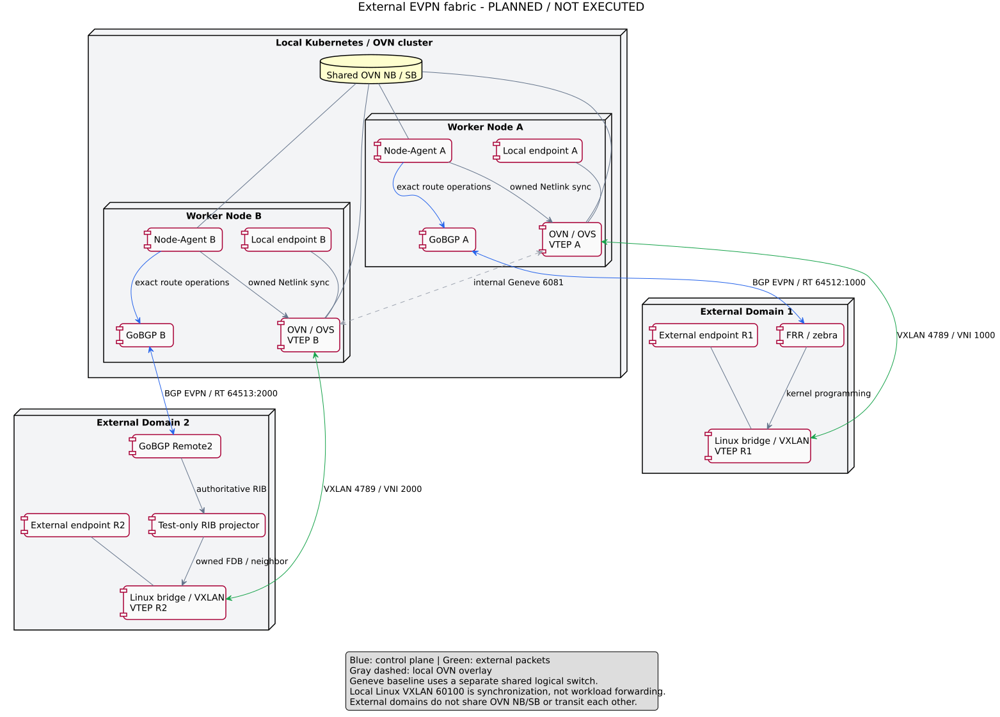

# EVPN networking use cases

EVPN-for-OVN connects OVN-managed endpoints to EVPN/VXLAN networks through
explicit Type-2 route ownership and lifecycle. The primary validated v0.1.0
scenario is two chassis sharing one OVN control plane. External-fabric
interoperability remains experimental, and interconnection of independent OVN
domains is planned. See the [capability matrix](../project/capability-matrix.md)
and [v0.1.0 release boundary](../release/v0.1.0.md).

OVN Northbound state describes logical networks and ports; `ovn-northd`
translates that state into Southbound state, and `ovn-controller` programs
local Open vSwitch forwarding. The Node-Agent observes and authorizes endpoint
state and reconciles route/integration lifecycles; it is not the BGP speaker or
packet-forwarding plane. GoBGP is the selected EVPN engine. `k8gobgp` is an
optional Kubernetes speaker provider, not another engine. Linux Netlink,
bridge, FDB, and neighbor state are supporting integration state consumed by
OVN/OVS, not a primary Linux-bridge workload path.

The [roadmap's EVPN/VXLAN interoperability plan](../roadmap/README.md#3-vendor-evpnvxlan-interoperability)
lists FRR as a planned reference peer and the vendor readiness gates. It does
not report completed vendor validation.

## Two-Chassis EVPN Type-2 Connectivity

**Status: Implemented and validated in v0.1.0.**

EVPN-for-OVN supports connectivity across two OVN chassis using GoBGP to
advertise and withdraw EVPN Type-2 MAC/IP routes and VXLAN for data-plane
forwarding. End-to-end validation covers bidirectional forwarding, route
reconciliation, Node-Agent restart recovery, route withdrawal, and cleanup.

The validated topology has two OVN/OVS chassis with distinct switches and
VTEPs, directly peered GoBGP speakers, and a shared NBDB/SBDB control plane.
It is not interconnection of independent OVN domains. GoBGP EVPN route exchange
is the control plane; OVN/OVS forwards workload packets over the external
VXLAN path. Linux bridge/FDB/neighbor state is supporting integration state,
not the primary workload forwarding path.

See the [two-chassis validation record](../internal/validation-history/two-chassis.md),
and the [separate route and packet-flow diagram](../uml/external-evpn-type2-exchange.svg).

## Integrating OVN with an External EVPN/VXLAN Fabric

**Status: Experimental.** This scenario concerns general external-fabric and
vendor interoperability. The validated two-chassis use case above does not
establish a complete external fabric or vendor interoperability guarantee.

### Networking problem

A Network/SDN Engineer has workloads attached to an OVN logical network and
needs selected endpoints to exchange traffic with endpoints behind an external
EVPN/VXLAN fabric. OVN provides local logical connectivity and programs
workload forwarding. External EVPN adds BGP-distributed MAC/IP reachability
and remote VTEP information across the network boundary; it does not replace
OVN or prove that the external tunnel forwards packets.

An external BGP EVPN speaker and an external VXLAN VTEP are distinct roles.
They may be implemented by the same appliance, but the architecture and
validation must not assume that they are the same device. FRR can represent a
reference BGP peer in a lab; FRR peering alone is not dataplane
interoperability.

### Network topology

The [PlantUML source](../uml/external-evpn-fabric.puml) shows one OVN-managed
site, its local host/chassis and VTEP, a BGP EVPN peer, an underlay, a separate
external VTEP, and a remote endpoint. It is a scoped reference topology, not a
combined deployment recipe or acceptance record.

**Validation scope:** the implementation is experimental and checks are
bounded to documented fixtures; general external-fabric and vendor
combinations remain unvalidated. See the [vendor EVPN/VXLAN interoperability
roadmap](../roadmap/README.md#3-vendor-evpnvxlan-interoperability).

**Implementation boundary:** the Node-Agent observes NB, SB, and OVSDB state;
its exporter uses the GoBGP API for local Type-2 AddPath and exact-UUID
DeletePath, while the importer reads the GoBGP EVPN RIB, validates remote
routes, and reconciles owned Linux Netlink FDB/neighbor state. That importer
does not update SBDB or program OVS flows. Any OVS VXLAN tunnel and workload
forwarding path is separate and must be configured and verified independently;
route import does not create it.

### EVPN control plane

1. The endpoint is represented in OVN Northbound state. `ovn-northd` translates
   the desired state; the local binding in Southbound state is part of the
   observed endpoint context.
2. The Node-Agent checks the endpoint's current observation against the
   applicable authorization and ownership boundary. It requests a local
   Type-2 advertisement from GoBGP only for an eligible endpoint.
3. GoBGP exchanges EVPN routes with the configured external BGP peer. A route
   describes MAC/IP reachability and a VTEP next hop; it does not carry the
   packet or configure the remote device by itself.
4. The Node-Agent validates imported route attributes, including configured
   route-target/VNI policy and the VTEP next hop, before reconciling its
   owned integration state. `ovn-controller` and OVS remain responsible for
   workload forwarding.
5. On authorized endpoint retirement, the framework withdraws only the exact
   acknowledged route it owns. Imported remote state has its own lifecycle;
   deleting a local endpoint is not a blanket cleanup of unrelated routes or
   forwarding state.

### VXLAN data plane

For traffic to a remote endpoint, the packet originates at the local workload,
is forwarded by the OVN logical network and OVS, and is encapsulated by the
local OVN/OVS VTEP. The VXLAN packet crosses the IP underlay to the external
VTEP, which decapsulates it toward the destination endpoint. Return traffic
follows the corresponding reverse path. BGP and the Node-Agent do not forward
these packets.

The intended packet path is **OVN/OVS → local VTEP → VXLAN underlay →
external VTEP → destination**. Linux bridge/FDB/neighbor synchronization is
supporting state, not the primary workload dataplane. A route exchange or
successful state write alone is not packet-forwarding evidence.

### Operational sequence

1. Prepare an authorized, disposable topology with OVN/OVS, the intended local
   speaker, external peer/VTEP roles, and compatible route-target/VNI policy.
2. Provision the endpoint through the applicable standalone or CNI procedure.
3. Observe and authorize its current OVN identity, then advertise its owned
   Type-2 path through GoBGP.
4. Validate remote Type-2 attributes and reconcile only the allowed imported
   state.
5. Where the scenario claims connectivity, verify endpoint-attributed,
   bidirectional packets on the intended OVN/OVS VXLAN path independently of
   BGP route checks.
6. Retire the endpoint, verify exact route withdrawal, and clean up only
   state whose ownership and absence are established.

Use the [deployment and integration guide](../guides/deployment-and-integration.md),
[authorization contract](../architecture/standalone-endpoint-authorization.md),
and [reliability/lifecycle guide](../guides/reliability-and-lifecycle.md) for
procedure-specific prerequisites and recovery behavior.

### Implementation and validation status

- **Implemented experimentally:** bounded Type-2 import/export and route
  lifecycle paths, a standalone Node-Agent mode, and a separate Kubernetes
  secondary CNI/Multus path when configured. They are distinct fixtures, not
  arbitrary combinations.
- **Not established:** arbitrary vendor interoperability, production
  readiness, generalized multi-VTEP lifecycle, or zero-loss mobility. See the
  [external-fabric evidence limits](../internal/validation-history/external-evpn-fabric.md).

The [route and packet-flow diagram](../uml/external-evpn-type2-exchange.svg)
keeps BGP control-plane exchange separate from the actual packet path.

Independent OVN-domain interconnection remains planned; its architecture,
control-plane and VXLAN requirements are documented in the
[roadmap](../roadmap/README.md#independent-ovn-domain-interconnection-planned).

## Deployment, topology, and lifecycle guides

| Supporting subject | Guide |
|---|---|
| Kubernetes secondary CNI / Multus and standalone OVN | [Deployment and Integration](../guides/deployment-and-integration.md#deployment-and-integration) |
| Kubernetes Operator | [Deployment and Operations](../guides/deployment-and-integration.md#deployment-and-operations) |
| Multi-worker / multi-VTEP placement | [Network Topologies](../guides/network-topologies.md) |
| Recovery, ownership, and missed cleanup | [Reliability and Lifecycle](../guides/reliability-and-lifecycle.md) |

### Legacy guide links

The following legacy anchors remain available for existing links. These
supporting subjects are guides, not additional EVPN networking scenarios.

[Provision a Kubernetes secondary network](../guides/deployment-and-integration.md#kubernetes-secondary-cni--multus).

[Recover safely from failures and missed cleanup](../guides/reliability-and-lifecycle.md#recovery-and-ownership).

[Operate EVPN across multiple worker nodes](../guides/network-topologies.md#multi-worker--multi-vtep-placement).

[Integrate with an existing standalone OVN deployment](../guides/deployment-and-integration.md#standalone-ovn-integration).

[Deploy and operate through Kubernetes Operator](../guides/deployment-and-integration.md#kubernetes-operator).

Return to the [project overview](../../README.md#use-cases), the
[documentation index](../README.md), the [topology guide](../guides/network-topologies.md),
or the [Testing Guide](../../TESTING_GUIDE.md#live-test-scenarios-and-expected-behavior).
